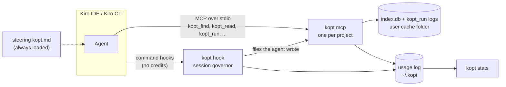

# kiro-optimizer (`kopt`)

[](https://github.com/dorian-richard/kiro-optimizer/actions/workflows/ci.yml)

`kopt` reduces what [Kiro](https://kiro.dev) (IDE and CLI) puts into the model's context on large codebases. It is
a local tool: one npm package, no server, no cloud account, no network calls at run time. It gives the agent 4
compact, budgeted MCP tools (code search, code reads, callers, compressed test/build output). Free command hooks act
as a session governor, and a short steering file tells the agent how to work with them. The index and the usage log
stay on your machine.

**Status: v0.2, pre-release** (not tagged yet; the package still reports version 0.1.0). Interfaces may still change.

**Why.** Kiro bills credits per request. kopt is built on a hypothesis that no credit measurement has confirmed yet:
that the price of a request grows with its size, so every token that enters the context is paid again on every later
turn of the session. Kiro does not publish how request size, output and prompt caching weigh in the price. If the
hypothesis holds, spend comes from verbose build and test logs, whole-file reads, re-runs of the same command, the
fixed prefix (steering, tool schemas) and runaway agent loops, and code retrieval is only part of it. Kiro does not
let you proxy its LLM traffic, so kopt acts where Kiro allows it: on what its own tools return, on hooks, and on
steering. Analysis and design decisions: [docs/ARCHITECTURE.md](docs/ARCHITECTURE.md).

## Results

Measured on 2026-10-09 and 2026-10-10; full tables, charts, method and limits in
[docs/BENCHMARKS.md](docs/BENCHMARKS.md). An HTML version with charts, [docs/benchmarks.html](docs/benchmarks.html),
will be published at <https://dorian-richard.github.io/kiro-optimizer/benchmarks.html> once v0.2 is on `main` and
GitHub Pages is enabled (not yet).

| What | kopt | Compared with |
|---|---|---|
| Offline, one exploration step, <!--v:offline.tasks-->138<!--/v--> tasks in 11 languages: tasks where every expected file and symbol is returned | <!--v:kopt.found-->108/138 (78%)<!--/v-->, median <!--v:kopt.median-->1,299<!--/v--> tokens | CodeGraph <!--v:codegraph.found-->79/138 (57%)<!--/v-->, median <!--v:codegraph.median-->8,315<!--/v--> · native Kiro (grep + line ranges) <!--v:ranged.found-->54/138 (39%)<!--/v-->, median <!--v:ranged.median-->6,675<!--/v--> · KiroGraph <!--v:kirograph.found-->4/138 (3%)<!--/v--> |
| Same, 22 held-out tasks written before any measurement | <!--v:heldout.kopt-->19/22 (86%)<!--/v--> | native Kiro (grep + line ranges) <!--v:heldout.ranged-->5/22 (23%)<!--/v--> |
| Real agents exploring 9 open-source repositories (15 tasks, 2 runs per arm): measured session cost, 95% CI | <!--v:ab.ex.primary-->-23% [-38%, -8%]<!--/v-->, lower in <!--v:ab.ex.primaryLower-->13/15<!--/v--> tasks; every answer correct in both arms | the same agents with stock tools |
| Real agents diagnosing failing tests (6 tasks): measured session cost | <!--v:ab.rn.primary-->+16% [-31%, +67%]<!--/v-->: no measurable saving | the same agents with stock tools |
| Test, build and git output (50 committed fixtures: 45 generated in each tool's format, 5 real runs) | <!--v:compress.reduction-->96.4%<!--/v--> of the tokens removed | the raw output |

These are not Kiro credits. The offline benchmark is a proxy, and the agent A/B ran outside Kiro (sub-agents driving
a shell wrapper, with a Kiro-sized prompt modeled). Our own Kiro credit measurement stopped when Kiro's anti-abuse
checks suspended the test account on its first automated request. To measure the credits on your repository, run
`kopt bench ab` (guide: [bench/ab/README.md](bench/ab/README.md)). For a developer testing kopt on large
repositories: [docs/TESTING.md](docs/TESTING.md) (test plan, in French) and [docs/FAQ.md](docs/FAQ.md) (the hard
questions, in French).

## Contents

1. [Results](#results)
2. [How it works](#how-it-works)
3. [Install](#install)
4. [Tools the agent uses (MCP)](#tools-the-agent-uses-mcp)
5. [Command reference](#command-reference)
6. [Session governor](#session-governor)
7. [Configuration](#configuration)
8. [Measuring savings](#measuring-savings)
9. [Uninstall](#uninstall)
10. [Troubleshooting](#troubleshooting)

## How it works



1. **Setup writes user-level Kiro configuration.** `kopt setup` installs the `kopt` command globally with npm
   (unless the running copy is already the global install or you pass `--no-global`). It then writes under `~/.kiro`
   (plus one IDE user setting): the `kopt` MCP server entry, global hooks, a Kiro CLI 2.x agent, steering, a
   read-only explorer sub-agent and a global ignore file. It records its install state in `~/.kopt`. Nothing is
   written into your projects.
2. **Kiro starts `kopt mcp` for each project.** The MCP server talks to Kiro over stdio.
3. **Root detection.** The server takes the project root from the client's MCP roots, else `KOPT_ROOT`, else the
   folder Kiro starts it in. MCP roots and the start folder are widened to the nearest folder (itself included) that
   holds `.git` or `.kopt/index.db`; `KOPT_ROOT` is used as is. kopt never indexes your home folder or a filesystem
   root; tools then answer one line asking you to open a project folder.
4. **Background index on first use.** The first build runs in a worker thread. It parses with tree-sitter (WASM)
   grammars for TypeScript/TSX, JavaScript, Python, Java, C#, Go, Kotlin, Rust, PHP, Ruby and Scala, into one SQLite
   file (`node:sqlite`, FTS5) per project, in your user cache folder. It honours `.gitignore`, `.kiroignore` (nested
   ones included), Kiro's global `~/.kiro/settings/kiroignore` (which setup fills with minified files, source
   maps and bundles; lockfiles and snapshots are per-project `kopt init` suggestions) and the `exclude` setting.
   `kopt_find` and `kopt_read` answer as soon as symbols are written; `kopt_refs` once references are
   resolved too. A call that would have to wait more than 15 s answers at once with the progress and an estimate
   (`index building: 12000/33090 files parsed, ~2 min left – use built-in search/read tools until then`).
5. **Incremental refresh.** Hooks record the files the agent writes; before answering a tool call, the server
   re-indexes those files (waiting 2 s at most). At most every 30 s, on a tool call (there is no timer), it compares a
   few git files (HEAD, the branch ref, `.git/index`) and runs the full freshness check (listing + size/date of every
   file), which catches pulls and checkouts, when they changed, and every 2 minutes in any case. All indexing runs in
   a worker thread, so tool calls keep answering meanwhile, and one process at a time indexes a project (a lock file
   next to the index). When the project has a complete index and the kopt MCP server is configured, a session start
   also triggers a background `kopt index --refresh --if-idle` (at most once a minute).
6. **The agent calls kopt tools.** Answers are compact text (never JSON) with a hard token cap and short `#handles`.
   Code already shown in the session is not re-sent. Test and build output is reduced to the verdict, the failures
   and the errors.
7. **Hooks govern the session.** Kiro `command` hooks cost no credits. kopt counts tool calls and blocks a few
   expensive patterns, with a one-line hint: whole-file reads of big files, verbose commands outside `kopt_run`,
   identical re-runs, runaway loops. The big-read, verbose-command and duplicate-run rules block once each. Once the
   tool-call budget is reached, every further tool call is blocked until the next user prompt. Hooks also measure
   the size of every tool response.
8. **Local stats.** kopt tool calls, governor blocks and the size of every tool response go to a local JSONL log
   under `~/.kopt`, kept 90 days. `kopt stats` reads it, together with the per-request credits found in Kiro's local
   session files.

## Install

You need [Node.js 22.13+](https://nodejs.org) and git. On Linux, macOS or Windows, run once:

```bash
npx -y github:dorian-richard/kiro-optimizer setup
```

Then **restart Kiro** (in Kiro IDE, reload the window). kopt now starts by itself in every project you open.

> **Until v0.2 is merged into `main`**, this command installs v0.1, the head of `main`. To install the version this
> README describes, run setup from a checkout of it: `npm ci && npm run build && node dist/bin.js setup --global`.

- Check the installation at any time: `kopt doctor`
- See what it saves: `kopt stats`
- Remove it: `kopt uninstall`, then `npm uninstall -g kiro-optimizer`

`setup` is idempotent: run it again after a Kiro upgrade. It never touches your shell profile or `PATH`. The files
it writes on each OS, the per-project mode and more troubleshooting are covered in [docs/INSTALL.md](docs/INSTALL.md).
Testing kopt on a large repository: [docs/TESTING.md](docs/TESTING.md) (in French).

### Supported surfaces

| Surface | What `kopt setup` configures | What you get |
|---|---|---|
| Kiro IDE 1.x | `~/.kiro/settings/mcp.json`, global hooks `~/.kiro/hooks/kopt.json`, steering, explorer agent, `~/.kiro/settings/kiroignore`, the IDE setting `kiroAgent.agentIgnoreFiles` | 4 tools, full governor, steering, `.kiroignore` |
| Kiro IDE 0.x (0.12) | the same files; 0.x ignores global hooks, so the MCP server writes one prompt hook (`.kiro/hooks/kopt-prompt.kiro.hook`) into each workspace it serves | 4 tools, steering. No tool-call governor: upgrade to 1.x for it. The prompt hook is written only when prompt pointers are on (`budgets.frontload`) |
| Kiro CLI V3 | `mcp.json` and the global hooks `~/.kiro/hooks/kopt.json` | 4 tools, full governor, steering |
| Kiro CLI 2.x | agent `~/.kiro/agents/kopt.json` (hooks embedded, `includeMcpJson`), set as `chat.defaultAgent` when no default agent is set | 4 tools, full governor, `always` steering (use `kiro-cli chat --agent kopt` if you keep another default agent) |
| Standalone CLI | the global `kopt` command | the same operations as commands (`kopt find/read/outline/refs/run/expand`), same output, for any terminal or agent |

**OS notes.** It works the same on Linux, macOS and Windows (CI runs all three on Node 22 and 24), with no native
modules and no compiler needed. Kiro starts kopt with absolute paths, so nothing has to be on the `PATH` Kiro sees
(Kiro IDE started from the Dock or the Start menu does not get your shell's `PATH`): the MCP server is
`<absolute node> <kopt>/dist/bin.js mcp`, and hooks run a small launcher, `~/.kopt/bin/kopt` (`kopt.cmd` on Windows),
that turns any failure into a silent allow. Re-run `kopt setup` after upgrading or moving Node (see
[docs/INSTALL.md](docs/INSTALL.md)). `kopt_run` uses PowerShell 7 when it is on `PATH`, else Windows PowerShell 5.1, else
cmd.exe. On Linux and macOS it uses bash, else sh. `KOPT_SHELL` overrides the shell.

## Tools the agent uses (MCP)

`kopt mcp` lists 4 tools. Every request carries their specs and the always-on steering, so each spec is one line
and lists only the parameters of the common calls: 348 tokens in all (chars / 3), against 852 for the 6 tools of
v0.1 (`test/mcp.test.ts` keeps it under 350). In the agent A/B, kopt's prompt added a median of
<!--v:ab.koptPrompt-->+282<!--/v--> tokens per request, measured with the model's own tokenizer. The other parameters are still accepted, and the outputs name them where
they help. `kopt_outline` and `kopt_expand` are reached through `kopt_read` (a directory, `mode: "outline"`, a
`kopt_run` log handle) and still answer by name. The three read-only tools are auto-approved in `mcp.json`, so
`kopt_read` refuses, in one line, files excluded by `.gitignore` or `.kiroignore`, anything under `.git`, and paths
or symlinks that leave the project. `kopt_run` executes commands, so Kiro still asks before running it. Every tool
returns compact text and accepts `maxTokens`, clamped to 50-8000. Handles such as `#sn` (symbols) and `o3fad54`
(command outputs) can be passed from one tool to another.

| Tool | Purpose | Listed parameters | Also accepted | Default budget | Example of output |
|---|---|---|---|---|---|
| `kopt_find` | Ranked search by identifiers or plain words (case- and camelCase-insensitive). Each listed file ends with an `also:` line naming its other relevant symbols. `mode: "pack"` adds the bodies of the best symbols, the callers (`path: L<line> in <caller>`) of the symbols the query names and the callees of the best body: "how does X work" in one call. | `query`, `mode` (`pack`; hits by default) | `kinds` (e.g. `["class","function"]`), `path` (prefix or glob), `limit` (12, max 100; pack: 8 with signatures then compact ones), `maxTokens`, `fresh` (resend bodies already shown) | 700 (hits), 2,500 (`pack`) | `#qz 252-279 function export function loadConfig(root: string = process.cwd(), opts: LoadConfigOptions = {}): KoptConfig` |
| `kopt_read` | Exact code by `#handle`, `Class.method`, `path` or `path:start-end`; code already shown returns `unchanged`. A directory, a glob or `.` (the repo), or `mode: "outline"` on a file: the structure map with the line of each member (on a type: its skeleton). A `kopt_run` log handle (`o3fad54`, `o3fad54:120-180`): that log, filtered by `grep` (regex, 2 lines of context) when given. | `target`, `mode` (`outline`) | `mode` `body` (default), `skeleton` (signatures only), `card` (≈ 60 tokens); `focus` (outline: task words ranked first); `grep`, `startLine`, `endLine` (logs); `maxTokens`, `fresh` | code 3,000 (a function whole up to 6,000, a file up to 4,000), outline 1,200, log 1,500 | `src/core/config.ts:252-279 #qz` then the 28 lines of code; `outline src/compress/runner.ts · 67 symbols · 566 lines` then `L60 export function quietEnv(...)` lines |
| `kopt_refs` | Callers/usages (`in`), callees (`out`) or `both` of a `#handle`, `Class.method` or field. One line per caller: the call line, the caller's handle and declaration lines, then the code of the call line; the readers and writers of a field are tagged `read` / `write`. The callers of a thin wrapper (a small function that only forwards to the target) follow under `via wrapper`. A last line says whether the list is `complete` (every reference to the name resolved, every function whose code names it listed) or `incomplete`, and what may be missing (unresolved same-name references are listed under `possible`). | `target` | `direction` (`in` default, `out` = callees, `both`), `depth` (`2` = callers of callers), `maxTokens` | 900 | `src/cli.ts:26 in #1r6 config (defined 24-27): return loadConfig(root ? resolve(root) : findRoot());` + `incomplete: 1 function names loadConfig with no reference linked: src/mcp/local.ts:635 in #2aw AutoRepo.setDecision (defined 635-654)` |
| `kopt_run` | Runs a test, build or lint command in the repo and returns only the verdict, failures and errors (a short output as it is, a short passing test run as its verdict line). The full log is stored. An identical re-run with no file change returns the stored result without running again; an identical command still running is joined, not started twice. Commands that never exit by themselves (watch modes, dev servers, `tail -f`) are refused in one line unless `timeoutSec` is given. Cancelling the call kills the command. When the failures of a test run do not all fit in detail, every failing test is listed first (grouped by file, tests with the same error on one line), then as many failures in detail as the budget holds. When a run fails and the project index is ready, up to 200 more tokens say where the failure points in the source: the function around each stack frame in the repo, the deepest first; for each failing test, the product function it calls, followed through thin wrappers down to the function that sets the field its diff shows or the one the test is named after; and the one function that has the failure message as a string literal. | `command` | `cwd` (relative to the repo root), `timeoutSec` (600 default, max 21600), `maxTokens`, `fresh` (force a re-run) | 900 (+200 of source context) | `exit 1 · 8.2s · raw ~4562 tok` then the failures, then `full output: kopt_read o3fad54 (grep=<regex> filters it)`, then `source (kopt index):` lines such as `test test/a.test.ts:57 (test L49-64) calls #nc runCommand src/compress/index.ts:351 > #nr execute src/compress/index.ts:425 (sets stored)` |

Valid `kinds`: `class`, `interface`, `enum`, `type`, `record`, `struct`, `trait`, `module`, `namespace`, `function`,
`method`, `constructor`, `field`, `property`, `constant`. `function`, `method` and `constructor` match each other,
`class` also matches structs and records, `field` also matches properties. When the `kinds` or `path` filter leaves
no hit, `kopt_find` returns the hits without that filter, under a `note:` line.

A typical exchange, as the agent sees it:

```text
kopt_find {"query": "load config", "kinds": ["function"]}
find "load config" · 12 hits · ~679 tok
src/core/config.ts
  #qz 252-279 function export function loadConfig(root: string = process.cwd(), opts: LoadConfigOptions = {}): KoptConfig — Load config: ...
  #qu 203-223 function export function defaultConfig(root: string): KoptConfig
  also: indexPath L281 #r0, pathFor L104 #qk, usesProjectDataDir L199 #qt, ...
...

kopt_find {"query": "who calls loadConfig", "mode": "pack"}
pack "who calls loadConfig" · 3 hits · 2 bodies · ~1093 tok
...                                    -> pointers, then the bodies of loadConfig and LoadConfigOptions
callers of #qz loadConfig · 17 refs in 9 files · complete:
  src/cli.ts: L26 in #1r6 config (defined 24-27); L116 in #1rg hookMain (defined 89-133); L358 in #1rw main (defined 322-542)
  src/hooks/index.ts: L29 import; L609 in #35h runHookCli (defined 585-618)
  ...
  tests: test/bench-ab.test.ts (2), test/hooks-shell.test.ts (2), test/setup.test.ts (2), +1 file
  via wrapper #1r6 config · 3 refs:
    src/cli.ts: L170 in #1rk tool (defined 169-176); L212 in #1rq cmdIndex (defined 211-230); L233 in #1rr cmdCredits (defined 232-253)
callees of #qz loadConfig:
  src/core/config.ts: #qu defaultConfig, #qw merge
  ...

kopt_read {"target": "#qz"}            -> the 28 lines of loadConfig
kopt_refs {"target": "#qz"}            -> 17 usages in 9 files (+3 through the config() wrapper), one line per usage
kopt_run  {"command": "npm test"}      -> verdict + failures (a median of 188 tokens on the 35 failing fixtures, 738 per kopt run in the agent A/B)
kopt_read {"target": "o3fad54", "grep": "TypeError"}
kopt_read {"target": "src/core", "mode": "outline"}  -> map of src/core: the main symbols of each file
```

The `kopt-explorer` sub-agent (on `claude-haiku-4.5` by default) can use `kopt_find`, `kopt_read` and `kopt_refs` for "where / how is X
done" questions. It answers with `path:start-end` spans, not code dumps. Kiro CLI loads it; from a reading of the IDE
bundles (0.12 and 1.2), Kiro IDE skips agent files that carry CLI-only fields such as `allowedTools`, which this one
has. Whether agents delegate to it, and what it saves, is not measured.

## Command reference

Every command except `hook` accepts `-h, --help` (`kopt --help`, `kopt <command> --help`). `kopt hook --help`
prints nothing (a hook must stay silent), so use `kopt help hook`. `kopt help <command>` works for the other commands
too, except `bench`: use `kopt bench --help`. `kopt -V, --version` prints the version.

| Command | For | Purpose |
|---|---|---|
| [`setup`](#kopt-setup) | you | one-time setup for every project |
| [`doctor`](#kopt-doctor) | you | check the installation |
| [`uninstall`](#kopt-uninstall) | you | remove what kopt wrote |
| [`init`](#kopt-init) | you | optional per-project install |
| [`index`](#kopt-index) | you | build or update a project's index |
| [`find`](#kopt-find), [`read`](#kopt-read), [`outline`](#kopt-outline), [`refs`](#kopt-refs) | you, scripts, other agents | the code tools from a terminal |
| [`run`](#kopt-run), [`expand`](#kopt-expand) | you, scripts, other agents | compact command output from a terminal |
| [`stats`](#kopt-stats), [`credits`](#kopt-credits) | you | token savings (gross) and Kiro credits report |
| [`bench`](#kopt-bench) | maintainers | offline benchmark (from a clone of this repository) |
| [`mcp`](#kopt-mcp) | **called by Kiro** | the MCP server |
| [`hook`](#kopt-hook) | **called by Kiro** | the session governor hook entry point |

The code and output commands (`find`, `read`, `outline`, `refs`, `run`, `expand`) print the same text as the MCP
tools. They exit with 1 on invalid arguments or an internal failure. When the command fails, `kopt run` exits with the
command's own exit code (124 after `--timeout`, 127 when the command cannot be started). A lookup that finds nothing
(unknown handle, missing file, no matching symbol) prints a one-line message and exits 0. `find`, `read`, `outline`
and `refs` build the index on first use when there is none. The `--root <dir>` option of these commands sets the
project root. By default it is `KOPT_ROOT` (used as is), else the nearest folder (the current one included) that holds
`.git` or `.kopt/index.db` (never above your home folder), else the current folder.

### `kopt setup`

One-time setup. It installs kopt globally if needed and configures Kiro IDE and Kiro CLI for every project. It
installs kopt globally with npm unless the running copy is already the global install or you pass `--no-global`; a
development checkout is left alone unless you pass `--global`. It packs the running copy (the one npx already built,
or your checkout) and installs it with `npm install -g`. It then detects the installed Kiro surfaces, writes the
user-level files, and ends with the user-level `doctor` checks.

```text
kopt setup [options]
```

| Option | Argument | Default | Meaning |
|---|---|---|---|
| `--surface` | `<surface>`: `ide`, `cli`, `all` | the detected surfaces (all of them when none is detected) | configure these surfaces whatever is detected |
| `--no-global` | | global install on | do not install kopt globally with npm. When the running copy is npx's, setup installs a private copy in `~/.kopt/runtime` instead: Kiro never runs kopt from the npx cache, which npm purges |
| `--global` | | off from a checkout | install kopt globally with npm even from a development checkout (from npx it is the default) |
| `--dry-run` | | off | show what would be written |
| `--force` | | off | overwrite kopt files edited by hand and make kopt the Kiro CLI default agent. Your `env`, `disabled`, `disabledTools` and `autoApprove` edits in the `kopt` entry of `mcp.json` are kept |
| `--no-doctor` | | checks on | skip the final checks |
| `--explorer-model` | `<id>` | `claude-haiku-4.5` | model for the read-only explorer agent |

```bash
npx -y github:dorian-richard/kiro-optimizer setup     # first install
kopt setup --dry-run                                   # preview after a Kiro upgrade
kopt setup --surface cli --force                       # Kiro CLI only, and make kopt the default agent
```

### `kopt doctor`

It checks Node, `PATH`, the Kiro surfaces, the config files, the MCP server and the index status. It also checks
that the hooks run silently: it runs the configured hook command the way Kiro does and checks that an allowed call
prints nothing and a blocked call exits 2. It starts the MCP server and lists its tools. These checks run in a
scratch folder, so nothing of yours is touched. It prints one `ok` / `warn` / `fail` line per check, with a fix, and
exits with 1 when a check fails.

```text
kopt doctor [options]
```

| Option | Argument | Default | Meaning |
|---|---|---|---|
| `--root` | `<dir>` | current folder | folder whose index status to report |
| `--quick` | | off | skip the checks that start processes (hook, MCP server) |

```bash
kopt doctor
kopt doctor --quick --root ~/code/my-service
```

### `kopt uninstall`

It removes what `kopt setup` / `kopt init` wrote, and the index caches. Only kopt's own entries are removed: the
`kopt` server in `mcp.json`, kopt's hook, agent and steering files (an edited copy is kept and listed; `--force`
removes it), its marked block in `kiroignore`, `chat.defaultAgent` if it is still `kopt`, and the `.kiroignore` IDE
setting if setup added it. It also removes the IDE 0.x workspace hooks. Running it twice is harmless.

```text
kopt uninstall [options]
```

| Option | Argument | Default | Meaning |
|---|---|---|---|
| `--keep-index` | | off | keep the index caches |
| `--purge` | | off | also delete `~/.kopt` (telemetry, governor state) |
| `--user` | | user and workspace | only the user-level configuration |
| `--workspace` | | user and workspace | only the files `kopt init` wrote in this project |
| `--force` | | off | also remove kopt files you edited since kopt wrote them |
| `--dry-run` | | off | show what would be removed |
| `--root` | `<dir>` | project root of the current folder | project whose `kopt init` files are removed |

```bash
kopt uninstall --dry-run
kopt uninstall --purge && npm uninstall -g kiro-optimizer
```

### `kopt init`

Optional per-project install, for a team that commits kopt's Kiro files instead of running `setup`. It writes
`.kiro/settings/mcp.json` (server pinned to this root), `.kiro/hooks/kopt.json`, `.kiro/steering/kopt*.md`,
`.kiro/agents/kopt-explorer.json`, a `.kiroignore` block suggested from an analysis of the repository, and the
`.vscode/settings.json` ignore setting. Existing files are skipped unless you pass `--force`. `kopt setup` already
covers every project.

```text
kopt init [options]
```

| Option | Argument | Default | Meaning |
|---|---|---|---|
| `--user` | | workspace (`<root>/.kiro`) | install for the user (`~/.kiro`): same files as `kopt setup`, without the npm install |
| `--dry-run` | | off | show what would be written |
| `--force` | | off | overwrite existing files |
| `--explorer-model` | `<id>` | `claude-haiku-4.5` | model for the read-only explorer agent |
| `--root` | `<dir>` | project root of the current folder | project to install into |

```bash
cd ~/code/my-service && kopt init --dry-run
kopt init --root ~/code/my-service --force
```

`.kiro/settings/mcp.json` always pins this checkout's absolute path (`kopt mcp --root /abs/path`) and, by default,
the absolute paths of `node` and `bin.js` (whether or not kopt is on `PATH`); `.kiro/hooks/kopt.json` runs the
absolute path of the `~/.kopt/bin/kopt` launcher. Keep `.kiro/settings/mcp.json` and `.kiro/hooks/kopt.json` out of
git (or set `KOPT_HOOK_COMMAND=shim` for the bare `kopt` command, which must then be on the `PATH` Kiro sees; the
`--root` path stays); commit the steering, agent, `.kiroignore` and `.vscode/settings.json` files. `kopt init` prints
the same advice.

### `kopt index`

Build or update the local index of a project. Unchanged files are skipped. The MCP server does this by itself in the
background; run it by hand to pre-build a big repository or after a large pull. When another kopt process is
indexing the same project (a Kiro window's MCP server), it waits for it, then only catches up.

On a large repository expect, for the first build, about 1.5 minutes and up to 2 GB of memory for 30k Java files
(search answers after about 30 s; 30 s in all for 15k TypeScript files), and an index of about 1 GB on disk
(`kopt doctor` shows the size); see `bench/results/scale-elasticsearch.md` for a measured 33k-file build, refreshes
and query latencies. Each checkout or
worktree has its own index; `kopt uninstall` removes them all.

```text
kopt index [options]
```

| Option | Argument | Default | Meaning |
|---|---|---|---|
| `--root` | `<dir>` | nearest git root | repo root |
| `--refresh` | | off | only re-index files changed since the last run (cheap check: git listing plus mtime/size) |
| `--if-idle` | | off | do nothing when another kopt process is indexing this project (default: wait for it) |

```bash
kopt index
kopt index --refresh --root ~/code/my-service
# indexed 206 files (1 parsed, 205 unchanged, 0 deleted) · 4941 symbols · 30900 refs · 0.4s
```

### `kopt find`

Search code (`kopt_find`). The query words are joined with spaces.

```text
kopt find [options] <query...>
```

| Option | Argument | Default | Meaning |
|---|---|---|---|
| `<query...>` | | required | identifiers or plain words |
| `--pack` | | off (`hits` mode) | include bodies of the best symbols, their callers (path:line) and callees |
| `--max-tokens` | `<n>` | 700 (2,500 with `--pack`) | token budget |
| `--path` | `<prefix>` | whole repo | restrict to a path prefix or glob |
| `--kinds` | `<list>` | all kinds | symbol kinds, e.g. `class,function` |
| `--limit` | `<n>` | 12 | max hits (with `--pack`, the first 8 with signatures, the rest compact) |
| `--root` | `<dir>` | see above | project root |

```bash
kopt find "where is the refund amount computed" --pack
kopt find OrderService place --kinds class,method --path src/billing --limit 5
```

### `kopt read`

Read a symbol, file or range, the outline of a directory, or a `kopt run` log (`kopt_read`).

```text
kopt read [options] <target>
```

| Option | Argument | Default | Meaning |
|---|---|---|---|
| `<target>` | | required | `#handle`, `Class.method`, `path`, `path:start-end`, a directory, `.` (the repo), or a `kopt run` log handle (`o1a2b3c`, `o1a2b3c:40-90`) |
| `--mode` | `<mode>`: `body`, `skeleton`, `card`, `outline` | `body`; a file or type over 4,000 tokens gets its skeleton, a function over 6,000 its first part and the range of the rest | what to return (`outline`: the structure map of a file, the members of a type) |
| `--focus` | `<words>` | none | (outline) rank files/symbols relevant to these words first |
| `--grep` | `<regex>` | none | (log) filter lines (case-insensitive, with 2 lines of context) |
| `--start`, `--end` | `<line>` | whole log | (log) line range |
| `--max-tokens` | `<n>` | 3,000 for ranges; a named function comes whole up to 6,000, a file or type up to 4,000; outline 1,200; log 1,500 | token budget |
| `--root` | `<dir>` | see above | project root |

```bash
kopt read "#3mv"
kopt read OrderService.place --mode card
kopt read src/billing/refund.ts:40-90
kopt read src/billing --focus refund
kopt read o1a2b3c --grep "FAIL|Exception"
```

Quote `#handles`: an unquoted `#` starts a comment in most shells. `kopt outline` and `kopt expand` below do the same
as `kopt read` of a directory and of a log handle.

### `kopt outline`

Structure map of the repo, a directory or a file (`kopt_outline`).

```text
kopt outline [options] [path]
```

| Option | Argument | Default | Meaning |
|---|---|---|---|
| `[path]` | | whole repo | folder or file to map |
| `--focus` | `<words>` | none | rank files/symbols relevant to these words first |
| `--max-tokens` | `<n>` | 1,200 | token budget |
| `--root` | `<dir>` | see above | project root |

```bash
kopt outline src/billing --focus refund
kopt outline --focus "session governor" --max-tokens 600
```

### `kopt refs`

Callers / callees of a symbol (`kopt_refs`).

```text
kopt refs [options] <target>
```

| Option | Argument | Default | Meaning |
|---|---|---|---|
| `<target>` | | required | `#handle`, `Class.method` or a field (a plain name works when it is unambiguous) |
| `--direction` | `<dir>`: `in`, `out`, `both` | `in` | callers/usages, callees, or both |
| `--depth` | `<n>`: `1`, `2` | `1` | `2` adds callers of callers (impact) |
| `--max-tokens` | `<n>` | 900 | token budget |
| `--root` | `<dir>` | see above | project root |

```bash
kopt refs OrderService.place --depth 2
kopt refs "#1rb" --direction out
```

### `kopt run`

Run a command and print compact output (`kopt_run`). Options go **before** the command. A single argument is passed
to the shell as is, so pipes work. Several arguments are quoted for the shell. A cacheable command (a test, build,
lint or read-only git command) re-run with no file change in the repo returns the stored result.

```text
kopt run [options] <command...>
```

| Option | Argument | Default | Meaning |
|---|---|---|---|
| `<command...>` | | required | one argument = a shell command line as is; several = argv |
| `--cwd` | `<dir>` | repo root | working directory relative to the repo root |
| `--timeout` | `<sec>` | 600 (max 21600) | timeout in seconds; the whole process tree is killed. Also the way to run a command that never exits (dev server, watch mode) for a bounded time |
| `--max-tokens` | `<n>` | 900 | token budget |
| `--fresh` | | off | bypass the identical-command cache |
| `--root` | `<dir>` | see above | project root |

```bash
kopt run -- mvn -q test
kopt run --cwd services/api --timeout 900 "npm test && npm run lint"
```

kopt sets quiet environment variables for the child process: no color, no progress bars, Maven batch mode, and
similar.

### `kopt expand`

Show more of a `kopt_run` output (`kopt_expand`). `--grep` and the line range can be combined.

```text
kopt expand [options] <handle>
```

| Option | Argument | Default | Meaning |
|---|---|---|---|
| `<handle>` | | required | output handle printed by `kopt run` (`full output: kopt_read <handle>`) |
| `--grep` | `<regex>` | none | filter lines (case-insensitive, with 2 lines of context) |
| `--start` | `<line>` | 1 | first line |
| `--end` | `<line>` | last line | last line |
| `--max-tokens` | `<n>` | 1,500 | token budget |
| `--root` | `<dir>` | see above | project root |

```bash
kopt expand o1a2b3c --grep "FAIL|Exception"
kopt expand o1a2b3c --start 1 --end 40
```

### `kopt stats`

Token savings (gross) and Kiro credits report, from the local usage log. It shows a **kopt tools** table (calls,
tokens returned, and the exact baseline where it is known: raw command output, full file), one **governor blocks**
line by rule (`governor blocks: budget 4 · verbose-cmd 1 · …`), and a **context intake by tool** table (what each tool
put into the context) once hooks have recorded tool responses. Last come the per-request Kiro credits found in local
session files.

```text
kopt stats [options]
```

| Option | Argument | Default | Meaning |
|---|---|---|---|
| `--days` | `<n>` | 7 | window in days |
| `--root` | `<dir>` | see above | project whose config to use |

```bash
kopt stats
kopt stats --days 30
```

### `kopt credits`

Collect Kiro session credits and print a summary. It reads, without changing them, Kiro CLI 2.x session files
(`~/.kiro/sessions/cli/*.json`) and IDE 1.x / CLI V3 sessions (`~/.kiro/sessions/*/*/messages.jsonl`). It prints the
credits collected since the last collection, per day (30 most recent days), and adds them to the usage log:
`kopt stats` shows the full history.

```text
kopt credits [options]
```

| Option | Argument | Default | Meaning |
|---|---|---|---|
| `--root` | `<dir>` | see above | project whose config to use |

```bash
kopt credits
```

### `kopt bench`

Offline proxy benchmark. It compares the tokens returned to the model and the recall of verified gold items: native
Kiro exploration (`grep_search` + `read_file`) against kopt (`kopt_find` / `kopt_read`) and recorded competitor
outputs. It runs from a clone of this repository, because it reads `bench/` and needs the checkouts listed in
[bench/README.md](bench/README.md).

```text
kopt bench [<repo-name|tasks.json> ...] [options]
kopt bench quality <repo-name> ... [options]
kopt bench failures [<repo-name> ...] [options]
kopt bench all [options]
```

| Form | Meaning |
|---|---|
| (default) | run the strategies on `bench/tasks/<repo>.json` (all task files when none is given) |
| `quality <repo> ...` | index the repo and measure extraction quality per language -> `bench/results/quality-<repo>.{md,json}` |
| `failures [<repo> ...]` | run `kopt-pack` and classify every miss (ranking, unresolved refs, extraction gap, budget/format, multi-step) with evidence from the index; all repos of `bench/langs.json` by default -> `bench/results/failures.{md,json}` (`failures-<repo>.*` when repos are named) |
| `all` | every repo of `bench/langs.json`: verify + index + quality + strategies + failures -> `bench/results/<repo>.{md,json}`, `quality-<repo>.*`, `failures.*`, `summary.{md,json}` |

| Option | Argument | Default | Meaning |
|---|---|---|---|
| `--all` | | | run every `bench/tasks/*.json` (default command) |
| `--repo` | `<path>` | `bench/repos/<name>` | checkout to explore |
| `--strategies` | `<list>` | the built-ins + competitors that have a results file | comma list of `native-naive`, `native-ranged`, `kopt-pack`, `kopt-hits+read`, `kirograph`, `codegraph` |
| `--input` | `search`, `question`, `natural` | `search` | feed the agent-derived search phrase, the raw prompt, or the identifier-free paraphrase (falls back to the prompt) |
| `--tasks` | `<ids>` | all | comma list of task ids |
| `--only` | `<names>` | all | (`all`) comma list of repo names from `bench/langs.json` |
| `--label` | `<name>` | repo name | results file name |
| `--out` | `<dir>` | `bench/results` | output directory |
| `--index-dir` | `<dir>` | `bench/repos/.kopt-<name>` | kopt index location; with several repos (and for `all`) the parent folder: one `<dir>/.kopt-<name>` per repo |
| `--rebuild-index` | | off | delete and rebuild the kopt index first |
| `--competitors` | `<dir>` | `bench/competitors/results` | competitor results directory |
| `--parse-sample` | `<n>` | 1000 | (`quality`) files re-parsed per language |
| `--precision-sample` | `<n>` | 30 | (`quality`) symbols checked per language |
| `--no-quality` | | off | (`all`) skip the quality pass |
| `--no-failures` | | off | (`all`) skip the failure analysis |
| `--clone` | | off | (`all`) clone missing checkouts at their pinned tag |
| `--langs` | `<file>` | `bench/langs.json` | (`all`) corpus file |
| `--chars-per-token` | `<n>` | 3.0 | token estimate calibration |
| `--raw` | | off | also write `<label>.raw.json` with every output |
| `--verify` | | off | only check gold items against the checkout (exit code 1 on issues) |

```bash
kopt bench --all --verify
kopt bench django --strategies native-ranged,kopt-pack --raw
```

#### `kopt bench ab`

Online A/B on your own repository: the same questions run through the real Kiro CLI in a stock arm and a kopt arm,
and the report compares the credits Kiro bills, at equal correctness. It spends real credits under a budget
(`--max-credits`; a single run can overshoot it, see the guide). It works from an installed kopt too (it does not
need `bench/`). Step-by-step guide, cost and isolation details:
[bench/ab/README.md](bench/ab/README.md).

**Read the guide's account warning first.** Kiro's anti-abuse checks can suspend an account that sends automated
requests (it happened to a Free account on its first headless request, after a script had triggered a login). Log in
yourself, never let a script log in, avoid many logins, logouts and headless sessions in a short time, and prefer a
paid account for A/B campaigns. Support: <https://support.aws.amazon.com/#/contacts/kiro>.

```text
kopt bench ab --check --repo <path> --tasks <file>                  preflight, no prompt sent
kopt bench ab --repo <path> --tasks <file> --max-credits <N>        the campaign
kopt bench ab report --out <dir>                                    rebuild the report (keeps manual grades)
kopt bench ab clean --out <dir>                                     remove worktrees, KIRO_HOMEs, kopt indexes
```

Main options: `--arms A,B[,C]`, `--reps <n>` (2), `--model <id>` (`claude-sonnet-4.5`), `--engine v2|v3` (`v2`),
`--credits-per-run <n>` (2), `--max-run-credits <n>`, `--timeout <s>` (600), `--out <dir>`, `--resume`, `--smoke`
(opt-in smoke run), `--list-models` (opt-in model-list request). `kopt bench ab --help` lists them all, with the exit
codes. Measure one task on the cheapest model before a campaign: the guide has the recipe.

### `kopt mcp`

**Called by Kiro**, through the `mcp.json` entry that `setup` writes. It runs the MCP server over stdio. Without
`--root` it serves the project Kiro opens (see [How it works](#how-it-works), step 3). Any other MCP client can run it
the same way.

```text
kopt mcp [options]
```

| Option | Argument | Default | Meaning |
|---|---|---|---|
| `--root` | `<dir>` | from the MCP client roots, `KOPT_ROOT`, then the git root of the cwd | fixed repo root |

```json
{ "mcpServers": { "kopt": { "command": "/usr/local/bin/node", "args": ["/usr/local/lib/node_modules/kiro-optimizer/dist/bin.js", "mcp"], "timeout": 900000, "requestTimeout": 900000 } } }
```

`kopt setup` writes absolute paths like these, and 900 s timeouts because Kiro CLI cuts MCP calls at 120 s by default
(a long `kopt_run` build would fail). `"command": "kopt", "args": ["mcp"]` also works when `kopt` is on the `PATH`
that Kiro sees.

### `kopt hook`

**Called by Kiro command hooks**: the session governor. Kiro pipes the event JSON to its stdin. It exits 0 silently
when it allows the call. It exits 2 with a one-line message on stderr to block. Any internal error is a silent exit
0, so a kopt bug never breaks your session. Errors in the event handler are logged to `~/.kopt/hook-errors.log`; an
unreadable payload (invalid JSON, no `hook_event_name`) is reported only with `KOPT_DEBUG=1`.

```text
kopt hook [options] [event]
```

| Option | Argument | Default | Meaning |
|---|---|---|---|
| `[event]` | | from the payload | event name used when the payload has no `hook_event_name` |
| `--source` | `<name>` | none | which hook configuration runs it (`global`, `workspace`, `agent`, `legacy`). Duplicate events from two sources are handled once |
| `--legacy` | | off | Kiro IDE 0.x `.kiro.hook` invocation (data in `USER_PROMPT`, no stdin) |

```bash
# what Kiro runs: global hooks (IDE 1.x, CLI V3), the CLI 2.x agent, the IDE 0.x workspace hook
kopt hook --source global
kopt hook --source agent
kopt hook promptSubmit --legacy --source legacy
# try it by hand (this writes governor state to ~/.kopt; kopt doctor runs the same check in a scratch folder)
echo '{"hook_event_name":"PreToolUse","session_id":"t1","tool_name":"execute_bash","tool_input":{"command":"npm test"}}' | kopt hook
```

## Session governor

Kiro hooks cannot rewrite tool output. A hook can only block the call (exit 2: stderr goes to the model, which costs
one extra turn) or add context (stdout, only on session start and prompt submit). kopt therefore blocks only where the
expected gain far exceeds one turn. The big-read, verbose-command and duplicate-run rules block once each. Once the
tool-call budget is reached, every further tool call is blocked until the next user prompt. Every block is a single
line that names the cheaper alternative. When it allows a call, it prints nothing.

| Kiro event | What kopt does |
|---|---|
| SessionStart (CLI 2.x `agentSpawn`) | one line with the index status and a hint (250 characters max); once the first build is complete, starts a background `kopt index --refresh --if-idle` (at most once a minute) |
| UserPromptSubmit | re-arms the tool-call budget once it has been reached; adds a few `#handle` pointers for the prompt when prompt pointers are on (off by default), only when retrieval is confident |
| PreToolUse | the four rules below |
| PostToolUse | records the size of every tool response (`kopt stats` "context intake"); write tools mark files as changed |
| PostFileSave / Create / Delete | records the file written: unblocks re-runs and feeds the incremental index refresh |
| Stop | records the end of the turn; drops usage log days older than 90 days |

The rules, with their config keys (see [Configuration](#configuration)):

| Rule | Trigger | What the agent sees | Why it should save (not measured) | Tune / disable |
|---|---|---|---|---|
| Tool-call budget | more than `maxToolCallsPerSession` tool calls in one session. Every further call is blocked until the next user prompt, which re-arms it | `kopt governor: session tool-call budget (200) reached. Stop here: summarize what is done and what remains, and ask the user before continuing.` | circuit breaker for runaway loops; Kiro has no per-session credit cap | `governor.maxToolCallsPerSession` (200; `0` disables) |
| Big whole-file read | a read tool (`read_file`, `read_files`, `fs_read`, `read`, ...) without offset/limit, or with a range wider than `bigFileLines` lines, on a text file estimated above `bigFileTokens` tokens (a block costs one model request, so only files that clearly cost more are blocked). Once per file per session: a second identical attempt goes through | `kopt: big.txt is ~12k tokens (1200 lines). Use kopt_read big.txt mode=outline or kopt_read big.txt:<a>-<b>, or read with offset/limit.` | a whole big file stays in the context and is re-billed on every later turn | `governor.bigFileTokens` (8000; `0` disables), `governor.bigFileLines` (800) |
| Verbose command | a shell tool (`execute_bash`, `execute_pwsh`, `execute_cmd`, `shell`) running a test or build command whose output is predictably long (full test suites, Maven and Gradle without `-q`, MSBuild, cargo, make, ...). Never a quiet or narrowed run (`tsc`, `go vet`, one test file or test id, `mvn -q`), never a command that does not exit by itself (watch modes, dev servers, `run` goals), and only when `kopt_run` can be called (the kopt server is configured, not disabled, and `kopt_run` is not in `disabledTools`). Once per command and folder, at most 3 per session | `kopt: use kopt_run with command="npm test": same execution, returns only failures/errors (full log via kopt_read <handle>).` | the full log of a test run is often thousands of tokens, re-billed every turn; `kopt_run` returns the failures only | `governor.enforceRunForVerbose` (`true`) |
| Duplicate run | the same test/build shell command, in the same folder, again in the session with nothing changed since: no file written by the agent (edit tools, or a shell command that may write), no new user prompt, and the same git workspace state (so edits made outside Kiro count). Blocked once; a retry goes through | `kopt governor: identical command already ran this session and no file changed since; reuse its result (run it again to override).` | nothing kopt can see has changed (environment variables, services and flaky tests are not covered); it saves a turn of output and the build minutes | `governor.blockDuplicateRuns` (`true`) |

Prompt pointers are off by default (`budgets.frontload` `0`). On the 175 bench questions they fired on 55% of the
prompts (~126 tokens each, re-billed on every later request), and only 21% of the pointers named an expected symbol (3
of the 9 fired prompts of the agent A/B tasks; [bench/results/frontload.json](bench/results/frontload.json)); the
agent's first `kopt_find` returns the same kind of pointers, ranked for its own query. Set `budgets.frontload` (e.g.
`200`) to turn them on: at most 4 pointers, within 400 ms. None for follow-up or conversational prompts ("yes,
continue", "fix the failing test"). A prompt that names code gets pointers only when the top hit is that code;
otherwise the top hit must cover at least 2 of the prompt's non-generic words and two thirds of them. Handles already
sent in the session are not repeated.

To turn every hook off without uninstalling, set `KOPT_HOOKS=0` in the environment Kiro runs in. Governor state lives
in `~/.kopt/sessions/<session id>.json`.

## Configuration

kopt works without configuration. To change a value, create a JSON file. Files are merged in this order, later
wins:

1. built-in defaults
2. `~/.kopt/config.json`: your defaults for every project
3. `<data dir>/config.json`: one project, in the project's cache folder, or in `<root>/.kopt/` in per-project mode
   (see below)
4. `<root>/kopt.config.json`: one project, can be committed
5. environment variables (`KOPT_TELEMETRY`, `KOPT_LEGACY_WORKSPACE_HOOKS`, `KOPT_DATA_DIR`, `KOPT_HOME`)

Objects are merged key by key; arrays (`exclude`) replace the default list. A relative `dataDir` is resolved against
the project root. Example `kopt.config.json`:

```json
{
  "budgets": { "pack": 3000 },
  "governor": { "maxToolCallsPerSession": 300, "bigFileTokens": 12000 }
}
```

### Config keys

| Key | Default | Meaning |
|---|---|---|
| `dataDir` | the project's cache folder (see below) | where the index and `kopt_run` logs live |
| `exclude` | `node_modules/`, `vendor/`, `dist/`, `build/`, `out/`, `target/`, `bin/`, `obj/`, `.git/`, `.kopt/`, `.gradle/`, `.idea/`, `.vscode/`, `__pycache__/`, `.venv/`, `venv/`, `.next/`, `.nuxt/`, `coverage/`, `*.min.js`, `*.min.css`, `*.map`, `*.lock`, `package-lock.json`, `pnpm-lock.yaml`, `yarn.lock`, `*.generated.*`, `*.g.cs`, `*.designer.cs`, `*_pb2.py`, `*.pb.go` | gitignore-syntax patterns not indexed, on top of `.gitignore`, `.kiroignore` (nested ones included) and Kiro's global `~/.kiro/settings/kiroignore`. Setting it replaces this list |
| `maxFileBytes` | `1000000` | files larger than this are not indexed |
| `budgets.find` | `700` | `kopt_find` budget (hits mode), in tokens |
| `budgets.pack` | `2500` | `kopt_find` budget in pack mode |
| `budgets.read` | `3000` | `kopt_read` budget for ranges, and for any read that passes `maxTokens` |
| `budgets.readSymbol` | `6000` | `kopt_read` of a named function or method without `maxTokens`: the whole body up to this size in one call (longer: its first part and the range of the rest) |
| `budgets.readFile` | `4000` | `kopt_read` of a file or a type without `maxTokens`: verbatim up to this size, else a skeleton |
| `budgets.outline` | `1200` | outline budget (`kopt_read` of a directory or with `mode: "outline"`, `kopt outline`) |
| `budgets.refs` | `900` | `kopt_refs` budget |
| `budgets.run` | `900` | `kopt_run` budget |
| `budgets.expand` | `1500` | `kopt_run` log budget (`kopt_read <handle>`, `kopt expand`) |
| `budgets.frontload` | `0` | prompt pointers budget; `0` (the default) disables them |
| `dedup.enabled` | `true` | do not re-send code already returned in the session (answers `unchanged`; `fresh: true` resends) |
| `dedup.windowCalls` | `40` | ... if it was returned within this many tool calls |
| `dedup.windowMinutes` | `30` | ... and within this many minutes (Kiro's compaction drops old tool results) |
| `governor.maxToolCallsPerSession` | `200` | tool-call budget per Kiro session; `0` disables |
| `governor.bigFileTokens` | `8000` | a whole-file read of a file estimated above this many tokens is blocked once; `0` disables |
| `governor.bigFileLines` | `800` | a read with a range wider than this many lines counts as a whole-file read; `0` disables the big-read rule |
| `governor.enforceRunForVerbose` | `true` | redirect verbose test/build shell commands to `kopt_run` once |
| `governor.blockDuplicateRuns` | `true` | block an identical test/build re-run with no file change once |
| `telemetry.enabled` | `true` | write the local usage log (read by `kopt stats`; never sent anywhere) |
| `charsPerToken` | `3.0` | token estimate used for every budget (conservative on purpose) |
| `kiro.legacyWorkspaceHooks` | `"auto"` | Kiro IDE 0.x workspace prompt hook: `"auto"` (when the installed IDE is 0.x), `"on"`, `"off"` |

`root` and `userDir` are derived at run time. Set them with `KOPT_ROOT` and `KOPT_HOME`, not in a config file.

**A committed `kopt.config.json` is applied as it is.** Today a repository's config file (and `.kopt/config.json` in
per-project mode) can set any key, `root`, `dataDir`, `userDir` and the governor settings included: a repository can
point kopt at another folder or turn its guards off. Check for these files in repositories you did not write.
Restricting repository files to harmless keys is planned.

### Environment variables

| Variable | Effect |
|---|---|
| `KOPT_ROOT` | project root for `kopt mcp`, the hooks and the CLI commands (used when the MCP client sends no roots) |
| `KOPT_DATA_DIR` | data folder (index, `kopt_run` logs) of the project, for this process; relative to the project root if relative |
| `KOPT_CACHE_DIR` | parent folder of all per-project data folders |
| `KOPT_HOME` | kopt's user folder (default `~/.kopt`) |
| `KOPT_KIRO_HOME`, `KIRO_HOME` | Kiro's user folder (default `~/.kiro`); `KOPT_KIRO_HOME` wins. Credit collection (`kopt credits`, `kopt stats`) reads both `KIRO_HOME` and `~/.kiro` (Kiro IDE always writes under `~/.kiro`); `KOPT_KIRO_HOME` replaces both |
| `KOPT_KIRO_USER_SETTINGS` | path of the Kiro IDE user `settings.json` that `setup` edits |
| `KOPT_KIRO_IDE_PATHS` | Kiro IDE install folders or `package.json` paths to detect (`:`-separated, `;` on Windows), replacing the default search |
| `KOPT_KIRO_CLI` | path of the `kiro-cli` executable to detect, or `none` |
| `KOPT_INSTALL_SPEC` | npm spec that `setup` installs globally (default: the copy npx is running) |
| `KOPT_HOOK_COMMAND` | `node` or `shim`: force how Kiro starts kopt (explicit `node <bin.js>`, or the `kopt` command on `PATH`) |
| `KOPT_CLI` | path of the `bin.js` to use in the Kiro configuration and for background refreshes |
| `KOPT_LEGACY_WORKSPACE_HOOKS` | `0`/`off` or `1`/`on`: Kiro IDE 0.x workspace prompt hook (overrides `kiro.legacyWorkspaceHooks`) |
| `KOPT_INDEX_ON_START` | `0`: do not start the background index build when the MCP server starts (it starts on the first tool call) |
| `KOPT_INDEX_WORKERS` | number of parse worker threads (default: up to 4, 2 with less than 12 GB of memory; `0` or `1` parses in-process) |
| `KOPT_HOOKS` | `0`: disable all kopt hooks |
| `KOPT_TELEMETRY` | `0`: no local usage log (`kopt stats` then has nothing to report); `1`: write it even when a config file turns it off |
| `KOPT_SHELL` | shell for `kopt_run` / `kopt run`: a name (`bash`, `sh`, `pwsh`, `powershell`, `cmd`) or a path |
| `KOPT_SESSION` | session id that CLI tool commands record in the usage log (default `cli`). When set, the CLI keeps that session's dedup ledger between calls (`<dataDir>/ledgers`, 30-minute window, as the MCP server within a session): an agent driving kopt through the shell gets "unchanged" for code it was already sent. Unset, every CLI call is stateless |
| `KOPT_DEBUG` | print the stack trace of CLI errors, and hook error messages, on stderr (do not leave it on: hook output reaches Kiro) |
| `KOPT_INDEX_DEBUG` | `1`: indexer debug logs on stderr |
| `KOPT_INDEX_BULK_MIN` | file count from which a first build writes in larger batches (default 2000) |
| `KOPT_NO_REEXTRACT` | `1`: do not re-parse stale files in the background when a tool reads them |
| `KOPT_CHARS_PER_TOKEN` | initial token estimate; replaced by the `charsPerToken` config value as soon as a config is loaded, so use the config key |

kopt sets `KOPT_RUN` on the commands `kopt_run` starts, and `KOPT_BACKGROUND` on its background refreshes. Do not set
them yourself. The commands `kopt_run` starts get no other `KOPT_*` variable: kopt's own settings (`KOPT_SESSION`,
`KOPT_ROOT`, `KOPT_HOME`...) never leak into your tests and builds.

### Where data lives

| Data | Linux | macOS | Windows |
|---|---|---|---|
| Per-project folder (`<name>-<hash>`): `index.db`, `kopt_run` logs (`outputs/`), optional `config.json` | `$XDG_CACHE_HOME/kopt/` (default `~/.cache/kopt/`) | `~/Library/Caches/kopt/` | `%LOCALAPPDATA%\kopt\` |
| User folder: usage log (`telemetry/<day>.jsonl`, 90 days), governor sessions, install state, `config.json`, `hook-errors.log` | `~/.kopt/` | `~/.kopt/` | `%USERPROFILE%\.kopt\` |
| Kiro configuration written by `setup` | `~/.kiro/` | `~/.kiro/` | `%USERPROFILE%\.kiro\` |

**Per-project mode.** If a project has a `.kopt/` folder at its root, kopt keeps that project's index there instead
of the user cache. Create it with `mkdir .kopt` before the first index. `kopt init` then adds `.kopt/` to
`.gitignore` and `.kiroignore`. `KOPT_DATA_DIR` or a `dataDir` key override both locations.

## Measuring savings

`kopt stats` reports, from the local usage log, the tokens each kopt tool returned and the savings where the raw
alternative is computable (raw command output for `kopt_run`, the full file for `kopt_read`). These are gross
figures and upper bounds: the fixed prompt, the extra turns of governor blocks and follow-up reads are not
subtracted. It also shows the governor blocks, the tokens that built-in tools put into the context, and the
per-request credits found in Kiro's session files (Kiro CLI and IDE 1.x; IDE 0.x stores none that kopt reads).
`kopt credits` collects those credits explicitly. No savings figure is claimed without measurement.

Three benchmarks back the [Results](#results): `kopt bench`, an offline proxy that compares the tokens returned and
the recall of verified gold answers for one exploration step on 11 repositories (138 tasks; one repository per
language), native Kiro exploration, CodeGraph and KiroGraph against kopt; `bench/agentab`, real agents with and
without kopt and every tool call logged; and the compression table of `bench/compress/run.mjs`. `kopt bench ab` is the
online A/B that runs your own questions about your own repository through the real Kiro CLI, with and without kopt,
and compares the credits Kiro bills on paired tasks both arms solved (guide:
[bench/ab/README.md](bench/ab/README.md)). Results: [docs/BENCHMARKS.md](docs/BENCHMARKS.md); method and protocol:
[bench/README.md](bench/README.md).

## Uninstall

```bash
kopt uninstall                     # removes kopt's entries from ~/.kiro, the workspace files of kopt init, the index caches
npm uninstall -g kiro-optimizer    # removes the command
```

Add `--purge` to also delete `~/.kopt`, or `--keep-index` to keep the caches. `--dry-run` previews. See
[`kopt uninstall`](#kopt-uninstall).

## Troubleshooting

- **`kopt: command not found`**: npm's global bin folder is not on your `PATH`. Run `npm prefix -g` and add its `bin`
  folder (Linux/macOS) or the folder itself (Windows). Kiro is not affected: setup configures it with absolute
  paths.
- **Several Node versions (nvm)**: global packages are per Node version. Run `setup` with Node 22.13+ active.
- **Kiro does not list kopt's tools**: restart Kiro; in Kiro IDE, check that MCP is enabled in Settings. Then run
  `kopt doctor`: it starts the server exactly as configured.
- **Tools answer `index building: … left`**: the first build of a big repository is still running (search answers
  once files are parsed, `kopt_refs` a little later). Wait, or pre-build it with `kopt index --root <repo>` before
  opening Kiro.
- **Tools answer `index unavailable: …`**: the build failed; kopt retries after 1, 2, 4… minutes. `kopt doctor`
  shows the error; `kopt index` in the project prints it in full.
- **Tools answer `no project folder is open`**: Kiro was opened on your home folder or a filesystem root, which kopt
  never indexes. Open the project folder.
- **Hooks seem to do nothing**: run `kopt doctor`. In Kiro IDE 0.x only the prompt hook exists, and the IDE asks once
  per workspace before running it. Hook errors are logged to `~/.kopt/hook-errors.log`.
- **Kiro CLI 2.x does not use the kopt agent**: another default agent was kept. Run `kiro-cli chat --agent kopt`, or
  `kopt setup --force`.
- **Windows: `kopt_run` chain syntax fails**: Windows PowerShell 5.1 has no `&&`. Install PowerShell 7
  (`winget install Microsoft.PowerShell`), or set `KOPT_SHELL`.

More in [docs/INSTALL.md](docs/INSTALL.md#troubleshooting). Module contracts: [docs/CONTRACTS.md](docs/CONTRACTS.md).
The hard questions about how kopt works, answered with what was measured and what was not:
[docs/FAQ.md](docs/FAQ.md) (in French).

## License

[MIT](LICENSE)
