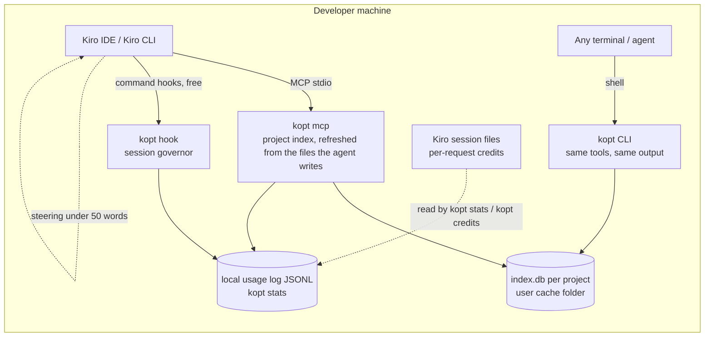

# kiro-optimizer: architecture and design decisions

> Status: v0.2.1 (October 2026). This document explains why the tool is built the way it is.
> The detailed sources (repositories read, Kiro docs, published benchmarks) are summarized in the appendix. Measured
> results are in [BENCHMARKS.md](BENCHMARKS.md).

**What is a hypothesis and what is measured.** The cost model in §1.1 is a hypothesis: no Kiro credit has been
measured by this project (the one headless request of the online A/B was refused by Kiro's anti-abuse checks, see
§6). What is measured: one exploration step on <!--v:offline.tasks-->138<!--/v--> tasks (kopt finds
<!--v:kopt.found-->108/138 (78%)<!--/v--> at a median of <!--v:kopt.median-->1,299<!--/v--> tokens), and real agents
outside Kiro (exploration session cost <!--v:ab.ex.primary-->-23% [-38%, -8%]<!--/v-->, test diagnosis
<!--v:ab.rn.primary-->+16% [-31%, +67%]<!--/v-->).

## 1. The problem as it actually exists in Kiro

### 1.1 How Kiro bills
- Kiro bills **credits per request**, metered to 0.01. The amount is multiplied by the model factor:
  Auto 1.0x, Haiku 4.5 0.4x, Sonnet 1.3x, Opus 5.5 2.0x, Opus 5 2.2x, Qwen3 Coder Next 0.05x.
- **Hypothesis, not confirmed:** consumption depends on the total request size (tokens), on the generated output
  and on the reasoning effort. Kiro documents that it bills per request, not how size, output and caching weigh in.
  The only evidence is a third-party probe on a free tier, with a small sample and most likely a model other than
  Claude; it also found that a prefix already in cache is billed **the same**. It should be confirmed on your own
  Kiro plan (see §6 and §7).
- **Consequence, if the hypothesis holds:** every token that enters the context is billed again on **every later turn** of the session.
  Real cost ≈ Σ(turns) × (fixed prefix + resident history) + outputs. We must therefore reduce three things:
  **what enters** the context, **how long it stays there**, and **the number of turns**.

### 1.2 What Kiro does not allow
- **No LLM proxy.** Traffic goes to the Kiro API, and no option redirects it to a gateway or to your own Bedrock
  (issue #34 has been open since 07/2025). The pricing FAQ also forbids third-party harnesses that route requests
  outside Kiro. This rules out compression proxies such as Headroom, the caveman proxy or lean-ctx.
- **Hooks cannot rewrite anything.** A hook can only do two things:
  - *block*: exit 2, and stderr is sent to the model, which costs one extra turn;
  - *add context*: stdout, and only on SessionStart and UserPromptSubmit.

  So built-in tool outputs cannot be compressed transparently.
- `command` hooks consume **no credits**. `agent` hooks do, because they start a new agent loop.

### 1.3 What we fully control
1. **The output of our MCP tools.** It enters the context verbatim, and the client does not truncate it.
2. The **fixed prefix**: steering (`always` / `auto` / `fileMatch` / `manual`), tool schemas and MCP instructions.
3. **Command hooks** (free): count, gate, block where it pays off, and measure.
4. **Custom agents**: the model per sub-agent and the tool allow-list.
5. **`.kiroignore`**: a deterministic filter on reads and searches that costs no extra turn.

## 2. KiroGraph and CodeGraph: what their source code shows

| Finding | KiroGraph 1.4 | CodeGraph 1.6 |
|---|---|---|
| Lexical search | **broken**: the FTS5 join `TEXT id = rowid` always returns 0 rows; exact, case-sensitive lookups of lower-cased words | correct (FTS5) |
| Response size | up to 10 full symbol bodies, cut at 15,000 chars in the middle of a code block | up to 25,000 chars (~8.3k tokens at chars / 3) per call, verbatim line-numbered code |
| Cross-call dedup | no | off by default |
| Fixed prefix | 7 tools in its default mode (about 1.5k tokens of schemas), up to 127 with every feature on (~6-13k tokens), plus `always` steering of 1-8k tokens | 1 tool (good; its server instructions are another 2.2k tokens, if Kiro forwards them) |
| Freshness | sync on Stop via `git status`; misses pulls and commits; inactive on the CLI | daemon and watcher (good), 4.3% edge drift |
| Measurement | hard-coded counterfactuals (1,500 tokens per "avoided" file); failures counted as 100% savings | real A/B, but 1 question on famous repos, with cache reads counted as tokens; at 3 turns: −24%, and **+17% on Django** |
| Output / loop levers | none (only optional "caveman" steering) | none |

CodeGraph also leaves on average **+82% more retrieval context resident** at the end of a session (its own
measurement), and that context is billed again on every turn.

Measured on our offline benchmark (one exploration step, same tasks and metrics, each tool in its default mode):
CodeGraph finds <!--v:codegraph.found-->79/138 (57%)<!--/v--> of the tasks at a median of
<!--v:codegraph.median-->8,315<!--/v--> tokens, KiroGraph <!--v:kirograph.found-->4/138 (3%)<!--/v-->, kopt
<!--v:kopt.found-->108/138 (78%)<!--/v--> at <!--v:kopt.median-->1,299<!--/v-->. No session-level A/B compared kopt with
them.

**Design hypothesis.** Code retrieval is only part of the spend. The rest comes from:
- turns × resident history;
- verbose and repeated build and test logs;
- whole-file reads;
- the fixed prefix;
- runaway loops.

Kiro's issue tracker shows a session of more than 1,000 credits that included 42 pytest runs, and review→fix loops
with no circuit breaker. The agent A/B supports part of this: on exploration, the fixed prefix was half of the stock
arm's re-based session cost, and kopt's saving came as much from fewer requests (-18%) as from fewer tokens read
(-23%).

## 3. Architecture

Everything runs on the developer machine:

### 3.1 The five levers, by expected impact

1. **Compressed command outputs (`kopt_run`, logs read back with `kopt_read <handle>`).** Tests, builds and linters return only the verdict,
   the failures and the errors, with file:line and the frames that belong to the repo. The full log is stored and
   available by handle. **An identical command re-run with no file change is not executed again**: the previous
   result is returned, which saves the build minutes and the re-sent output (the model still makes the call). The
   per-call reduction is computable, since the raw output is known: <!--v:compress.reduction-->96.2%<!--/v--> of the
   tokens on the committed fixtures, and <!--v:ab.rawTest-->152.2k<!--/v--> raw test-output tokens reduced to
   <!--v:ab.koptTest-->15.2k<!--/v--> in the agent A/B. The workspace fingerprint covers git state, `.env*` files,
   installed dependencies, ignored lockfiles and build outputs; not environment variables or external services.
2. **Session governor (command hooks, free):**
   - a circuit breaker on tool calls per session (Kiro has no credit budget);
   - a *one-time* block of whole-file reads of files estimated above N tokens (8,000 by default), with a precise
     alternative (outline or line range);
   - a *one-time* redirect of verbose test/build commands to `kopt_run`;
   - a block on identical re-runs with no file change;
   - per-tool measurement of built-in tool output sizes (PostToolUse). This is the observability that is missing
     today to see where context goes.

   "One-time" matters: a block costs a turn, so we only block where the expected gain far exceeds that cost, and we
   never block the same thing twice (no blocking loops).
3. **Budgeted code navigation (`kopt_find` / `kopt_read` / `kopt_refs`; `kopt_read` of a directory or with mode
   outline is the outline):**
   - a hard token cap on every response, compact text (never JSON), short `#3mv` handles;
   - per-session dedup, with a bounded window because Kiro's compaction erases MCP results;
   - a `pack` mode that returns task-level context in a single call (fewer turns);
   - hybrid search with code-aware tokenization (camelCase/snake_case), column-weighted BM25, centrality (PageRank)
     and demotion of tests;
   - `outline` for file skeletons and an aider-style repo map personalized by the task focus.
4. **Minimal fixed prefix:**
   - 4 listed tools, each spec one line with only the parameters of the common calls (the others are accepted and
     named by the outputs where they help), no MCP instructions; `kopt_outline` and `kopt_expand` are folded into
     `kopt_read`. Tool specs as Kiro sends them plus the always-on steering: 348 tokens (chars / 3), against 852 in
     v0.1. A test keeps it under 350. Measured in the agent A/B with the model's tokenizer:
     <!--v:ab.koptPrompt-->+282<!--/v--> tokens per request (it was +956 in v0.2's first round), about 1% of the kopt
     arm's session cost;
   - `always` steering under 50 words, routing only (named symbol: `kopt_read`/`kopt_find`; "who calls X":
     `kopt_refs`, trusted unless it reports something unresolved; members of a file: `kopt_read` mode outline; "how
     does Y work": a pack; tests: `kopt_run`); the code-change guidance below is in `auto` mode (loaded only when
     relevant). Guidance is never repeated between steering and descriptions: each request re-bills both.
   - prompt pointers (UserPromptSubmit) are off by default: on the 175 bench questions only 21% of them named an
     expected symbol (`bench/results/frontload.json`), and they are re-billed on every later request;
   - a generated `.kiroignore` covering lockfiles, minified bundles, generated code, snapshots and large data files.
5. **Output levers and model routing:**
   - "output" steering (`auto`, loaded for code changes): don't restate code or the plan, edit with minimal replacements, no unrequested summaries,
     stop at the acceptance criteria. Measured gain in the literature: about −8% output tokens, not the −65% some
     tools advertise;
   - a `kopt-explorer` sub-agent on Haiku 4.5 (0.4x) for exploration, returning file:line spans rather than code.
     Kiro CLI loads it; from a reading of the IDE bundles, Kiro IDE skips agent files with CLI-only fields such as
     `allowedTools`, which it has. Its use and its effect are not measured.

### 3.2 Why no server
kopt is a local tool on purpose: everything runs on the developer machine and nothing leaves it.
- **Kiro already runs there.** The levers that pay most (`kopt_run`, the governor, whole-file read redirects) need the
  checkout, the developer's shell and Kiro's hooks, which only exist on that machine.
- **Local indexing is cheap enough.** The first build runs once per project in a background worker thread (search
  answers as soon as symbols are written, before references are resolved); after
  that, only the files the agent writes (reported by the hooks) and the files changed by a pull are re-indexed.
- **Nothing to operate.** No accounts, tokens, secrets, network access or cloud bill: one `npx` command installs it,
  `kopt uninstall` removes it.
- **Privacy.** The code index and the usage log stay in the user's cache and `~/.kopt` folders. `kopt stats` reads
  them locally; there is no upload. Kiro prompts still go to the Kiro service, which is outside kopt's scope.

## 4. Surface compatibility

One command (`npx -y github:dorian-richard/kiro-optimizer setup`) installs kopt globally and writes **user-level**
Kiro configuration only, so kopt starts by itself in every project; nothing is written into repositories. The index
of each project lives in the per-user cache folder (macOS `~/Library/Caches/kopt`, Linux `~/.cache/kopt`, Windows
`%LOCALAPPDATA%\kopt`), keyed by the repository path. The user-level MCP server learns its project from the client's
MCP roots, else `KOPT_ROOT`, else the git root of the folder Kiro starts it in, and never indexes HOME or `/`.

| Capability | Kiro IDE 1.x | Kiro IDE 0.x (0.12) | Kiro CLI V3 | Kiro CLI 2.x (legacy) | Standalone `kopt` CLI |
|---|---|---|---|---|---|
| Written by `kopt setup` | `~/.kiro/settings/mcp.json`, `~/.kiro/hooks/kopt.json`, global steering, `~/.kiro/settings/kiroignore`, IDE user setting `kiroAgent.agentIgnoreFiles` | same files (0.x ignores the global hooks) | `mcp.json`, `~/.kiro/hooks/kopt.json` | `~/.kiro/agents/kopt.json` (hooks embedded, `includeMcpJson`) set as `chat.defaultAgent` | the global `kopt` command |
| MCP tools | `mcp.json` (+ `autoApprove`) | same | `mcp.json` through the agent (`includeMcpJson`) + `allowedTools` | same as V3 | n/a: same operations as commands (`kopt find/read/outline/refs/run/expand`) |
| Hooks | global v1 hooks (`~/.kiro/hooks/kopt.json`) | workspace `.kiro.hook` files only; the MCP server writes one `promptSubmit` hook per workspace (no tool-call governor, see below) | same file as IDE 1.x | object form in the agent: `agentSpawn`, `userPromptSubmit`, `preToolUse`, `postToolUse`, `stop` (the only triggers `kiro-cli agent validate` 2.28 accepts) | n/a |
| Block semantics | exit 2 (kopt never exits with another non-zero code: a Stop hook exiting 1 means "continue the agent") | n/a | exit 2 only | exit 2 | n/a |
| Allow path | **must be silent**: in the IDE, any PreToolUse output intercepts the tool call | n/a | silent | silent | n/a |
| Steering | all inclusion modes | all modes | all modes | only `always` loads automatically | n/a |
| `.kiroignore` | yes (+ `kiroAgent.agentIgnoreFiles` setting) | yes (+ setting) | yes (workspace) | no | the indexer honors it |
| Built-in tool names | `read_file`, `read_code`, `grep_search`, … | same as 1.x | `read`, `grep`, `glob`, `shell`, `write`, … | `fs_read`, `execute_bash`, `fs_write`, … | n/a |
| Credit telemetry | per request (session files, read by `kopt credits`) | not read by kopt (the chat shows Kiro's own estimate per turn) | per request (session files) | per request (session files) | n/a |

The governor normalizes tool names and payload shapes across surfaces, and de-duplicates events in case both hook
formats are active (events tagged with different `--source` values within 2 s are handled once).

Kiro IDE 0.x limits (verified in the 0.12.318 bundle): hooks load only from `<workspace>/.kiro/hooks`; `runCommand`
hooks get no stdin (data comes in env `USER_PROMPT`); and any matched `preToolUse` hook blocks the tool call even
when it prints nothing (one extra model turn per call), while `postToolUse` output is appended to every matched tool
result. kopt therefore installs only the `promptSubmit` pointer hook there, listed in `.git/info/exclude`, and only
when prompt pointers are on (`budgets.frontload` above 0; off by default): with the defaults, nothing is written into
workspaces. The full governor needs IDE 1.x.

## 5. Technical choices
- **TypeScript / Node ≥ 22.13, zero native dependencies**: SQLite through `node:sqlite` (FTS5 included) and tree-sitter
  as WASM. It installs on locked-down laptops (no native prebuild to download).
- **One SQLite file per project**, in the user cache folder (WAL mode): indexing writes from a worker thread, the
  server reads through its own connection, so tool calls keep answering while a refresh runs. One indexing pass at a
  time per project, across processes (`index.db.lock`). File text is always read from disk.
- **Tree-sitter** grammars for 11 languages (Java, TypeScript/TSX, JavaScript, Python, C#, Go, Kotlin, Rust, PHP,
  Ruby, Scala); the Scala and Rust grammars are vendored and checked against their SHA-256 at load. Reference
  resolution favors precision: an ambiguous reference stays unresolved. Planned next step: SCIP indexers
  (scip-java, scip-typescript, scip-dotnet), run locally, for exact resolution on Java and .NET stacks.
- **No embeddings.** Code-aware lexical search plus centrality covers most agent queries, because agents query with
  identifiers. The measured gap is in the wording: on the 22 held-out tasks, kopt finds
  <!--v:heldout.kopt-->19/22 (86%)<!--/v--> with the agent's search phrase and <!--v:heldout.koptQ-->15/22<!--/v-->
  with the raw question. A small local embedding model remains an option if that gap matters in real sessions.

## 6. Measurement: prove before claiming
Three levels, from cheapest to most conclusive. Results: [BENCHMARKS.md](BENCHMARKS.md); protocol:
[bench/README.md](../bench/README.md).

- **Offline benchmark** (`kopt bench all`): one exploration step on 11 repositories, one per language (138 tasks with
  verified gold answers, plus 22 held-out tasks), comparing tokens returned and recall for Kiro-style grep plus
  whole-file reads, grep plus line ranges, `kopt_find` pack, `kopt_find` plus `kopt_read`, and the recorded outputs
  of CodeGraph and KiroGraph. kopt finds <!--v:kopt.found-->108/138 (78%)<!--/v--> at a median of
  <!--v:kopt.median-->1,299<!--/v--> tokens; grep plus line ranges <!--v:ranged.found-->54/138 (39%)<!--/v--> at
  <!--v:ranged.median-->6,675<!--/v-->. This is an indicator, **not** a credit saving.
- **Agent A/B** (`bench/agentab`): real agents (not Kiro) solve 15 exploration and 6 test-diagnosis tasks with stock
  tools or with kopt, every command logged through a wrapper, 2 interleaved runs per arm and task, answers graded,
  measured context re-based to a Kiro-sized prefix. Exploration session cost <!--v:ab.ex.primary-->-23% [-38%, -8%]<!--/v-->
  (lower in <!--v:ab.ex.primaryLower-->13/15<!--/v--> tasks), test diagnosis <!--v:ab.rn.primary-->+16% [-31%, +67%]<!--/v-->,
  every answer correct in both arms.
- **Online A/B** (`kopt bench ab`, `src/bench/ab/`) with `kiro-cli chat --no-interactive --output-format stream-json`:
  - the developer's own tasks and repository, N repetitions, stock arm vs kopt arm (optional MCP-only arm);
  - a git worktree and a `KIRO_HOME` per arm, the user's login reused (never a login by the harness), a credit
    budget, an opt-in smoke run;
  - credits read from the session files and the stream, kopt usage proven by kopt's telemetry;
  - paired comparison restricted to tasks both arms solved, bootstrap 95% CI, fixed decision rule.

  **Only this number** supports a credit-savings claim. Its preflight was verified against the real kiro-cli 2.28;
  its one headless request was refused because Kiro's anti-abuse checks had suspended the (Free) account, with 0
  credits spent. No credit has been measured yet; the guide starts with the account-safety rules.
- **Day to day**: `kopt stats` reports, from the local usage log, the tokens kopt returned against computable
  baselines (gross figures: the prefix, blocks and follow-up reads are not subtracted), governor blocks, built-in tool
  output sizes and the per-request credits of Kiro CLI and IDE 1.x sessions. A team that wants a cohort comparison
  can use Kiro's own usage export (credits per user per day).
- Rule: `baselineTokens` is only set when the counterfactual is exactly computable (raw command output, full file).

## 7. Open questions before a team rollout
1. Target stacks: languages (Java/Spring? .NET?), monorepo or polyrepo, number and size of repositories.
2. Surfaces in use: Kiro IDE 1.x, CLI 2.x or CLI V3? Some levers differ: Tool Search exists only in Kiro CLI;
   `.kiroignore` is honoured by the IDE and CLI V3, not by CLI 2.x; `read_code` exists only in the IDE.
3. The Kiro plan (Pro or Enterprise with IAM Identity Center). It determines MCP governance (registry), the usage
   export and OTel telemetry.
4. A one-day probe on the organization's Kiro account: fixed prompts with varying prefix and output sizes, reading
   the credits of each request. Goal: establish the real weighting of input, output and cache. Run it on a paid
   account and follow the account-safety rules of [bench/ab/README.md](../bench/ab/README.md): automated requests can
   trigger Kiro's anti-abuse checks.
5. Default model (Auto or pinned) and the sub-agent policy.

## 8. Roadmap
- **v0.1 (prototype)**: local index, 6 budgeted tools, output compression, governor, Kiro setup for IDE and CLI,
  local usage report (`kopt stats`), benchmark harness.
- **v0.2 (this version)**:
  - 4 listed tools and a routing-only steering (852 to 348 tokens of fixed prompt), prompt pointers off by default;
  - retrieval: member reads and writes as references, callers with call lines and definitions, thin wrappers,
    interface families, a completeness line; whole reads of named functions; vendored Scala and Rust grammars;
  - `kopt_run`: every failing test listed, source hints on failures, a fingerprint that covers ignored inputs, no
    `KOPT_*` variables in the commands it runs;
  - big repositories: index builds in a worker thread, answers during the first build, one indexing pass per project
    across processes, cheaper freshness checks;
  - `kopt_read` refuses ignored files, `.git` and paths or links that leave the project;
  - measurement: the 11-language corpus, held-out tasks, the agent A/B, and `kopt bench ab` for real credits.
- **v0.2.1**: the fixes of the v0.2.0 acceptance test ([CHANGELOG.md](../CHANGELOG.md)): every file text kopt
  quotes passes the access rules (with git's global excludes and its rule that nothing re-includes a file inside an
  excluded folder), `kopt_run` finds the user's tools under a minimal `PATH` and names a missing one, a node:test
  filter (the TAP filter of the list below), and no stale answer right after a write.
- **Next** (from the A/B blockers and the FAQ review, most urgent first):
  - a committed `kopt.config.json` must not set `root`, `dataDir`, `userDir` or the governor (an allowlist of
    repository-level keys);
  - no literal values in stored declaration lines;
  - `kopt_run` that honours Kiro's shell permission policy;
  - tagged releases with a checksum and a reserved npm name;
  - `kopt_run` environment (`CI=1`) and the "same execution" redirect wording;
  - TypeScript/JavaScript locals from `new X(...)` and Rust `self.` calls in `kopt_refs`; a completeness check that
    skips comments;
  - a failing re-run that repeats its failure list; a routing line that brings kopt use back (measured in A/B);
  - content-producing Maven goals passed through;
  - a `kopt-explorer` the IDE can load; spec steering and the tool-call budget for "Run all tasks".
- **Later**: SCIP indexers for Java, TS and .NET, run locally; search across several local repositories; optional local
  embeddings; "Code Mode" (the model writes a script that queries the local index); a "fast apply" step for fewer
  output tokens; impacted-test selection.

## Appendix: main sources
- Source code read: KiroGraph v1.4.0 (commit 3457727), CodeGraph v1.6.2 (b635dd4), sdl-mcp, CodeGraphContext,
  codegraph-rust.
- Kiro docs (258 pages, IDE 1.2 and CLI 2.28/V3): hooks, MCP (Tool Search), steering, `.kiroignore`, models and
  credits, enterprise governance.
- Read-only analysis of the installed Kiro IDE bundle (0.12 and 1.2.56):
  - hook semantics;
  - MCP instructions injected into context, capped at 2,048 chars;
  - the 2,000-line `read_file` cap;
  - compaction of MCP results.
- Literature: The Complexity Trap (NeurIPS 2025: observation masking ≈ −50% cost), SWE-Pruner, AgentDiet, the
  JetBrains study on terse output (−8.5% output tokens), and Anthropic Tool Search (−85% of schema tokens).
- Kiro issues: #11786 (a session of more than 1,000 credits), #11477 (no circuit breaker), #9576 (hooks cannot
  rewrite input), #7557 (no admin-enforced steering).
