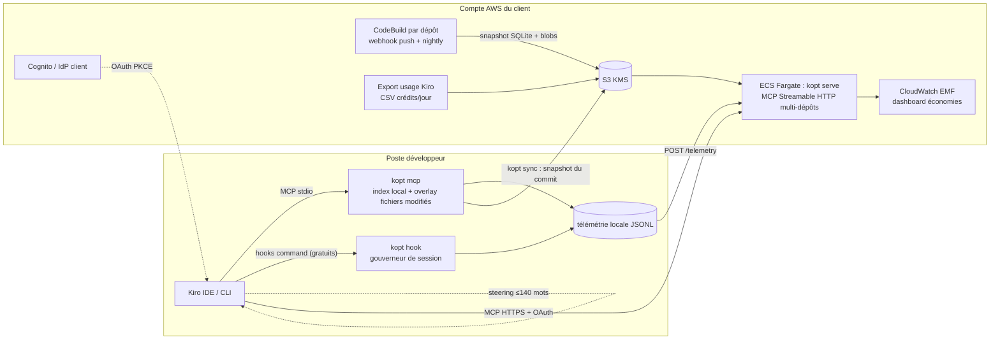

# KiroOptimizer : architecture et choix de conception

> Statut : prototype v0.1 (octobre 2026). Ce document explique pourquoi l'outil est construit ainsi.
> Les sources détaillées (dépôts lus, docs Kiro, benchmarks publiés) sont résumées en annexe.

## 1. Le problème, tel qu'il se pose réellement dans Kiro

### 1.1 Ce que Kiro facture
- Kiro facture des **crédits par requête**, fractionnés au centième, multipliés par le coefficient du modèle :
  Auto 1.0x, Haiku 4.5 0.4x, Sonnet 1.3x, Opus 5.5 2.0x, Opus 5 2.2x, Qwen3 Coder Next 0.05x.
- La consommation dépend de la taille totale de la requête (tokens), de la sortie générée et de l'effort de
  raisonnement. Une sonde tierce indique qu'un préfixe déjà en cache est facturé **au même prix**. Le cache
  améliore la latence, pas la facture (à confirmer sur votre propre contrat Kiro, cf. §6).
- **Conséquence clé :** chaque token entré dans le contexte est refacturé à **chaque tour suivant** de la session.
  Le coût réel ≈ Σ(tours) × (préfixe fixe + historique résident) + sorties. On doit donc réduire à la fois
  **ce qui entre** dans le contexte, **combien de temps cela y reste** et **le nombre de tours**.

### 1.2 Ce que Kiro ne permet pas
- **Pas de proxy LLM.** Le trafic part vers l'API Kiro et aucune option ne le redirige vers une passerelle ou
  vers Bedrock (issue #34 ouverte depuis 07/2025). Les CGU interdisent les « harnais tiers ». Les approches de type
  proxy de compression (Headroom, proxy caveman, lean-ctx) sont donc exclues.
- **Les hooks ne réécrivent rien.** Un hook peut seulement *bloquer* (exit 2 : stderr envoyé au modèle, ce qui coûte
  un tour) ou *ajouter* du contexte (stdout, uniquement sur SessionStart et UserPromptSubmit). Une compression
  « transparente » des sorties des outils natifs est impossible.
- Les hooks de type `command` ne consomment **aucun crédit**. Les hooks de type `agent` en consomment (nouvelle boucle).

### 1.3 Ce que nous contrôlons entièrement
1. **La sortie de nos outils MCP** : elle entre telle quelle dans le contexte, sans troncature côté client.
2. Le **préfixe fixe** : steering (modes `always`/`auto`/`fileMatch`/`manual`), schémas d'outils et instructions MCP.
3. **Les hooks command** (gratuits) : compter, garder, bloquer à bon escient et mesurer.
4. Les **agents personnalisés** : choix du modèle par sous-agent et liste d'outils autorisés.
5. **`.kiroignore`** : un filtre déterministe, sans tour supplémentaire, sur les lectures et les recherches.

## 2. Pourquoi KiroGraph et CodeGraph économisent peu (vérifié dans le code)

| Constat | KiroGraph 1.4 | CodeGraph 1.6 |
|---|---|---|
| Recherche lexicale | **cassée** : jointure FTS5 `TEXT id = rowid` qui renvoie toujours 0 ligne ; recherche exacte sensible à la casse sur des mots en minuscules | correcte (FTS5) |
| Taille des réponses | jusqu'à 10 corps complets, coupés à 15 000 caractères en plein bloc | jusqu'à 25 000 caractères (~11k tokens) par appel, code verbatim numéroté |
| Déduplication entre appels | non | désactivée par défaut |
| Préfixe fixe | 127 outils (~6-13k tokens de schémas) et un steering `always` de 1 à 8k tokens | 1 outil (bien) |
| Fraîcheur | sync au Stop via `git status`, ratée sur pull/commit, inopérante en CLI | daemon + watcher (bien), dérive de 4,3 % des arêtes |
| Mesure | contrefactuels codés en dur (1 500 tokens par fichier « évité »), échecs comptés comme 100 % d'économie | A/B réel mais 1 question, dépôts célèbres, cache reads comptés comme tokens ; à 3 tours : −24 %, et **+17 % sur Django** |
| Centralisation | aucune (stdio, index local par développeur) | aucune |
| Leviers de sortie / boucles | non (sauf un steering « caveman » optionnel) | non |

À noter aussi : CodeGraph laisse en moyenne **+82 % de contexte de récupération résident** en fin de session.
Ce contexte est refacturé à chaque tour.

**Leçon centrale.** La récupération de code n'est qu'une petite part de la dépense. La dépense vient surtout
(a) des tours × l'historique résident, (b) des logs de build/test verbeux et répétés, (c) des lectures de
fichiers entiers, (d) du préfixe fixe et (e) des boucles qui s'emballent. Dans les issues Kiro, on trouve une
session de plus de 1 000 crédits, dont 42 exécutions de pytest, et des boucles review→correction sans disjoncteur.

## 3. Architecture cible

### 3.1 Les cinq leviers, par ordre d'impact attendu

1. **Sorties de commandes compressées (`kopt_run` / `kopt_expand`)**
   Les tests, builds et linters renvoient seulement le verdict, les échecs et les erreurs (avec file:line et les
   frames du dépôt). Le log complet est stocké et consultable par handle. **Une commande identique relancée sans
   modification de fichier n'est pas réexécutée** : le résultat précédent est rendu, sans tour supplémentaire ni
   minutes de build. Le gain est mesurable exactement, puisque la sortie brute est connue.
2. **Gouverneur de session (hooks command, gratuits)**
   - Disjoncteur : nombre maximal d'appels d'outils par session (Kiro n'a pas de budget en crédits).
   - Blocage *une seule fois* des lectures de fichiers entiers au-delà de N lignes, avec une alternative précise
     (outline, plage de lignes).
   - Redirection *une seule fois* des commandes de test/build verbeuses vers `kopt_run`.
   - Blocage des relances identiques sans modification de fichier.
   - Mesure par outil de la taille des sorties des outils natifs (PostToolUse). C'est l'observabilité qui manque
     aujourd'hui pour savoir où part le contexte.
   - Règle « une seule fois » : un blocage coûte un tour. On ne bloque que là où le gain attendu dépasse
     largement ce coût, et on ne bloque jamais deux fois la même chose (pas de boucle bloquante).
3. **Navigation de code budgétée (`kopt_find` / `kopt_read` / `kopt_outline` / `kopt_refs`)**
   - Plafond dur en tokens sur chaque réponse, texte compact (jamais de JSON), handles courts `#3mv`.
   - Déduplication par session : un symbole déjà montré n'est pas renvoyé, avec une fenêtre bornée parce que la
     compaction Kiro efface les résultats MCP.
   - Mode `pack` : le contexte d'une tâche en un seul appel (pointeurs + 1 à 3 corps), pour réduire le nombre de tours.
   - Recherche hybride à tokenisation « code » (camelCase/snake_case), BM25 pondéré par colonne, centralité
     (PageRank) et déclassement des tests.
   - `outline` : squelettes de fichiers et carte du dépôt personnalisée par le focus de la tâche (à la aider).
4. **Préfixe fixe minimal**
   - 6 outils aux descriptions courtes, instructions MCP < 600 caractères, steering `always` < 140 mots.
   - Les consignes de spec passent en mode `auto` (chargées seulement si pertinentes).
   - `.kiroignore` généré : lockfiles, bundles minifiés, code généré, snapshots, gros fichiers de données.
5. **Leviers de sortie et routage de modèle**
   - Steering « sortie » : ne pas recopier le code ni le plan, éditer par remplacement minimal, pas de résumé non
     demandé, s'arrêter aux critères d'acceptation. Gain mesuré dans la littérature : environ −8 % de tokens de
     sortie (pas −65 % comme annoncé par certains outils).
   - Sous-agent `kopt-explorer` sur Haiku 4.5 (0.4x) pour l'exploration, qui renvoie des spans file:line plutôt que
     du code.

### 3.2 Mode centralisé (chez le client)
- **Indexation une fois par commit en CI** (CodeBuild, webhook), et non sur chaque poste. Le snapshot SQLite
  contient le code (blobs gzip) et est servi par **un serveur MCP HTTP multi-dépôts** (Fargate) authentifié en
  OAuth (Cognito ou IdP du client, client public PKCE avec `oauth.clientId` dans `mcp.json`, car Cognito ne fait
  pas de DCR).
- **Recherche inter-dépôts** : « qui consomme cette API dans les 50 dépôts » est une capacité centrale qu'aucun
  outil local n'offre.
- **Overlay local** : `kopt sync` télécharge le snapshot du commit courant puis réindexe seulement les fichiers
  modifiés localement. Le poste n'a jamais à indexer un dépôt de 2M de lignes à froid.
- **Télémétrie centrale** : événements des outils et des hooks, plus les crédits par requête récoltés localement
  dans les sessions Kiro CLI, envoyés à `/telemetry`, transformés en métriques CloudWatch EMF et affichés sur un
  dashboard. On croise avec l'export d'usage Kiro (crédits/jour/utilisateur) pour une comparaison par cohorte.
- **Pas d'exécution distante** : `kopt_run` n'existe pas en mode HTTP. Les commandes s'exécutent toujours sur le
  poste.
- Données : le code reste dans le compte AWS du client (S3 KMS, VPC). Les prompts Kiro, eux, partent toujours
  vers le service Kiro (hors de notre périmètre).

## 4. Choix techniques
- **TypeScript / Node ≥ 22, zéro dépendance native** : SQLite via `node:sqlite` (FTS5 inclus) et tree-sitter en WASM.
  Installation possible sur des postes verrouillés (pas de prebuild natif à télécharger) et image Docker simple.
- **SQLite par dépôt et par commit** : un artefact immuable, facile à mettre en cache, à versionner dans S3 et à
  servir en lecture. C'est le même format que l'index local.
- **Tree-sitter** pour 12 langages (Java, TS/JS, Python, C#, Go, Kotlin, Rust, PHP, Ruby, Scala). La résolution
  des références privilégie la précision : une référence ambiguë reste non résolue. Évolution prévue : SCIP
  (scip-java, scip-typescript, scip-dotnet) en CI pour une résolution exacte sur les stacks Java/.NET.
- **Pas d'embeddings dans la v0.1** : le lexical code-aware bien fait, avec centralité, couvre l'essentiel pour
  les agents, qui formulent des requêtes avec des identifiants. Les embeddings (Titan v2 à 0,02 $/M tokens en CI)
  sont une option pour la v0.2 si le banc de mesure montre un déficit de rappel sur les requêtes en langage naturel.

## 5. Mesure : prouver avant d'affirmer
- **Banc hors ligne** (`kopt bench`) sur deux grands dépôts (spring-framework, django), avec des tâches en anglais
  et en français dont les réponses de référence sont vérifiées dans le code. On compare 4 stratégies (grep + lecture
  de fichiers entiers façon Kiro, grep + plages, `kopt_find pack`, `kopt_find` + `read`) sur les tokens renvoyés et
  le rappel. C'est un indicateur, **pas** une économie de crédits.
- **A/B en ligne** (`bench/ab/`) avec `kiro-cli --no-interactive --output-format stream-json`, sur les mêmes
  tâches, N répétitions, bras stock contre bras kopt, crédits lus dans le flux, comparaison appariée seulement sur
  les tâches réussies par les deux bras, IC 95 % par bootstrap. **Seul ce chiffre compte** pour annoncer une économie.
- **En production** : comparaison par cohorte (différence de différences) des crédits/jour issus de l'export
  Kiro, plus la télémétrie fine.
- Règle : le champ `baselineTokens` n'est renseigné que lorsque le contrefactuel est exactement calculable (sortie
  brute d'une commande, fichier complet).

## 6. Questions ouvertes à valider avant un déploiement
1. Les stacks visées : langages (Java/Spring ? .NET ?), monorepo ou polyrepo, nombre et taille des dépôts.
2. Les surfaces utilisées : Kiro IDE 1.x, CLI 2.x ou CLI V3 ? Les leviers diffèrent (Tool Search et `.kiroignore`
   uniquement en CLI V3, `read_code` uniquement dans l'IDE…).
3. Le plan Kiro (Pro/Enterprise, IAM Identity Center) : il conditionne la gouvernance MCP (registre), l'export
   d'usage et la télémétrie OTel.
4. Une sonde d'une journée sur le compte Kiro de l'organisation : prompts fixes avec un préfixe de taille variable et une sortie de
   longueur variable, crédits lus à chaque requête. Objectif : établir la pondération réelle entrée, sortie et cache.
5. Le modèle par défaut (Auto ou modèle épinglé) et la politique de sous-agents.

## 7. Feuille de route
- **v0.1 (ce prototype)** : index local + 6 outils budgétés + compression des sorties + gouverneur + installation
  Kiro + télémétrie + infra CDK + banc de mesure.
- **v0.2** : SCIP en CI pour Java/TS/.NET ; recherche inter-dépôts ; embeddings optionnels ; « Code Mode »
  (le modèle écrit un script qui interroge l'index côté serveur et seul le résultat entre en contexte).
- **v0.3** : modèle « fast apply » sur Bedrock (édition par snippets `// ... existing code ...`, pour moins de
  tokens de sortie) ; sélection des tests impactés (Gradle/Maven/Jest/pytest) ; pruner de sorties appris.

## Annexe : principales sources
- Code lu : KiroGraph v1.4.0 (commit 3457727), CodeGraph v1.6.2 (b635dd4), sdl-mcp, CodeGraphContext, codegraph-rust.
- Docs Kiro (258 pages, IDE 1.2 et CLI 2.28/V3) : hooks, MCP (OAuth, Tool Search), steering, `.kiroignore`, modèles et crédits, gouvernance entreprise.
- Analyse en lecture seule du bundle Kiro IDE (0.12 et 1.2.56) : sémantique des hooks, injection des instructions MCP plafonnée à 2 048 caractères, plafond de `read_file` à 2 000 lignes, compaction des résultats MCP.
- Littérature : The Complexity Trap (NeurIPS 2025, masquage des observations ≈ −50 % de coût), SWE-Pruner, AgentDiet, étude JetBrains sur la concision (−8,5 % de tokens de sortie), Anthropic Tool Search (−85 % de schémas).
- Issues Kiro : #11786 (session de plus de 1 000 crédits), #11477 (absence de disjoncteur), #9576 (pas de réécriture d'entrée dans les hooks), #7557 (pas de steering imposé par l'administrateur).
