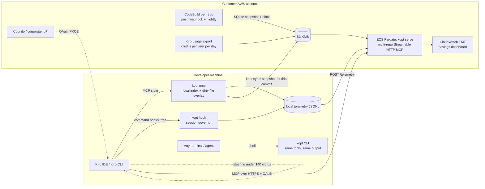

# kiro-optimizer: architecture and design decisions

> Status: prototype v0.1 (October 2026). This document explains why the tool is built the way it is.
> The detailed sources (repositories read, Kiro docs, published benchmarks) are summarized in the appendix.

## 1. The problem as it actually exists in Kiro

### 1.1 How Kiro bills
- Kiro bills **credits per request**, metered to 0.01. The amount is multiplied by the model factor:
  Auto 1.0x, Haiku 4.5 0.4x, Sonnet 1.3x, Opus 5.5 2.0x, Opus 5 2.2x, Qwen3 Coder Next 0.05x.
- Consumption depends on the total request size (tokens), on the generated output and on the reasoning effort.
  A third-party probe found that a prefix already in cache is billed **the same**. So caching improves latency,
  not the bill. This should be confirmed on your own Kiro plan (see §7).
- **Key consequence:** every token that enters the context is billed again on **every later turn** of the session.
  Real cost ≈ Σ(turns) × (fixed prefix + resident history) + outputs. We must therefore reduce three things:
  **what enters** the context, **how long it stays there**, and **the number of turns**.

### 1.2 What Kiro does not allow
- **No LLM proxy.** Traffic goes to the Kiro API, and no option redirects it to a gateway or to your own Bedrock
  (issue #34 has been open since 07/2025). The pricing FAQ also forbids third-party harnesses that route requests
  outside Kiro. This rules out compression proxies such as Headroom, the caveman proxy or lean-ctx.
- **Hooks cannot rewrite anything.** A hook can only do two things:
  - *block*: exit 2, and stderr is sent to the model, which costs one extra turn;
  - *add context*: stdout, and only on SessionStart and UserPromptSubmit.

  So built-in tool outputs cannot be compressed transparently.
- `command` hooks consume **no credits**. `agent` hooks do, because they start a new agent loop.

### 1.3 What we fully control
1. **The output of our MCP tools.** It enters the context verbatim, and the client does not truncate it.
2. The **fixed prefix**: steering (`always` / `auto` / `fileMatch` / `manual`), tool schemas and MCP instructions.
3. **Command hooks** (free): count, gate, block where it pays off, and measure.
4. **Custom agents**: the model per sub-agent and the tool allow-list.
5. **`.kiroignore`**: a deterministic filter on reads and searches that costs no extra turn.

## 2. Why KiroGraph and CodeGraph save little (verified in their source code)

| Finding | KiroGraph 1.4 | CodeGraph 1.6 |
|---|---|---|
| Lexical search | **broken**: the FTS5 join `TEXT id = rowid` always returns 0 rows; exact, case-sensitive lookups of lower-cased words | correct (FTS5) |
| Response size | up to 10 full symbol bodies, cut at 15,000 chars in the middle of a code block | up to 25,000 chars (~11k tokens) per call, verbatim line-numbered code |
| Cross-call dedup | no | off by default |
| Fixed prefix | 127 tools (~6-13k tokens of schemas), plus `always` steering of 1-8k tokens | 1 tool (good) |
| Freshness | sync on Stop via `git status`; misses pulls and commits; inactive on the CLI | daemon and watcher (good), 4.3% edge drift |
| Measurement | hard-coded counterfactuals (1,500 tokens per "avoided" file); failures counted as 100% savings | real A/B, but 1 question on famous repos, with cache reads counted as tokens; at 3 turns: −24%, and **+17% on Django** |
| Centralization | none (stdio, local index per developer) | none |
| Output / loop levers | none (only optional "caveman" steering) | none |

CodeGraph also leaves on average **+82% more retrieval context resident** at the end of a session, and that context
is billed again on every turn.

**Core lesson.** Code retrieval is a small share of the spend. Most of it comes from:
- turns × resident history;
- verbose and repeated build and test logs;
- whole-file reads;
- the fixed prefix;
- runaway loops.

Kiro's issue tracker shows a session of more than 1,000 credits that included 42 pytest runs, and review→fix loops
with no circuit breaker.

## 3. Target architecture

### 3.1 The five levers, by expected impact

1. **Compressed command outputs (`kopt_run` / `kopt_expand`).** Tests, builds and linters return only the verdict,
   the failures and the errors, with file:line and the frames that belong to the repo. The full log is stored and
   available by handle. **An identical command re-run with no file change is not executed again**: the previous
   result is returned, which saves both a turn and the build minutes. The savings are measured exactly, since the
   raw output is known.
2. **Session governor (command hooks, free):**
   - a circuit breaker on tool calls per session (Kiro has no credit budget);
   - a *one-time* block of whole-file reads above N lines, with a precise alternative (outline or line range);
   - a *one-time* redirect of verbose test/build commands to `kopt_run`;
   - a block on identical re-runs with no file change;
   - per-tool measurement of built-in tool output sizes (PostToolUse). This is the observability that is missing
     today to see where context goes.

   "One-time" matters: a block costs a turn, so we only block where the expected gain far exceeds that cost, and we
   never block the same thing twice (no blocking loops).
3. **Budgeted code navigation (`kopt_find` / `kopt_read` / `kopt_outline` / `kopt_refs`):**
   - a hard token cap on every response, compact text (never JSON), short `#3mv` handles;
   - per-session dedup, with a bounded window because Kiro's compaction erases MCP results;
   - a `pack` mode that returns task-level context in a single call (fewer turns);
   - hybrid search with code-aware tokenization (camelCase/snake_case), column-weighted BM25, centrality (PageRank)
     and demotion of tests;
   - `outline` for file skeletons and an aider-style repo map personalized by the task focus.
4. **Minimal fixed prefix:**
   - 6 tools with short descriptions and MCP instructions under 600 chars;
   - `always` steering under 140 words, with spec guidance in `auto` mode (loaded only when relevant);
   - a generated `.kiroignore` covering lockfiles, minified bundles, generated code, snapshots and large data files.
5. **Output levers and model routing:**
   - "output" steering: don't restate code or the plan, edit with minimal replacements, no unrequested summaries,
     stop at the acceptance criteria. Measured gain in the literature: about −8% output tokens, not the −65% some
     tools advertise;
   - a `kopt-explorer` sub-agent on Haiku 4.5 (0.4x) for exploration, returning file:line spans rather than code.

### 3.2 Centralized mode (in the customer's account)
- **Index once per commit in CI** (CodeBuild webhook) instead of on every laptop. The SQLite snapshot embeds the
  code (gzip blobs) and is served by **one multi-repository HTTP MCP server** (Fargate). Authentication is OAuth
  (Cognito or the corporate IdP), with a public PKCE client configured through `oauth.clientId` in `mcp.json`,
  because Cognito does not support dynamic client registration.
- **Cross-repository search**: "who consumes this API across all 50 repositories" is a central capability that no
  local tool offers.
- **Local overlay**: `kopt sync` downloads the snapshot for the current commit, then re-indexes only locally modified
  files. A laptop never cold-indexes a 2M-line repository.
- **Central telemetry**: tool and hook events, plus per-request credits collected locally from Kiro CLI sessions,
  are posted to `/telemetry`. There they become CloudWatch EMF metrics and feed a dashboard. They are cross-checked
  with Kiro's usage export (credits per user per day) for cohort comparisons.
- **No remote execution**: `kopt_run` does not exist in HTTP mode. Commands always run on the developer machine.
- Data: the code stays in the customer's AWS account (S3 with KMS, VPC). Kiro prompts still go to the Kiro service,
  which is outside our scope.

## 4. Surface compatibility

| Capability | Kiro IDE 1.x | Kiro CLI V3 | Kiro CLI 2.x (legacy) | Standalone `kopt` CLI |
|---|---|---|---|---|
| MCP tools | `.kiro/settings/mcp.json` (+ `autoApprove`) | `mcp.json` through the agent (`includeMcpJson`) + `allowedTools` | same as V3 | n/a: same operations as commands (`kopt find/read/outline/refs/run/expand`) |
| Hooks | `.kiro/hooks/kopt.json` (v1 schema) | same file | hooks embedded in agent config (object form: `agentSpawn`, `userPromptSubmit`, `preToolUse`, `postToolUse`, `stop`) | n/a |
| Block semantics | exit 2 (the IDE also treats other non-zero codes as blocking) | exit 2 only | exit 2 | n/a |
| Allow path | **must be silent**: in the IDE, any PreToolUse output intercepts the tool call | silent | silent | n/a |
| Steering | all inclusion modes | all modes | only `always` loads automatically | n/a |
| `.kiroignore` | yes (+ `kiroAgent.agentIgnoreFiles` setting) | yes (workspace) | no | the indexer honors it |
| Built-in tool names | `read_file`, `read_code`, `grep_search`, … | `read`, `grep`, `glob`, `shell`, `write`, … | `fs_read`, `execute_bash`, `fs_write`, … | n/a |
| Credit telemetry | daily admin export | per request (session files) | per request (session files) | n/a |

The governor normalizes tool names and payload shapes across surfaces, and de-duplicates events in case both hook
formats are active.

## 5. Technical choices
- **TypeScript / Node ≥ 22, zero native dependencies**: SQLite through `node:sqlite` (FTS5 included) and tree-sitter
  as WASM. It installs on locked-down laptops (no native prebuild to download) and builds into a simple Docker image.
- **One SQLite file per repository and commit**: an immutable artifact that is easy to cache, version in S3 and serve
  read-only. It is the same format as the local index.
- **Tree-sitter** for 12 languages (Java, TS/JS, Python, C#, Go, Kotlin, Rust, PHP, Ruby, Scala). Reference
  resolution favors precision: an ambiguous reference stays unresolved. Planned next step: SCIP (scip-java,
  scip-typescript, scip-dotnet) in CI for exact resolution on Java and .NET stacks.
- **No embeddings in v0.1.** Well-done code-aware lexical search plus centrality covers most agent queries, because
  agents query with identifiers. Embeddings (Titan v2 at $0.02 per million tokens, in CI) are a v0.2 option if the
  benchmark shows a recall gap on natural-language queries.

## 6. Measurement: prove before claiming
- **Offline benchmark** (`kopt bench`) on two large repositories (spring-framework, django), with verified gold
  answers. It compares 4 strategies on tokens returned and recall:
  - Kiro-style grep plus whole-file reads;
  - grep plus line ranges;
  - `kopt_find pack`;
  - `kopt_find` plus `read`.

  This is an indicator, **not** a credit saving.
- **Online A/B** (`bench/ab/`) with `kiro-cli --no-interactive --output-format stream-json`:
  - same tasks, N repetitions, stock arm vs kopt arm;
  - credits read from the stream;
  - paired comparison restricted to tasks both arms solved;
  - bootstrap 95% CI.

  **Only this number** supports a savings claim.
- **In production**: a cohort comparison (difference-in-differences) of daily credits from the Kiro export, plus
  the fine-grained telemetry.
- Rule: `baselineTokens` is only set when the counterfactual is exactly computable (raw command output, full file).

## 7. Open questions before a deployment
1. Target stacks: languages (Java/Spring? .NET?), monorepo or polyrepo, number and size of repositories.
2. Surfaces in use: Kiro IDE 1.x, CLI 2.x or CLI V3? Some levers differ: Tool Search and `.kiroignore` exist only in
   CLI V3, and `read_code` only in the IDE.
3. The Kiro plan (Pro or Enterprise with IAM Identity Center). It determines MCP governance (registry), the usage
   export and OTel telemetry.
4. A one-day probe on the organization's Kiro account: fixed prompts with varying prefix and output sizes, reading
   the credits of each request. Goal: establish the real weighting of input, output and cache.
5. Default model (Auto or pinned) and the sub-agent policy.

## 8. Roadmap
- **v0.1 (this prototype)**: local index, 6 budgeted tools, output compression, governor, Kiro setup for IDE and CLI,
  telemetry, CDK infrastructure, benchmark harness.
- **v0.2**:
  - SCIP in CI for Java, TS and .NET;
  - cross-repository search;
  - optional embeddings;
  - "Code Mode": the model writes a script that queries the index server-side, and only the result enters context.
- **v0.3**:
  - a "fast apply" model on Bedrock: snippet edits with `// ... existing code ...`, for fewer output tokens;
  - impacted-test selection (Gradle, Maven, Jest, pytest);
  - a learned output pruner.

## Appendix: main sources
- Source code read: KiroGraph v1.4.0 (commit 3457727), CodeGraph v1.6.2 (b635dd4), sdl-mcp, CodeGraphContext,
  codegraph-rust.
- Kiro docs (258 pages, IDE 1.2 and CLI 2.28/V3): hooks, MCP (OAuth, Tool Search), steering, `.kiroignore`, models
  and credits, enterprise governance.
- Read-only analysis of the installed Kiro IDE bundle (0.12 and 1.2.56):
  - hook semantics;
  - MCP instructions injected into context, capped at 2,048 chars;
  - the 2,000-line `read_file` cap;
  - compaction of MCP results.
- Literature: The Complexity Trap (NeurIPS 2025: observation masking ≈ −50% cost), SWE-Pruner, AgentDiet, the
  JetBrains study on terse output (−8.5% output tokens), and Anthropic Tool Search (−85% of schema tokens).
- Kiro issues: #11786 (a session of more than 1,000 credits), #11477 (no circuit breaker), #9576 (hooks cannot
  rewrite input), #7557 (no admin-enforced steering).
