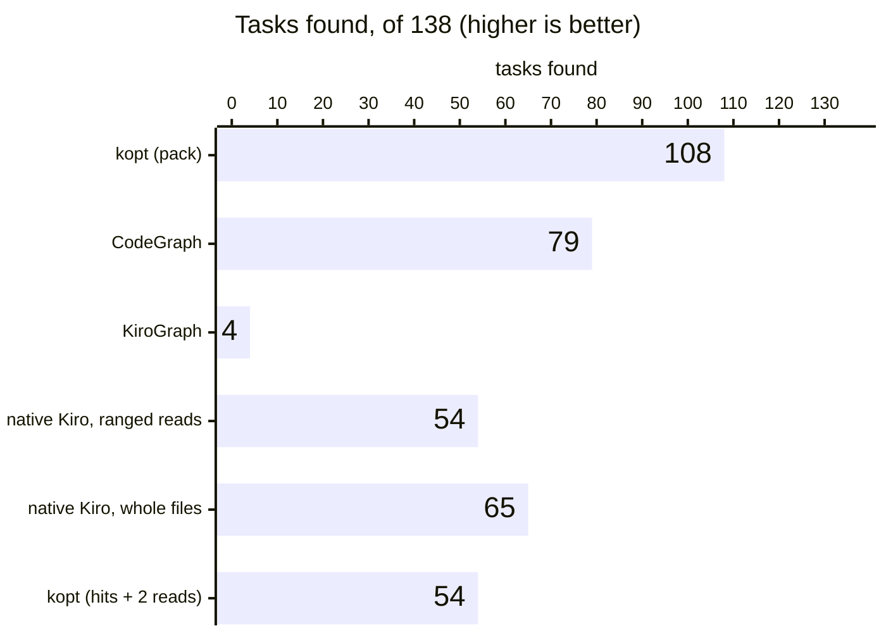
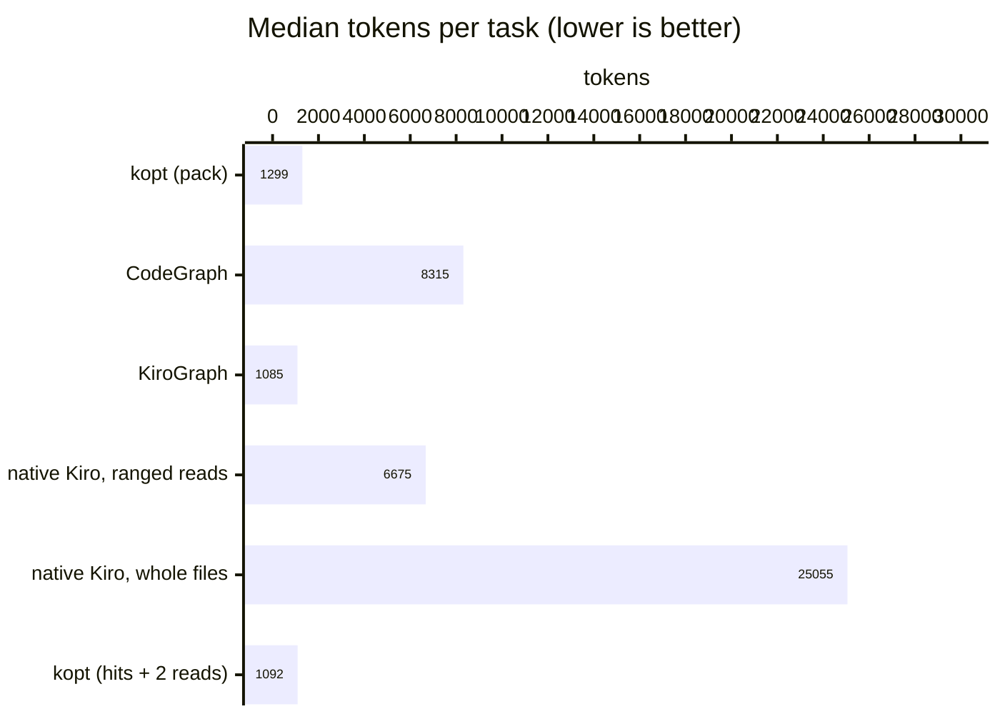
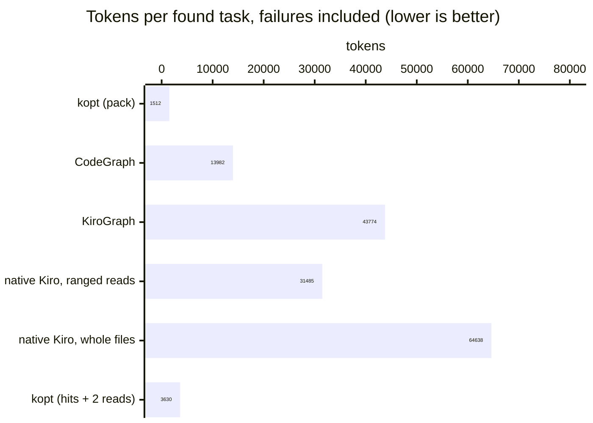
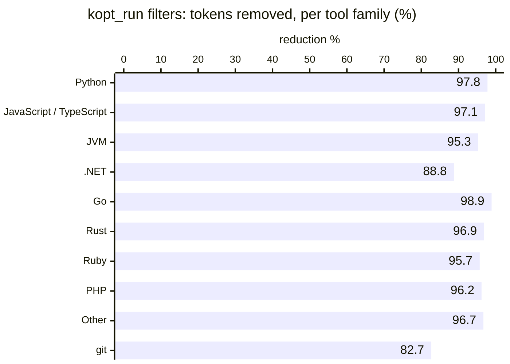

# kopt benchmarks

What kopt changes in what an agent reads, measured three ways: an offline benchmark of one exploration step on
<!--v:offline.tasks-->138<!--/v--> tasks in <!--v:offline.repos-->11<!--/v--> languages against CodeGraph, KiroGraph
and native Kiro tools; real agents solving 21 tasks with and without kopt; and kopt's command-output filters. A last
section covers indexing on two large repositories. Every number on this page comes from a result file committed in
[`bench/results`](../bench/results), and **none of them is a Kiro credit**: Kiro credits have not been measured by us
(see [Limits](#limits-what-these-numbers-are-not)). Teams can measure their own with `kopt bench ab`.

kopt <!--v:version-->0.2.0<!--/v--> (git tag `v0.2.0`), the release that follows the v0.1 prototype. Measured on 2026-10-09 and 2026-10-10. Builds and dates per data set:
[Data sources and versions](#data-sources-and-versions). An HTML version with charts, generated from the same data,
is [`docs/benchmarks.html`](benchmarks.html), published at
<https://dorian-richard.github.io/kiro-optimizer/benchmarks.html>.

## At a glance

- **Offline, one exploration step, <!--v:offline.tasks-->138<!--/v--> tasks.** One `kopt_find` call in pack mode
  finds every expected file and symbol in <!--v:kopt.found-->108/138 (78%)<!--/v--> of the tasks, at a median of
  <!--v:kopt.median-->1,299<!--/v--> tokens. CodeGraph finds <!--v:codegraph.found-->79/138 (57%)<!--/v--> at
  <!--v:codegraph.median-->8,315<!--/v-->, a disciplined native Kiro agent (grep, then line ranges)
  <!--v:ranged.found-->54/138 (39%)<!--/v--> at <!--v:ranged.median-->6,675<!--/v-->, and KiroGraph
  <!--v:kirograph.found-->4/138 (3%)<!--/v-->. These tasks guided the v0.2 work; on 22 held-out tasks written before
  any measurement, kopt finds <!--v:heldout.kopt-->19/22 (86%)<!--/v--> and native ranged reads
  <!--v:heldout.ranged-->5/22 (23%)<!--/v-->.
- **Real agents, code exploration.** Over <!--v:ab.exTasks-->15<!--/v--> tasks on 9 open-source repositories, the
  measured session cost (re-based to a 12k-token prefix) is <!--v:ab.ex.primary-->-23% [-38%, -8%]<!--/v--> with kopt,
  lower in <!--v:ab.ex.primaryLower-->13/15<!--/v--> tasks (sign test <!--v:ab.ex.primaryP-->p = 0.007<!--/v-->), with
  every answer correct in both arms. Over every v0.2 run pooled: <!--v:ab.pooled.ex-->-18% [-31%, -5%]<!--/v-->.
- **Real agents, test diagnosis.** No measurable saving: <!--v:ab.rn.primary-->+16% [-31%, +67%]<!--/v--> over
  <!--v:ab.rnTasks-->6<!--/v--> tasks. kopt cuts what the agent reads, not the number of calls.
- **Command output.** On <!--v:compress.fixtures-->50<!--/v--> committed test, build and git outputs (45 generated in
  each tool's format, 5 real runs), kopt's filters
  return <!--v:compress.out-->10,402<!--/v--> of <!--v:compress.raw-->286,154<!--/v--> tokens
  (<!--v:compress.reduction-->96.4%<!--/v--> removed). In the agent runs, `kopt run` turned
  <!--v:ab.rawTest-->152.2k<!--/v--> tokens of raw test output into <!--v:ab.koptTest-->15.2k<!--/v-->.
- **Large repositories.** On elasticsearch (<!--v:scale.esIndexed-->33,090<!--/v--> files indexed), search answers
  <!--v:scale.esFind-->32 s<!--/v--> after the first start and callers <!--v:scale.esRefs-->87 s<!--/v-->; the index
  takes <!--v:scale.esIndex-->941 MB<!--/v--> and the first build peaks at <!--v:scale.esRss-->2.04 GB<!--/v--> of memory.
- **Not measured: Kiro credits.** The offline benchmark is a proxy, and the agent A/B runs outside Kiro. How Kiro
  turns tokens into credits is not published; the cost model kopt is built on is a hypothesis until an online A/B
  confirms it.

## Offline retrieval: one exploration step on 11 languages

`kopt bench all` gives every strategy the same input (the search phrase an agent would derive from the question)
and measures one exploration step: the tokens returned to the model, and whether the verified gold files and symbols
appear in them. A task counts as **found** when every gold file path and every gold symbol name is in the output.
The corpus is 11 open-source repositories pinned at a tag, one per language, 12 to 15 tasks each (locate, explain,
usage, impact), every gold item checked by reading the code and re-checked mechanically (`kopt bench --verify`).
CodeGraph and KiroGraph ran in network-less containers on the same tasks, their default mode, one call of their main
context tool each; their outputs are scored with the same metrics.

### Headline

<!-- BEGIN generated:headline -->
| Strategy (one exploration step) | Found (of 138) | Median tokens per task | Tokens per found task | Mean symbol recall | Mean file recall | Mean definition recall |
|---|---|---|---|---|---|---|
| **kopt**: one `kopt_find` call in pack mode | **108 (78%)** | 1,299 | 1,512 | 92% | 92% | 50% |
| CodeGraph 1.6.2: one `codegraph_explore` call | 79 (57%) | 8,315 | 13,982 | 76% | 81% | 46% |
| KiroGraph 1.4.0: one `kirograph_context` call | 4 (3%) | 1,085 | 43,774 | 15% | 24% | 3% |
| Native Kiro, disciplined: grep, then ±60 lines around the 4 best matches | 54 (39%) | 6,675 | 31,485 | 61% | 76% | 48% |
| Native Kiro, naive: grep, then the 3 most-hit files whole (2,000-line cap) | 65 (47%) | 25,055 | 64,638 | 66% | 76% | 56% |
| kopt: `kopt_find` hits, then `kopt_read` of the top 2 | 54 (39%) | 1,092 | 3,630 | 67% | 74% | 50% |
<!-- END generated:headline -->

Tokens = characters / 3 for every strategy. "Tokens per found task" divides all the tokens a strategy returned over
the corpus, failures included, by the tasks it found. kopt's median step is
<!--v:ratio.medianRanged-->5.1x<!--/v--> smaller than the disciplined native one and
<!--v:ratio.medianCodegraph-->6.4x<!--/v--> smaller than CodeGraph's, and it finds more. Pass-gated, on the
<!--v:pair.codegraph.n-->68<!--/v--> tasks both kopt and CodeGraph found, CodeGraph returns a median of
<!--v:pair.codegraph.ratio-->6.5x<!--/v--> more tokens; on the <!--v:pair.ranged.n-->51<!--/v--> tasks both kopt and
the disciplined native strategy found, the native step is <!--v:pair.ranged.ratio-->5.2x<!--/v--> larger.

<!-- BEGIN generated:chart-found -->

<!-- END generated:chart-found -->

<!-- BEGIN generated:chart-median -->

<!-- END generated:chart-median -->

<!-- BEGIN generated:chart-perfound -->

<!-- END generated:chart-perfound -->

KiroGraph's step is small because it finds almost nothing: its lexical search join returns no rows (see
[ARCHITECTURE.md](ARCHITECTURE.md#2-kirograph-and-codegraph-what-their-source-code-shows)), so its
tokens per found task are the second highest. CodeGraph's one call returns 8,200 tokens or more, close to its own
output cap (25,000 characters, about 8,300 tokens), on <!--v:codegraph.nearCap-->109 of 138<!--/v--> tasks, since every
repository here has more than 500 files.

"Found" only needs the names: the stricter "Mean definition recall" column counts a gold symbol only when its
definition line is shown. On it kopt does not lead: <!--v:kopt.def-->50%<!--/v-->, against
<!--v:naive.def-->56%<!--/v--> for native whole-file reads, <!--v:ranged.def-->48%<!--/v--> for native ranged reads and
<!--v:codegraph.def-->46%<!--/v--> for CodeGraph (per repository: the `def recall` column of
`bench/results/<repo>.md`, for example [`bench/results/django.md`](../bench/results/django.md)).

### Per language

Tasks found per repository (the highest count of each row in bold):

<!-- BEGIN generated:per-language-found -->
| Language | Repository | Tasks | kopt (pack) | CodeGraph | KiroGraph | native ranged | native whole files |
|---|---|---|---|---|---|---|---|
| Java | spring-framework@v7.0.9 | 15 | **11** | 8 | 0 | 8 | 9 |
| Python | django@6.1.2 | 15 | **13** | 8 | 1 | 8 | 7 |
| TypeScript | medusa@v2.21.2 | 12 | **9** | 7 | 0 | 3 | 5 |
| JavaScript | webpack@v5.111.1 | 12 | **11** | 5 | 1 | 5 | 6 |
| C# | jellyfin@v10.11.11 | 12 | **10** | 8 | 0 | 5 | 5 |
| Go | gitea@v28.1.0 | 12 | **11** | 6 | 0 | 3 | 4 |
| Kotlin | exposed@1.5.0 | 12 | 8 | **9** | 1 | 4 | 4 |
| Rust | meilisearch@v1.54.3 | 12 | **7** | 5 | 0 | 3 | **7** |
| PHP | laravel@v13.35.0 | 12 | **9** | 5 | 0 | 4 | 6 |
| Ruby | discourse@v2026.9.0 | 12 | **11** | 8 | 1 | 6 | 3 |
| Scala | playframework@3.0.12 | 12 | 8 | **10** | 0 | 5 | 9 |
| **all** | 11 repositories | 138 | **108** | **79** | **4** | **54** | **65** |
<!-- END generated:per-language-found -->

<!-- BEGIN generated:chart-lang -->
<!-- END generated:chart-lang -->

Median tokens per task, and kopt's tokens per found task and mean symbol recall:

<!-- BEGIN generated:per-language-tokens -->
| Language | Repository | kopt median | CodeGraph median | KiroGraph median | native ranged median | native whole-file median | kopt tokens per found task | kopt symbol recall |
|---|---|---|---|---|---|---|---|---|
| Java | spring-framework | 1,327 | 8,307 | 1,208 | 7,378 | 19,851 | 1,778 | 93% |
| Python | django | 1,206 | 8,317 | 799 | 6,737 | 43,715 | 1,173 | 97% |
| TypeScript | medusa | 1,300 | 8,317 | 1,269 | 6,994 | 28,854 | 1,628 | 92% |
| JavaScript | webpack | 1,110 | 8,325 | 752 | 5,649 | 32,203 | 1,152 | 92% |
| C# | jellyfin | 1,299 | 8,316 | 865 | 6,578 | 13,681 | 1,369 | 90% |
| Go | gitea | 1,132 | 8,257 | 482 | 6,266 | 14,142 | 1,196 | 96% |
| Kotlin | exposed | 1,302 | 8,305 | 1,100 | 9,659 | 15,910 | 1,703 | 91% |
| Rust | meilisearch | 1,325 | 8,318 | 1,058 | 6,194 | 28,385 | 2,204 | 77% |
| PHP | laravel | 1,298 | 8,308 | 1,382 | 4,786 | 22,327 | 1,646 | 94% |
| Ruby | discourse | 1,310 | 7,954 | 1,020 | 5,988 | 22,658 | 1,307 | 98% |
| Scala | playframework | 1,319 | 8,319 | 1,307 | 7,631 | 21,802 | 2,006 | 90% |
| **all** |  | **1,299** | **8,315** | **1,085** | **6,675** | **25,055** | **1,512** | **92%** |
<!-- END generated:per-language-tokens -->

Each language is one repository with 12 to 15 tasks: a gap of one or two tasks is noise. kopt is weakest on Rust
(meilisearch), where native whole-file reads find as many tasks, and on Kotlin (exposed) and Scala (playframework),
where CodeGraph finds more (on Scala, native whole-file reads too); see the misses below.

### By task kind

<!-- BEGIN generated:by-kind -->
| Task kind | Tasks | kopt (pack) | CodeGraph | KiroGraph | native Kiro, ranged reads | native Kiro, whole files |
|---|---|---|---|---|---|---|
| locate | 44 | 38 (86%) | 21 (48%) | 3 (7%) | 14 (32%) | 16 (36%) |
| explain | 35 | 17 (49%) | 16 (46%) | 1 (3%) | 10 (29%) | 12 (34%) |
| usage | 35 | 31 (89%) | 24 (69%) | 0 (0%) | 18 (51%) | 22 (63%) |
| impact | 24 | 22 (92%) | 18 (75%) | 0 (0%) | 12 (50%) | 15 (63%) |
<!-- END generated:by-kind -->

### Held-out tasks

The v0.2 retrieval work was driven by the failure analysis of this same corpus, so the corpus figures are
optimistic. 22 more tasks, two per repository, were written and committed before any kopt measurement on them
(`bench/tasks-heldout/`). They ran on the round-2 build and were not re-run in round 3; the competitors were not run
on them.

<!-- BEGIN generated:heldout -->
| Input | Strategy | Found | Median tokens | Tokens per found task | Symbol / file / definition recall |
|---|---|---|---|---|---|
| search phrase | **kopt (pack)** | **19/22 (86%)** | 1,303 | 1,389 | 89% / 91% / 54% |
| search phrase | kopt (hits + 2 reads) | 13/22 (59%) | 887 | 2,093 | 71% / 78% / 55% |
| search phrase | native Kiro, ranged reads | 5/22 (23%) | 6,421 | 56,232 | 36% / 61% / 24% |
| search phrase | native Kiro, whole files | 8/22 (36%) | 22,960 | 115,737 | 47% / 61% / 33% |
| raw question | **kopt (pack)** | **15/22 (68%)** | 1,332 | 1,803 | 77% / 80% / 53% |
| raw question | kopt (hits + 2 reads) | 11/22 (50%) | 1,164 | 2,939 | 66% / 73% / 52% |
| raw question | native Kiro, ranged reads | 4/22 (18%) | 7,836 | 74,252 | 27% / 50% / 17% |
| raw question | native Kiro, whole files | 4/22 (18%) | 27,933 | 252,411 | 29% / 50% / 15% |
<!-- END generated:heldout -->

With the raw question instead of the derived search phrase, kopt finds <!--v:heldout.koptQ-->15/22<!--/v--> and
native ranged reads <!--v:heldout.rangedQ-->4/22<!--/v-->: kopt still depends on the agent's choice of words. 22 tasks
are few, most have their answer in one or two files, and the same team wrote the tasks and the tool.

### Why kopt misses

kopt (pack) misses <!--v:misses-->30/138<!--/v--> tasks. The primary cause of each, from
[`bench/results/failures.md`](../bench/results/failures.md), which has the per-task evidence:

<!-- BEGIN generated:misses -->
| Primary cause of a kopt (pack) miss | Tasks |
|---|---|
| ranked out of the pack, or the words of the question do not match the code | 6 |
| unresolved references (a caller or callee the index could not link) | 4 |
| extraction gap (the parser missed the declaration) | 2 |
| shown, but over the token budget or without its path | 9 |
| needs a second step (`kopt_refs` or a read) | 9 |
| **all misses** | **30 of 138** |
<!-- END generated:misses -->

### kopt's index per repository

<!-- BEGIN generated:index-quality -->
| Language | Repository | KLOC | Files indexed | Symbols | Index build | References resolved, of in-repo names | Precision sample |
|---|---|---|---|---|---|---|---|
| Java | spring-framework | 1,501 | 9,552 | 138,619 | 20.2 s | 68% | 100% (n=30) |
| Python | django | 525 | 2,964 | 51,183 | 6.8 s | 59% | 100% (n=30) |
| TypeScript | medusa | 932 | 11,970 | 40,269 | 12.8 s | 36% | 100% (n=30) |
| JavaScript | webpack | 582 | 14,902 | 22,575 | 5.0 s | 32% | 100% (n=30) |
| C# | jellyfin | 278 | 1,922 | 17,980 | 2.1 s | 73% | 97% (n=30) |
| Go | gitea | 505 | 3,402 | 32,905 | 6.3 s | 73% | 100% (n=30) |
| Kotlin | exposed | 142 | 864 | 12,962 | 2.1 s | 73% | 97% (n=30) |
| Rust | meilisearch | 268 | 715 | 18,280 | 2.2 s | 52% | 100% (n=30) |
| PHP | laravel | 574 | 3,114 | 40,979 | 4.4 s | 72% | 100% (n=30) |
| Ruby | discourse | 1,422 | 15,517 | 82,698 | 10.4 s | 28% | 100% (n=30) |
| Scala | playframework | 114 | 1,427 | 18,592 | 2.2 s | 57% | 100% (n=30) |
<!-- END generated:index-quality -->

"References resolved, of in-repo names" counts the references whose name exists in the repository (library calls
excluded); kopt leaves an ambiguous reference unresolved rather than guess. The precision sample is a mechanical,
seeded check of 30 random extracted symbols per language (name, start and end lines, signature); resolved references
are not sampled, so their precision is not measured. The index times of this run were taken under heavy machine load
(load average above 60): read them as upper bounds. The
[big-repository section](#large-repositories-elasticsearch-and-vs-code) has times on an idle machine.

## Command-output compression

`kopt_run` (`kopt run` on the command line) runs a test, build or lint command and returns only the verdict, the
failures and the errors; the full log stays on disk behind a handle. The table below runs kopt's filters on the 50
outputs committed in `test/fixtures/compress`, at the default budget of 900 tokens
([`bench/results/compression.md`](../bench/results/compression.md), produced by `node bench/compress/run.mjs`). 45 of
them are generated in each tool's CI format (long passing runs generated, failing sections written by hand); 5 are
real runs of this repository's own suite and build.

<!-- BEGIN generated:compression-totals -->
| Set | Fixtures | Raw tokens | kopt tokens | Reduction (total) | Median reduction | Smallest reduction |
|---|---|---|---|---|---|---|
| all fixtures | 50 | 286,154 | 10,402 | 96.4% | 93.8% | 42.5% |
| exit 0 (passing runs, git) | 15 | 87,544 | 2,145 | 97.5% | 99.4% | 79.8% |
| exit non-zero (failures) | 35 | 198,610 | 8,257 | 95.8% | 91.8% | 42.5% |
| real runs of this repository | 5 | 32,729 | 1,889 | 94.2% | 94.1% | 60.7% |
| generated fixtures | 45 | 253,425 | 8,513 | 96.6% | 93.5% | 42.5% |
<!-- END generated:compression-totals -->

<!-- BEGIN generated:compression-family -->
| Tool family | Fixtures | Raw tokens | kopt tokens | Reduction | Smallest reduction |
|---|---|---|---|---|---|
| Python | 3 | 25,115 | 559 | 97.8% | 63.0% |
| JavaScript / TypeScript | 19 | 144,310 | 4,245 | 97.1% | 42.5% |
| JVM | 7 | 25,575 | 1,197 | 95.3% | 75.1% |
| .NET | 6 | 8,040 | 904 | 88.8% | 56.2% |
| Go | 3 | 34,423 | 383 | 98.9% | 80.6% |
| Rust | 3 | 9,670 | 303 | 96.9% | 91.9% |
| Ruby | 1 | 4,368 | 188 | 95.7% | 95.7% |
| PHP | 2 | 6,828 | 261 | 96.2% | 62.1% |
| Other | 3 | 17,497 | 571 | 96.7% | 91.8% |
| git | 3 | 10,328 | 1,791 | 82.7% | 79.8% |
<!-- END generated:compression-family -->

<!-- BEGIN generated:chart-compress -->

<!-- END generated:chart-compress -->

The figures cover the filter output only: a real answer adds a one-line header and the log handle (about 20 to 40
tokens) and, on a failing run, up to 200 tokens pointing at the source. The smallest reductions are short outputs,
where there is little to remove:

<!-- BEGIN generated:compression-smallest -->
| Fixture | Command | Origin | Raw tokens | kopt tokens | Reduction |
|---|---|---|---|---|---|
| tsc-pretty-fail.txt | `npx tsc --noEmit --pretty` | generated | 240 | 138 | 42.5% |
| xunit-console-fail.txt | `dotnet tools/xunit.console.dll tests/Shop.Tests.dll` | generated | 441 | 193 | 56.2% |
| build-kopt-fail.txt | `npm run build` | real | 521 | 205 | 60.7% |
| phpunit-fail.txt | `vendor/bin/phpunit` | generated | 462 | 175 | 62.1% |
| unittest-fail.txt | `python manage.py test` | generated | 602 | 223 | 63.0% |
| nunit-console-fail.txt | `nunit3-console tests/Shop.Tests.dll` | generated | 546 | 198 | 63.7% |
<!-- END generated:compression-smallest -->

Measured outside the fixtures:

- **Real agents** (the test tasks of the A/B below): `kopt run` turned <!--v:ab.rawTest-->152.2k<!--/v--> tokens of
  raw test output into <!--v:ab.koptTest-->15.2k<!--/v--> (<!--v:ab.testReduction-->-90%<!--/v-->).
- **elasticsearch**: `kopt_run` reduces 831k tokens of raw `git log` output to about 880.

What the filters do not do well yet: there is no filter for `node --test` (TAP) output, whose failing test name and
values the generic filter can drop; a passing Maven or Gradle run is reduced to its verdict, so a goal whose output
is the content (`mvn dependency:tree`) needs a second call to read the log. The assertions of
`test/compress.filters.test.ts` check, fixture by fixture, that the failing test, the assertion and the in-repo frames
survive; they run on these fixtures, not on a corpus of real logs.

## Real agents: A/B with logged tool calls

The offline step says nothing about a whole session: how many turns the agent takes, whether it uses kopt at all,
what it re-reads. This A/B runs real agents on real tasks, twice per arm and task, interleaved, with the same model,
and logs every command they run through a wrapper.

- **Arm A** (stock): read-only shell tools capped like Kiro's built-ins (search 100 matches / 10k characters, reads
  2,000 lines, command output 2,000 lines / 100k characters).
- **Arm B** (kopt): the same tools plus the kopt CLI (the same text as the MCP tools), kopt's steering and tool
  descriptions in the prompt, and kopt's real session governor (`kopt hook`).
- **Tasks**: <!--v:ab.exTasks-->15<!--/v--> exploration tasks (explain, usage, impact, locate) on 9 repositories of the
  offline corpus, and <!--v:ab.rnTasks-->6<!--/v--> test-diagnosis tasks: one realistic bug injected into a copy of this
  repository, find the root cause from the failing suite.
- **Run**: <!--v:ab.agents-->84<!--/v--> agents, <!--v:ab.reps-->2<!--/v--> interleaved runs per arm and task, kopt
  build <!--v:ab.build-->983e221<!--/v-->. Each task's value is the mean of its runs; confidence intervals are paired
  bootstrap 95% intervals over tasks (10,000 resamples), with an exact sign test.
- **Primary cost metric**: the input context the agents' model really processed, summed over its requests, with the
  agent harness's own 34k-token prefix replaced by 12,000 tokens on every request (a Kiro-sized prefix); arm B keeps
  its extra prompt. It is the closest proxy here to what Kiro bills, and it is not a credit.

Full report: [`bench/results/agent-ab-final.md`](../bench/results/agent-ab-final.md) (and `.json`); method:
[`bench/README.md`](../bench/README.md#agent-ab-with-logged-tool-calls-benchagentab).

### Checks

- All <!--v:ab.agents-->84<!--/v--> transcripts were audited: all <!--v:ab.toolCalls-->667<!--/v--> tool calls went
  through the wrapper, none for the wrong task or repetition, and the wrapper logs match the transcripts call for call.
- Every answer is correct in both arms under both graders (lenient substring and strict whole-word):
  <!--v:ab.exRuns-->30/30<!--/v--> exploration runs and <!--v:ab.rnRuns-->12/12<!--/v--> test runs, with 100% symbol
  recall.
- All <!--v:ab.koptCalls-->106<!--/v--> kopt calls succeeded: find, read and refs exited 0, and `kopt run` returned the
  test command's own status (<!--v:ab.runFailing-->14<!--/v--> failing suites, <!--v:ab.runPassing-->2<!--/v-->
  passing runs). No refused call, no governor block, no error text.
- Flagged: one `kopt run` hit the agent harness's 120 s Bash timeout, and <!--v:ab.refsIncomplete-->6 of 21<!--/v-->
  `kopt refs` answers said "incomplete".

### Exploration

<!-- BEGIN generated:ab-explore -->
| Measure, B (kopt) vs A (stock), paired by task | B/A [95% CI] | B lower in | Sign test |
|---|---|---|---|
| **Measured session cost, re-based to a 12k prefix (primary)** | **-23% [-38%, -8%]** | 13/15 | p = 0.007 |
| Modeled cost: 12k prefix + kopt's measured prompt on every arm-B request | -27% [-41%, -11%] | 12/15 | p = 0.035 |
| Modeled cost: 12k prefix + tokens read so far (v0.1 formula) | -28% [-42%, -13%] | 13/15 | p = 0.007 |
| Tokens read (tool output) | -23% [-39%, -10%] | 13/15 | p = 0.007 |
| Model requests (124.5 vs 102.5 per pass) | -18% [-29%, -5%] | 11/15 (2 ties) | p = 0.022 |
| Tool calls (150 vs 114 per pass) | -24% [-36%, -10%] | 11/15 (1 tie) | p = 0.057 |
| Measured input context, raw (agent harness prefix included) | -21% [-33%, -7%] | 13/15 | p = 0.007 |
<!-- END generated:ab-explore -->

<!-- BEGIN generated:chart-ab-explore -->
<!-- END generated:chart-ab-explore -->

- kopt's extra prompt is now <!--v:ab.koptPrompt-->+282<!--/v--> tokens per request (median first-request context,
  B minus A), about 1% of arm B's session cost. It was <!--v:ab.koptPromptR2-->+469<!--/v--> in round 2 and
  <!--v:ab.koptPromptR1-->+956<!--/v--> in round 1.
- The fixed prompt is most of the bill: the 12k prefix is half of arm A's re-based cost. kopt saved about a fifth of
  the requests and of the tokens read, so the bill fell by about a fifth, not more.
- The biggest savings are on usage tasks (md-usage <!--v:ab.mdUsage-->-65%<!--/v-->, dj-usage
  <!--v:ab.djUsage-->-44%<!--/v-->) and one locate task (lv-locate <!--v:ab.lvLocate-->-43%<!--/v-->). On dj-usage,
  `kopt refs _add_new_csrf_cookie` listed the callers in one complete answer in both runs; on md-usage, the second
  refs call (`kopt refs LocalWorkflow.cancel`) found 0 usages ("incomplete") and the agent grepped (5 to 7 native
  calls). The two tasks where kopt costs more are a Rust explanation (more calls) and a webpack impact task where the
  agent never called kopt.

Per task (session cost = measured context re-based to a 12k prefix, mean of the 2 runs):

<!-- BEGIN generated:ab-tasks-explore -->
| Task | A: calls | B: calls (kopt) | A: tokens read | B: tokens read | A: session cost | B: session cost | B/A session cost |
|---|---|---|---|---|---|---|---|
| `dj-explain-migration-optimizer` | 11.5 | 11 (0.5) | 9,036 | 7,645 | 177,939 | 162,818 | -8% |
| `dj-usage-add-new-csrf-cookie` | 7 | 3 (1.5) | 3,065 | 1,601 | 119,580 | 67,121 | -44% |
| `sf-explain-concurrency-limit` | 7 | 6 (4) | 7,281 | 6,713 | 138,643 | 117,771 | -15% |
| `sf-usage-fail-early` | 6.5 | 5.5 (1) | 5,837 | 6,617 | 124,951 | 122,343 | -2% |
| `md-explain-compensation` | 17 | 11.5 (5) | 9,559 | 9,092 | 244,927 | 219,270 | -10% |
| `md-usage-cancel-transaction` | 17.5 | 8 (2) | 12,651 | 3,660 | 457,435 | 158,345 | -65% |
| `gt-explain-egress` | 18 | 11 (2) | 17,442 | 16,195 | 489,360 | 338,704 | -31% |
| `gt-usage-egress-transport` | 8.5 | 3.5 (1.5) | 4,109 | 1,725 | 93,561 | 69,141 | -26% |
| `jf-explain-quick-connect` | 9.5 | 10 (3) | 9,105 | 7,417 | 176,827 | 145,230 | -18% |
| `jf-usage-refresh-trickplay` | 4 | 4 (1) | 2,729 | 1,845 | 69,151 | 66,788 | -3% |
| `lv-locate-cache-flexible` | 7.5 | 4.5 (1) | 4,265 | 1,807 | 156,016 | 88,549 | -43% |
| `lv-usage-image-driver` | 2.5 | 2 (1) | 3,425 | 397 | 61,226 | 46,784 | -24% |
| `ex-impact-check-cycle` | 13 | 10.5 (3.5) | 9,272 | 6,560 | 295,278 | 248,269 | -16% |
| `ms-explain-autobatch` | 7.5 | 9.5 (5.5) | 13,085 | 11,489 | 177,487 | 223,094 | +26% |
| `wp-impact-legacy-is-circular` | 13 | 14 (0) | 6,783 | 7,824 | 195,748 | 209,881 | +7% |
<!-- END generated:ab-tasks-explore -->

### Test diagnosis

<!-- BEGIN generated:ab-test -->
| Measure, B (kopt) vs A (stock), paired by task | B/A [95% CI] | B lower in | Sign test |
|---|---|---|---|
| **Measured session cost, re-based to a 12k prefix (primary)** | **+16% [-31%, +67%]** | 4/6 | p = 0.69 |
| Modeled cost: 12k prefix + kopt's prompt (wrapper count) | -24% [-57%, +14%] | 4/6 | p = 0.69 |
| Tokens read, as logged by the wrapper | -65% [-82%, -37%] | 6/6 | p = 0.031 |
| Tokens read, as the agent received them | -26% [-61%, +22%] | 4/6 | p = 0.69 |
| Model requests (36 vs 42 per pass) | +17% [-18%, +52%] | 2/6 (1 tie) | p = 1.00 |
| Tool calls (32 vs 37.5 per pass) | +17% [-23%, +56%] | 3/6 | p = 1.00 |
<!-- END generated:ab-test -->

<!-- BEGIN generated:chart-ab-test -->
<!-- END generated:chart-ab-test -->

Two confounds, the same for both arms, explain most of the spread:

- **Flaky tests under load.** 24 agents ran this repository's 813-test suite at the same time, and its
  timing-dependent tests failed in 9 of the 24 runs. Arm B spent 16 calls on these extra failures, arm A 4: `kopt run`
  names every failing test, while arm A's output was cut (next point).
- **The agent harness, not Kiro.** It cut every failing command's output to about 10k characters, so arm A received
  only <!--v:ab.aDelivered-->90.0k<!--/v--> of the <!--v:ab.aLogged-->192.6k<!--/v--> tokens the wrapper logged. Whether
  Kiro's shell tool cuts output the same way is not documented.

With the same removal rules for both arms (labels per call under `diagnosis.testTasks` in the `.json`; these
intervals come from the diagnosis script's own bootstrap and can differ by a point from the table above):

<!-- BEGIN generated:ab-test-adjusted -->
| Calls counted (same rules for both arms) | Tool calls (A vs B) | Tokens received | Modeled cost, as received | B lower in (tokens received) |
|---|---|---|---|---|
| every call | +17% [-22%, +56%] (32 vs 37.5) | -26% [-61%, +22%] | +13% [-34%, +61%] | 4/6 |
| flaky-test chasing and harness timeouts removed | +2% [-16%, +19%] (28.5 vs 29) | -40% [-65%, +11%] | -11% [-30%, +14%] | 5/6 |
| up to the first call that shows the injected bug line | 0% [-27%, +29%] (18.5 vs 18.5) | -48% [-65%, -22%] | -12% [-39%, +21%] | 5/6 |
<!-- END generated:ab-test-adjusted -->

Per task:

<!-- BEGIN generated:ab-tasks-run -->
| Task | A: calls | B: calls (kopt) | A: tokens read | B: tokens read | A: session cost | B: session cost | B/A session cost |
|---|---|---|---|---|---|---|---|
| `rt1` | 5 | 3.5 (2.5) | 12,753 | 2,049 | 133,376 | 79,678 | -40% |
| `rt2` | 6.5 | 10.5 (2.5) | 12,822 | 7,270 | 163,145 | 256,173 | +57% |
| `rt3` | 5.5 | 6 (3.5) | 27,499 | 4,908 | 151,666 | 147,328 | -3% |
| `rt4` | 4.5 | 2.5 (1.5) | 14,317 | 2,525 | 121,688 | 61,278 | -50% |
| `rt5` | 5 | 10 (7.5) | 14,335 | 13,782 | 124,057 | 294,349 | +137% |
| `rt6` | 5.5 | 5 (3) | 14,564 | 2,919 | 117,075 | 103,653 | -11% |
<!-- END generated:ab-tasks-run -->

### Against earlier runs

Rounds 1 and 2 ran the same tasks with earlier v0.2 builds (one run per arm and task in each). Arm A, the same stock
tooling each time, cost <!--v:ab.driftA-->+26% [+13%, +39%]<!--/v--> more in the final run than in round 1, with the
same prompt and model (harness version as in round 2; round 1's was not recorded), for a reason we could not
identify: compare B with A within a run, not across runs.

Exploration:

<!-- BEGIN generated:ab-earlier-explore -->
| Metric | r1: B/A | r2: B/A | final: B/A | Arm A drift, final vs r1 | Final B vs mean of both A runs (r1) |
|---|---|---|---|---|---|
| measured session cost, re-based | -12% [-26%, +8%] | -11% [-28%, +5%] | -23% [-38%, -8%] | +26% [+13%, +39%] | -14% [-29%, +1%] |
| cost12k + kopt prompt | -27% [-41%, -4%] | -14% [-33%, +7%] | -27% [-41%, -11%] | +25% [+13%, +43%] | -19% [-34%, 0%] |
| tokens read | -25% [-35%, -14%] | -17% [-32%, +1%] | -23% [-39%, -10%] | +27% [+15%, +44%] | -14% [-30%, -1%] |
| model requests | -8% [-21%, +8%] | -10% [-25%, +5%] | -18% [-29%, -5%] | +16% [+7%, +25%] | -11% [-23%, +1%] |
| tool calls | -25% [-39%, -4%] | -14% [-33%, +4%] | -24% [-36%, -10%] | +19% [+9%, +34%] | -17% [-31%, -1%] |
<!-- END generated:ab-earlier-explore -->

Test diagnosis (round 2's test tasks are left out: kopt's own variables leaked into the test commands of arm B, a
confound fixed since):

<!-- BEGIN generated:ab-earlier-run -->
| Metric | r1: B/A | final: B/A | Arm A drift, final vs r1 | Final B vs mean of both A runs (r1) |
|---|---|---|---|---|
| measured session cost, re-based | -7% [-21%, +10%] | +16% [-31%, +67%] | +6% [-6%, +25%] | +19% [-26%, +67%] |
| cost12k + kopt prompt | -21% [-39%, +9%] | -24% [-57%, +14%] | +35% [+17%, +64%] | -13% [-50%, +28%] |
| tokens read | -68% [-80%, -45%] | -65% [-82%, -37%] | +47% [+17%, +123%] | -59% [-80%, -28%] |
| model requests | +3% [-8%, +16%] | +17% [-18%, +52%] | +3% [-7%, +17%] | +18% [-14%, +51%] |
| tool calls | +7% [-6%, +19%] | +17% [-23%, +56%] | +7% [-1%, +15%] | +21% [-19%, +59%] |
<!-- END generated:ab-earlier-run -->

Every v0.2 run pooled (per task and arm, the mean over every repetition; three kopt builds):

<!-- BEGIN generated:ab-pooled -->
| Tasks | Runs | Runs per arm and task | Metric | Pooled B/A [95% CI] | B lower in | Sign test |
|---|---|---|---|---|---|---|
| exploration (15) | r1 + r2 + final | 4 | measured session cost, re-based | -18% [-31%, -5%] | 10/15 | p = 0.30 |
| exploration (15) | r1 + r2 + final | 4 | cost12k + kopt prompt | -24% [-37%, -10%] | 12/15 | p = 0.035 |
| exploration (15) | r1 + r2 + final | 4 | cost12k | -26% [-39%, -13%] | 13/15 | p = 0.007 |
| exploration (15) | r1 + r2 + final | 4 | tokens read | -22% [-35%, -12%] | 14/15 | p < 0.001 |
| exploration (15) | r1 + r2 + final | 4 | model requests | -14% [-24%, -3%] | 8/15 (2 ties) | p = 0.58 |
| exploration (15) | r1 + r2 + final | 4 | tool calls | -22% [-33%, -9%] | 9/15 (2 ties) | p = 0.27 |
| test diagnosis (6) | r1 + final | 3 | measured session cost, re-based | +9% [-19%, +38%] | 4/6 | p = 0.69 |
| test diagnosis (6) | r1 + final | 3 | cost12k + kopt prompt | -23% [-46%, +2%] | 4/6 | p = 0.69 |
| test diagnosis (6) | r1 + final | 3 | cost12k | -26% [-49%, -1%] | 4/6 | p = 0.69 |
| test diagnosis (6) | r1 + final | 3 | tokens read | -66% [-80%, -46%] | 6/6 | p = 0.031 |
| test diagnosis (6) | r1 + final | 3 | model requests | +12% [-8%, +32%] | 2/6 | p = 0.69 |
| test diagnosis (6) | r1 + final | 3 | tool calls | +14% [-10%, +36%] | 2/6 (1 tie) | p = 1.00 |
<!-- END generated:ab-pooled -->

The v0.1 A/B (`ab2`) is not a valid comparison: all 11 of its kopt calls failed (a Node version error), so it
compared stock tools with stock tools.

### Remaining blockers

From the final run's logs and transcripts, in order of expected value:

<!-- BEGIN generated:ab-blockers -->
1. **kopt use halved with the shorter prompt.** kopt calls per exploration run 4.6 → 2.2, kopt share of tokens read 68% → 34%, 3/30 runs without kopt, 4.5 whole-file cat reads per 15 tasks (0 in r2), after the prompt lost its "no grep or whole-file reads" line. Proposed fix: restore one routing line (read code with kopt read #id|path:a-b, not cat/sed), then A/B the line within arm B.
2. **Timing-dependent tests in kopt's own suite fail under load.** 9/24 test-task runs showed extra timing failures (kopt_run header duration, hooks fingerprint timeout, CLI ledger timeout); arm B chased them in 5/12 runs (16 calls, 14.5k tokens), arm A in 4/12 (4 calls). Proposed fix: make those tests independent of wall time; lower test-task concurrency; group kopt_run failures that share one assertion diff.
3. **A repeated `kopt run` after a timeout answers only "same as run X".** B-rt5-r1: after an undelivered (timed-out) run, the re-run answered "same as run oe3b8f0 (call 1), no file changed since" with counts only; the agent paged the log in 4 reads (5.9k tokens). Proposed fix: a failing re-run repeats its compact failure list (<1k tokens).
4. **`kopt refs` misses calls on TypeScript and Rust receivers.** kopt refs LocalWorkflow.cancel: 0 usages, 36 unresolved `cancel` (flow = new LocalWorkflow(...)); Rust self.create_next_batch_unprioritized only "possible"; md-usage B ran 7 and 5 native calls (3.8k, 2.5k tokens). Proposed fix: type TS/JS locals from new X(...) and typed parameters; resolve Rust self. to the impl type.
5. **The completeness check counts mentions in comments.** kopt refs autobatch: "incomplete: 19 functions name autobatch with no reference linked" from test comments ("we can autobatch"). Proposed fix: skip comments and string literals in the completeness text check.
6. **Agents read callers with `sed` after a complete `kopt refs` answer.** sf-usage-fail-early run 2: a complete 237-token refs answer, then 8.6k tokens of sed ranges to read the two callers (each listed with its #id). Proposed fix: steering: read a caller with kopt read #id; or inline bodies of up to 3 callers within budget.
7. **Measurement.** arm A +25% between runs (same prompt, model and harness version); the harness caps failing output at ~10k characters (A delivered 90.0k of 192.6k logged tokens on test tasks). Proposed fix: keep arms interleaved in one window; report logged and delivered tokens; add exploration tasks.
<!-- END generated:ab-blockers -->

The first one matters most: kopt use halved after the shorter prompt dropped the "No grep or whole-file reads" line
(<!--v:ab.adoptR2-->4.6<!--/v--> kopt calls per exploration run in round 2, <!--v:ab.adoptFinal-->2.2<!--/v--> now).
The saving held anyway, and whether restoring the line adds to it is untested.

### What this A/B does not measure

- **Kiro.** The agents are Claude Code 2.1.295 sub-agents driving a shell wrapper, on one model (Claude Opus 5.5).
  Arm B reads kopt's tool descriptions in the prompt in CLI spelling, where Kiro sends MCP schemas; Kiro's own system
  prompt and tool schemas are modeled by the 12k-token prefix.
- **Credits.** The primary metric is measured context, not what Kiro bills.
- **Edits and long sessions.** Every task is read-only, from 2 to 18 tool calls per task on average; no multi-task
  spec, no autopilot run, no compaction.
- **Parts of kopt.** The governor never blocked (0 blocks), prompt pointers are off by default, and the
  `kopt-explorer` sub-agent and the output steering were not exercised.
- **Other stacks.** Exploration tasks come from the offline corpus (not held out); the test tasks are on this
  TypeScript repository only.

## Large repositories: elasticsearch and VS Code

The v0.2 indexing changes (one indexing pass per project across processes, index builds in a worker thread, answers
during the first build, cheaper freshness checks, resolver caches) were measured before and after on two large
repositories, kopt driven the way Kiro drives it (an MCP client sending the project root, the hooks as `kopt setup`
writes them, and the CLI), on macOS: elastic/elasticsearch (Java, <!--v:scale.esIndexed-->33,090<!--/v--> of
<!--v:scale.esTracked-->50,285<!--/v--> tracked files indexed) and microsoft/vscode (TypeScript,
<!--v:scale.vsIndexed-->14,713<!--/v--> files indexed).

<!-- BEGIN generated:scale-v02 -->
**First build from the CLI (kopt index)**

|  | elasticsearch before | elasticsearch after | VS Code before | VS Code after |
|---|---|---|---|---|
| wall time | 124.3 s | 79.5 s | 28.5 s | 27.9 s |
| user CPU | 205 s | 155 s | 88 s | 79 s |
| reference resolution | 89.4 s | 46.3 s | 12.6 s | 10.0 s |
| peak memory (RSS) | 2.12 GB | 2.04 GB | 1.66 GB | 1.59 GB |
| index on disk | 1,048 MB | 941 MB | 381 MB | 338 MB |
| references resolved | 2,230,249 | 2,230,247 | 762,233 | 762,234 |

- The 1-2 reference differences come from which of two same-named declarations gets the lower symbol id; a forced full re-resolve of the same index gives identical checksums with both builds.
- An 8 GB laptop simulated on elasticsearch (2 GB heap, 2 parse workers): the build completes in 98 s with 2.03 GB peak memory.

**First build through MCP, as Kiro does it (fresh cache, kopt_find and kopt_refs called every 3 s)**

|  | elasticsearch before | elasticsearch after | VS Code before | VS Code after |
|---|---|---|---|---|
| first kopt_find answer | 132 s | 32 s | 30.5 s | 17.7 s |
| first kopt_refs answer | 132 s | 87 s | 27.5 s | 29.0 s |
| "building" answers / total time they blocked | 8 / 120 s | 25 / 11 s | 1 / 15 s | 3 / 5 s |
| memory 70 s after the build | 520 MB | 422 MB | 573 MB | 553 MB |

- A call during the build answers almost at once, for example: index building: 15000/33090 files parsed, ~20 s left – use built-in search/read tools until then.

**Warm MCP server while the index changes (a tools/list every 100 ms measures how long other calls are frozen)**

|  | elasticsearch before | elasticsearch after | VS Code before | VS Code after |
|---|---|---|---|---|
| 50 files edited, reported by the hooks: longest freeze | 1,679 ms | 15 ms | 695 ms | 10 ms |
| git checkout of those 50 files: longest freeze | 2,042 ms | 91 ms | 558 ms | 65 ms |
| 40 searches 2 s apart: p95 / max latency | 939 / 1,744 ms | 336 / 841 ms | 133 / 438 ms | 136 / 143 ms |

- The search right after an edit still finds the new code (it waits at most 2 s for those files).

**Other measurements on elasticsearch**

|  | before | after |
|---|---|---|
| kopt index --refresh, 50 files edited | 4.8 s | 3.0 s |
| kopt index --refresh, 1 new file | 2.65 s | 1.1 s |
| kopt index --refresh, nothing changed or 1 file edited | about 1-1.5 s | about 1-1.5 s |
| full re-resolve of an existing index | still running after 651 s (stopped) | 39-44 s |
| 200 call-chain lookups after a full pass | 6,577 ms | 10 ms |
| prompt hook (UserPromptSubmit), p50 | 286 ms | 171 ms |
| other hooks | 45-55 ms | 45-55 ms |
| kopt_run git log -n 3000 | 1,248 ms | 706 ms |
| other calls frozen during that kopt_run | 581 ms | 51 ms |
<!-- END generated:scale-v02 -->

A later re-check of elasticsearch with the round-2 build, through `bench/scale/run.mjs`
([`bench/results/scale-elasticsearch.md`](../bench/results/scale-elasticsearch.md)):

<!-- BEGIN generated:scale-recheck -->
| Step (round-2 build, `bench/scale/run.mjs`) | Result |
|---|---|
| first build: `kopt_find` answers from the index | 31.5 s |
| first build: `kopt_refs` answers (references resolved) | 82.3 s |
| query latency on the built index (11 calls) | median 54 ms, max 496 ms |
| `kopt index` typed during the server's first build | waits, then catches up: exit 0 after 80.1 s |
<!-- END generated:scale-recheck -->

<!-- BEGIN generated:scale-quality -->
- elasticsearch: 27 of 29 queries return the same top hits with both builds; the 2 that differ are vague plain-language queries.
- Offline benchmark (kopt-pack and kopt-hits+read on spring-framework, django, medusa, gitea): same tasks found, same recall, same tokens.
- Per-lookup proxy on elasticsearch, unchanged between the builds: 20 lookups through kopt (kopt_find, then kopt_read of the first handle) cost 26,869 tokens, against 419,941 for the native path (a grep of the identifier, then a read_file of the file holding the answer, capped at 2,000 lines): -94%. It is an upper bound: it assumes the agent uses kopt for every lookup.
- kopt_run reduces 831k tokens of raw git log output to about 880.
- Before the stack-overflow fix, kopt answered nothing on a repository of elasticsearch's size.
- Only macOS was measured; the new code (lock file, git-state stamp, worker thread, async git calls) uses only portable Node APIs.
- Peak memory on elasticsearch is still about 2 GB during the first build, and varies by about 150 MB from run to run on macOS.
- The final v0.2 build (983e221) was not re-measured at this scale; bench/results/scale-elasticsearch.md is a later re-check with the round-2 build through bench/scale/run.mjs.
<!-- END generated:scale-quality -->

## Method and fairness

- **Measured baselines only.** Native strategies run real `git grep` and real file reads on the checkout; nothing is
  an assumed counterfactual. The native emulation favours the native side: its grep picks the most selective
  keywords, shows the files with the most distinct keywords first, and reads return raw text with no line numbers.
- **Same input, same metrics.** Every strategy gets the same search phrase; tokens are characters / 3 for all (no
  local Claude tokenizer: absolute values can be off by 25-45%, ratios are more robust).
- **Failures count.** Tokens per found task include the tokens of the tasks a strategy missed; the A/B is reported
  on every task (both arms solved all of them).
- **Pre-registered tasks.** Corpus tasks were committed before kopt was measured on them, held-out tasks before any
  measurement at all; neither is changed after a result.
- **Competitors in their default mode.** One call of their main context tool, default arguments, a fresh MCP session
  per task (their best first-call behaviour), in containers with no network. Their index times were measured in a
  Linux VM under other load and are not compared with kopt's.
- **"Found" is generous to outputs that list names.** A name in a relationship map counts even when its code is not
  shown. Definition recall is the stricter measure: the "Mean definition recall" column of the
  [headline table](#headline), and the `def recall` column of each `bench/results/<repo>.md`.
- **Real agents, interleaved.** Both arms ran in the same window, in a seeded interleaved order, with the same model
  and harness; the comparison is within a run, paired by task.
- **Raw data.** Every competitor output, every agent's commands (with the tokens of each) and final answer
  (`bench/results/agent-ab-final.json`; the wrapper's own per-call logs of rounds 1, 2 and the final run in
  `bench/agentab/logs/`), and the per-task results are committed; kopt's own outputs are regenerable
  (`kopt bench --raw`).

The full protocol is in [`bench/README.md`](../bench/README.md) and
[`bench/competitors/README.md`](../bench/competitors/README.md).

## Limits: what these numbers are not

- **The offline proxy is not credits.** It sees one step. It does not see the number of turns, the model's output,
  the context re-billed on every turn, compaction, the fixed prompt, or an agent that ignores kopt. A proxy can point
  the opposite way from reality (another code-graph tool's offline savings turned into losses in its own live runs).
- **Kiro credits were not measured by us.** The online harness `kopt bench ab` passed its preflight against the real
  kiro-cli 2.28, but its one headless request was refused: Kiro's anti-abuse checks had suspended the account (a Free
  account; 0 credits spent). We stopped there and have run no automated Kiro session since.
- **The cost model is a hypothesis.** kopt is built on the assumption that Kiro bills each request according to its
  total size, so a token that enters the context is paid again on every later request. Kiro documents that it bills
  per request, not how request size, output or prompt caching weigh in. If cached context is discounted, the saving
  on re-billed context shrinks, and the saving on turns and on new tokens remains.
- **The agent A/B is not Kiro.** See [What this A/B does not measure](#what-this-ab-does-not-measure).
- **Measure on your own repository.** `kopt bench ab` runs your own questions through the real Kiro CLI, with and
  without kopt, and compares the credits Kiro bills on the tasks both arms answered correctly. Log in yourself first:
  automated sessions can trigger Kiro's anti-abuse checks. Guide: [`bench/ab/README.md`](../bench/ab/README.md); a
  step-by-step test plan in French: [TESTING.md](TESTING.md).

```bash
kopt bench ab --check --repo ~/src/my-repo --tasks my-tasks.json                    # preflight, no prompt sent
kopt bench ab --repo ~/src/my-repo --tasks my-tasks.json --max-credits 60 --reps 2  # the campaign
kopt bench ab report --out ~/src/my-repo-kopt-ab                                    # rebuild the report
```

The decision rule is fixed before the runs: kopt is worth rolling out when, on the pairs both arms answered
correctly, it saves at least 20% of the credits with a 95% CI that excludes 0 and is cheaper on more pairs than not;
when the evidence is large enough (at least 5 tasks and 10 pairs, or a sign test below 0.05 over at least 3 tasks);
when its correctness is not lower than stock Kiro's by more than one run (timeouts, missing answers, crashes and errors
count as wrong answers); and when it does not fail more often than stock Kiro.

## Reproduce

From a clone, with Node 22.13 or later. The checkouts are read-only and gitignored; their code is never executed.

```bash
npm ci && npm run build
node dist/bin.js bench all --clone                     # 11 repositories: verify, index, quality, strategies
node dist/bin.js bench all --index-dir /tmp/kopt-idx   # the same, with the indexes outside the checkouts
node bench/compress/run.mjs                            # compression table -> bench/results/compression.{md,json}
node bench/scale/run.mjs --repo <large checkout> --out /tmp/scale.md
npm run bench:page                                     # rebuild docs/BENCHMARKS.md, docs/benchmarks.html and the marked numbers of README.md and docs/ARCHITECTURE.md
npm run bench:page -- --check                          # fail when a generated file is out of date
```

The competitor runs need Docker (`bench/competitors/run.sh`, see its README); the agent A/B needs an agent runner
(`bench/agentab`, see [`bench/README.md`](../bench/README.md#agent-ab-with-logged-tool-calls-benchagentab)).

## Data sources and versions

<!-- BEGIN generated:sources -->
| Data | File | Date | Build or tool versions |
|---|---|---|---|
| Offline retrieval, 11 languages | [`bench/results/summary.json`](../bench/results/summary.json) | 2026-10-09 | round-3 build, v22.23.3, darwin-arm64; competitors: KiroGraph 1.4.0, CodeGraph 1.6.2 |
| Held-out tasks | [`bench/results/heldout/`](../bench/results/heldout/) | 2026-10-09 | round-2 build (not re-run in round 3) |
| Real-agent A/B | [`bench/results/agent-ab-final.json`](../bench/results/agent-ab-final.json) | 2026-10-09 (23:18-23:33 UTC) | kopt 983e221; Claude Code 2.1.295 subagents (same version as round 2) |
| Command-output compression | [`bench/results/compression.json`](../bench/results/compression.json) | 2026-10-10 | fixtures of `test/fixtures/compress`, v22.23.3 |
| Big-repository scale | [`bench/results/scale-v02.json`](../bench/results/scale-v02.json) | 2026-10-09 | before fe64765 + 654422d, after 42930b0 |
| Big-repository re-check | [`bench/results/scale-elasticsearch.json`](../bench/results/scale-elasticsearch.json) | 2026-10-09 | round-2 build, v22.23.3, darwin-arm64 |
<!-- END generated:sources -->

This file's tables, charts and marked numbers are generated by `scripts/build-benchmarks-page.mjs` from these files;
the prose is written by hand.
