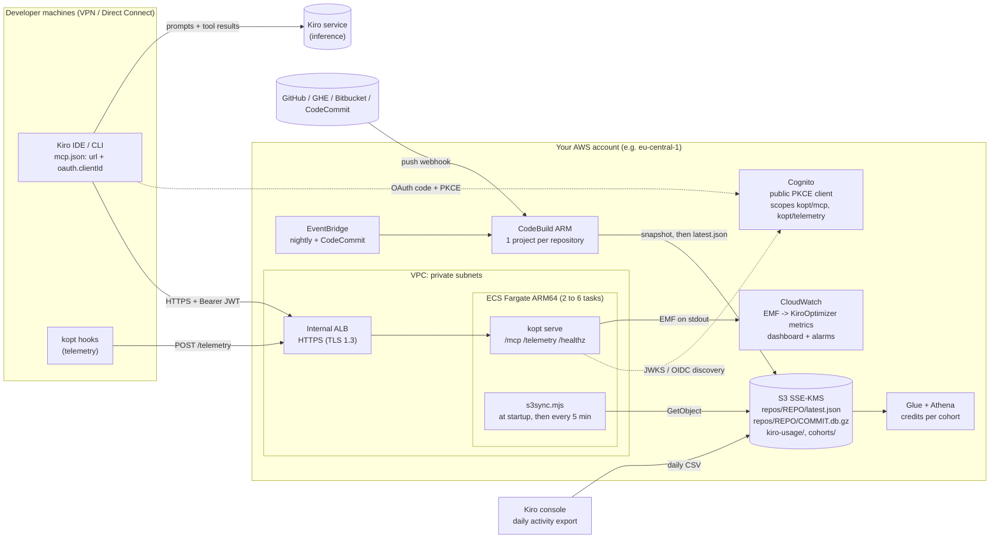
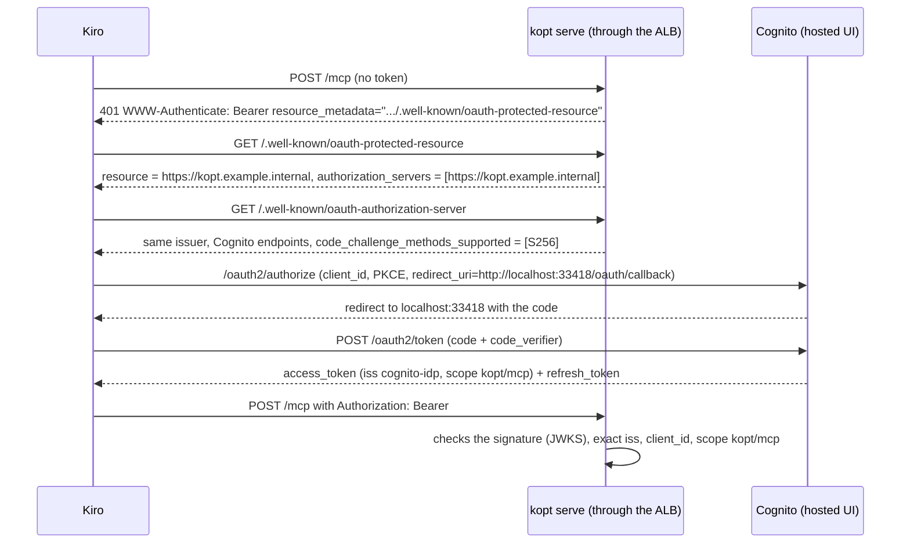

# Centralized deployment of KiroOptimizer on AWS

This guide is for the platform team of your organization. It explains how to run KiroOptimizer (`kopt`) in
**centralized** mode in your own AWS account:

* one MCP server shared by every developer;
* one index per repository, built in CI;
* OAuth authentication through Amazon Cognito, which can federate your corporate identity provider (IdP);
* token-savings metrics.

The infrastructure code is in [`infra/`](../infra/README.md) (AWS CDK v2, TypeScript).
**Nothing is deployed automatically**: you run every command below yourself.

## 1. Why a centralized mode

Kiro does not let anyone intercept its LLM traffic. The only levers are:

* the output of MCP tools;
* steering files;
* hooks;
* custom agents;
* `.kiroignore`.

Kiro bills credits per request, based on the model and on the total size of the request. Every token that enters
the context is therefore billed again on every later turn. The centralized mode adds:

* **a warm index per repository**, built once in CI instead of on every laptop. Answers are compact and capped by a
  token budget (`kopt_find`, `kopt_read`, `kopt_outline`, `kopt_refs`);
* **no command execution** on the server (`KOPT_DISABLE_RUN=1`). `kopt_run` stays local, in stdio mode;
* **honest measurement** of the savings: server metrics, hook telemetry, and a cohort comparison of Kiro credits.

## 2. Architecture



| Component | Role |
|---|---|
| **`Kopt-Data` stack** (stateful, retained by default) | Customer-managed KMS key; S3 bucket (versioned, SSE-KMS, public access blocked, TLS required); Cognito (user pool, domain, resource server, public client); Glue/Athena. |
| **`Kopt-App` stack** (stateless) | VPC (2 AZs, 1 NAT gateway by default, S3 gateway endpoint), ALB, ECS cluster and Fargate ARM64 service (2 vCPU / 8 GB), CodeBuild projects, EventBridge rules, SNS, dashboard, alarms. |
| **Container** | `docker/entrypoint.sh` syncs the snapshots from S3, then starts `kopt serve --port 8080 --repos-dir /data/repos`. The tasks share a session secret (Secrets Manager), so any task can resume any MCP session. |
| **Indexing** | One CodeBuild project per repository listed in `infra/repos.json`. Triggers: a webhook on pushes to the default branch, a CodeCommit rule, and a full nightly rebuild (staggered 3 minutes apart per repository). Each build installs `kopt` (from GitHub by default, see section 3, item 6), publishes `repos/<repo>/<commit>.db.gz`, then `latest.json` `{commit, key, indexedAt, ...}`. |

**OAuth flow.** Kiro compares the issuer **character for character**, and Cognito publishes no RFC 8414 metadata.
The default `oauthMetadataMode=self` solves both problems: the kopt server declares itself as the authorization
server and republishes Cognito's OIDC discovery document under its own issuer, advertising PKCE S256.



## 3. Prerequisites

1. **Account and region.** Deploy in the **region of your Kiro profile**: `us-east-1`, or `eu-central-1` (Frankfurt)
   for European organizations. The Kiro activity export can only write to a bucket in that region, in the account
   where the users are subscribed. If the stack must live elsewhere (for example Paris), set `kiroUsageExport=false`
   and use a dedicated bucket.
2. **Tools.** Node.js 22.13 or later, AWS CLI v2, Docker with buildx. The image is built for `linux/arm64` during
   `cdk deploy`, so an x86 machine needs QEMU/buildx. Otherwise, pass a prebuilt image with `-c imageUri=...`.
3. **Network.** Developer machines must reach the VPC through a VPN, Direct Connect or a Transit Gateway. Prepare:
   * the client CIDR ranges (`allowedCidrs`);
   * a **private** Route 53 hosted zone associated with the VPC, if you want the DNS record created automatically.
4. **ACM certificate** in the region, for the chosen name (for example `kopt.example.internal`). Kiro requires HTTPS
   whenever the host is not `localhost`. For an internal name, use a private certificate (AWS Private CA) trusted by
   the developer machines, or a public subdomain validated through DNS.
5. **Git access for CodeBuild.** Register the source credentials **before** deploying, because the webhooks are
   created during `cdk deploy`.
   * GitHub or GitHub Enterprise:
     `aws codebuild import-source-credentials --server-type GITHUB --auth-type CODECONNECTIONS --token <connection-arn>`.
     A personal access token (`--auth-type PERSONAL_ACCESS_TOKEN`) also works.
   * Bitbucket Cloud: same principle. Bitbucket Server is not supported by CodeBuild webhooks.
   * CodeCommit: nothing to do; the triggers go through EventBridge.
6. **Where CodeBuild gets kopt.** Each index build installs the `kopt` CLI in its install phase. Pick one option:
   * **Default: the public GitHub repository.** The build runs
     `npm pack "github:dorian-richard/kiro-optimizer#<koptRef>"`, which builds the package from source (its
     `prepare` script), then installs the resulting tarball with `npm install -g`. (A direct `npm install -g` of a git
     spec skips the dev dependencies that the build needs.) `koptRef` defaults to `main`. **Pin it in production**
     to the tag or commit of the image you deploy (for example `-c koptRef=$(git rev-parse HEAD)`), so that the
     indexer and the server always agree on the index schema. CodeBuild needs outbound HTTPS to github.com: this is the case by default (CodeBuild runs outside
     your VPC); with `indexerInVpc=true`, the private subnets need a NAT gateway. To install from a fork or a mirror,
     set `koptSource` (for example `git+https://git.example.internal/tools/kiro-optimizer.git`).
   * **CodeArtifact:** publish the package to your repository, then pass
     `-c codeArtifactDomain=... -c codeArtifactRepository=...` (and `koptPackage`, `koptVersion`). The build logs in
     with `aws codeartifact login` and runs `npm install -g <koptPackage>@<koptVersion>`.
   * **Tarball in the bucket:** run `npm pack` in a kopt checkout (it builds `dist/` first if the package has a
     `prepare` script), then `aws s3 cp kiro-optimizer-x.y.z.tgz s3://<bucket>/dist/`, and pass
     `indexerInstallCommand="aws s3 cp s3://<bucket>/dist/kiro-optimizer-x.y.z.tgz /tmp/ && npm i -g /tmp/kiro-optimizer-x.y.z.tgz"`.
     The CodeBuild role can already read `dist/`.
   * **Internal npm registry:** put the whole install step in `indexerInstallCommand`.

   In every case the build then runs `kopt` (`indexerCommand`). Each `latest.json` records the installed version
   (`koptVersion`) and where it came from (`koptOrigin`).
7. **CDK bootstrap** of the account and region: `npx cdk bootstrap aws://<account>/<region>`.

## 4. Main context parameters

The full list is in [`infra/README.md`](../infra/README.md#context-keys). Put the values in `infra/cdk.json`, or
pass them with `-c key=value`.

| Key | Default | What to set |
|---|---|---|
| `account`, `region` | unset, `eu-central-1` | Target account and region. Synth works without credentials. |
| `certificateArn`, `domainName` | unset | **Required in production**: HTTPS and the public URL of the server. |
| `hostedZoneId`, `hostedZoneName` | unset | Alias record pointing at the ALB. |
| `allowedCidrs` | VPC CIDR | VPN / Direct Connect ranges allowed on the ALB. |
| `internetFacing` | `false` | Public ALB: not recommended; if you enable it, restrict `allowedCidrs`. |
| `vpcId` | new VPC | Existing VPC (CDK lookup: synth then needs credentials). |
| `natGateways`, `interfaceEndpoints` | `1`, `false` | High availability (2 NAT gateways) and private ECR/Logs endpoints. |
| `taskCpu`, `taskMemoryMiB`, `minTasks`, `maxTasks` | `2048`, `8192`, `2`, `6` | Sizing. The indexes fit in the page cache. |
| `cognitoDomainPrefix` | `kopt-<account>` | Prefix of the Cognito hosted domain. |
| `oauthCallbackPort` | `33418` | Port of Kiro's loopback redirect (`http://localhost:33418/oauth/callback`). |
| `samlMetadataUrl` / `oidcIssuerUrl` | unset | Federation with your corporate IdP (see section 5.3). |
| `reposAcl` | `false` | Restrict repositories per group (`cognito:groups`). |
| `koptSource`, `koptRef` | `github:dorian-richard/kiro-optimizer`, `main` | Where the indexer installs kopt from (see section 3, item 6). Pin `koptRef` in production. |
| `koptPackage`, `koptVersion`, `codeArtifactDomain`, `indexerInstallCommand` | `kiro-optimizer`, `0.1.0`, unset, unset | Alternative install sources for the indexer (see section 3, item 6). |
| `separateTelemetryScope` | `false` | `/telemetry` requires `kopt/telemetry` instead of `kopt/mcp` (see section 6.1). |
| `repoMetricDimension` | `false` | Publish the per-repository `[Repo]` metric dimension (cost, see section 8). |
| `alarmEmail` | unset | Recipient of the alarms. |
| `retainData` | `true` | Keeps the KMS key, the bucket and the Cognito user pool if a stack is deleted. |

## 5. Step-by-step deployment

### 5.1 Prepare the list of repositories

Edit `infra/repos.json`. [`infra/repos.example.json`](../infra/repos.example.json) shows every source type:

```json
[
  { "name": "billing-api", "source": { "type": "GITHUB", "owner": "acme", "repo": "billing-api", "branch": "main" } },
  { "name": "legacy-erp", "source": { "type": "CODECOMMIT", "repo": "legacy-erp", "branch": "master" }, "computeType": "LARGE", "timeoutMinutes": 120 }
]
```

`name` is used as the S3 prefix, as the repository name in MCP answers, and as the key in the ACL.

### 5.2 Check, then deploy the data stack

```bash
cd infra
npm ci
npm test
npx cdk synth  -c account=123456789012 -c region=eu-central-1 \
  -c certificateArn=arn:aws:acm:eu-central-1:123456789012:certificate/xxxx \
  -c domainName=kopt.example.internal -c 'allowedCidrs=["10.0.0.0/8"]' \
  -c alarmEmail=platform-team@example.com -c koptRef=<tag-or-commit>
npx cdk deploy Kopt-Data -c account=123456789012 -c region=eu-central-1   # same -c options as above
```

Write down these outputs: `ClientId`, `Issuer`, `HostedUiBaseUrl`, `RedirectUri`, `BucketName`, `KiroUsageExportUri`,
and, if SAML is configured, `SamlAcsUrl` and `SamlAudience`.

### 5.3 (Optional) Federate IAM Identity Center or your corporate IdP

* **IAM Identity Center over SAML.**
  1. In IAM Identity Center, create a *custom SAML 2.0 application*:
     * ACS URL = `SamlAcsUrl` (`https://<prefix>.auth.<region>.amazoncognito.com/saml2/idpresponse`);
     * audience = `SamlAudience` (`urn:amazon:cognito:sp:<poolId>`);
     * attribute mappings: subject → `${user:email}` (format `emailAddress`), and an attribute named
       `http://schemas.xmlsoap.org/ws/2005/05/identity/claims/emailaddress` → `${user:email}`.
  2. Redeploy with `-c samlMetadataUrl=<IAM Identity Center metadata URL> -c samlProviderName=IdentityCenter`,
     and optionally `-c disableCognitoLogin=true` to accept federated sign-ins only.
  3. Assign the developer groups to the application.
* **Entra ID or Okta over OIDC.**
  1. Store the client secret in Secrets Manager.
  2. Pass `-c oidcIssuerUrl=... -c oidcClientId=... -c oidcClientSecretName=...`.
  3. On the IdP side, the redirect URI is `https://<prefix>.auth.<region>.amazoncognito.com/oauth2/idpresponse`.
* **Per-repository access control.** Cognito groups arrive in the `cognito:groups` claim. With a federated IdP, a
  *pre token generation* Lambda (not provided) must copy the IdP groups into the token. Then:
  1. upload `s3://<bucket>/config/repos-acl.json`, for example
     `{"payments": ["billing-api"], "admins": ["*"], "*": ["docs"]}`;
  2. **only then** deploy with `-c reposAcl=true`. If the file is missing, the server refuses to start.

Cognito cost: 50 federated monthly active users (MAU) are free, then $0.015 per MAU.

### 5.4 Deploy the service and the indexers

```bash
npx cdk deploy Kopt-App -c account=123456789012 -c region=eu-central-1 ...   # same -c options
```

Useful outputs: `McpUrl` (goes into `mcp.json`), `TelemetryUrl`, `DashboardUrl`, `LogGroupName`.

### 5.5 First indexing

```bash
for p in $(aws codebuild list-projects --query "projects[?starts_with(@, 'kopt-index-')]" --output text); do
  aws codebuild start-build --project-name "$p" --query 'build.id' --output text
done
```

The tasks load new snapshots within `syncIntervalSec` (5 min).
`GET https://kopt.example.internal/healthz` returns `{"status":"ok","repos":<n>,...}`.

### 5.6 Post-deployment checks

Kiro abandons discovery if the advertised issuer and the one in the metadata differ, even by a trailing slash.
Check it with:

```bash
BASE=https://kopt.example.internal
curl -s "$BASE/healthz"
curl -s -i -X POST "$BASE/mcp" -H 'content-type: application/json' -d '{}' | grep -i '^www-authenticate'
AS=$(curl -s "$BASE/.well-known/oauth-protected-resource" | jq -r '.authorization_servers[0]')
# self mode (default): RFC 8414 metadata served by kopt (issuer without a path)
ISS=$(curl -s "$BASE/.well-known/oauth-authorization-server" | jq -r '.issuer')
# issuer mode: Cognito does not serve RFC 8414, so Kiro has to fall back to OIDC discovery
#   ISS=$(curl -s "$AS/.well-known/openid-configuration" | jq -r '.issuer')
[ "$AS" = "$ISS" ] && echo "OK, same issuer: $AS" || echo "FAILED: '$AS' != '$ISS'"
curl -s "$BASE/.well-known/oauth-authorization-server" | jq '{authorization_endpoint, token_endpoint, code_challenge_methods_supported}'
```

* For an issuer with a path (such as Cognito's, `https://cognito-idp.<region>.amazonaws.com/<poolId>`), RFC 8414
  puts the well-known suffix *before* the path: `https://cognito-idp.../.well-known/oauth-authorization-server/<poolId>`.
  Cognito answers 400 at that URL, which is why `self` mode is the default.
* On the token side, the server always checks the real Cognito `iss` (`KOPT_AUTH_ISSUER`, no trailing slash), the
  `client_id` (`KOPT_AUTH_CLIENT_ID`) and the `kopt/mcp` scope.

## 6. Configuring Kiro on developer machines

Cognito does not support dynamic client registration (DCR), so Kiro must be given `oauth.clientId`.
The IDE only supports **public** clients (PKCE, no secret); the CLI also accepts confidential clients.
The client created here is public and works for both.

**With kopt (recommended)**:

```bash
kopt init --remote https://kopt.example.internal/mcp --client-id <ClientId> --oauth-port 33418 \
  --oauth-scopes "openid,email,profile,kopt/mcp,kopt/telemetry"        # add --user to write ~/.kiro instead
```

**Or by hand**, in `.kiro/settings/mcp.json` (workspace) or `~/.kiro/settings/mcp.json` (user):

```json
{
  "mcpServers": {
    "kopt": {
      "url": "https://kopt.example.internal/mcp",
      "oauth": {
        "clientId": "<ClientId>",
        "redirectUri": "http://localhost:33418/oauth/callback",
        "oauthScopes": ["openid", "email", "profile", "kopt/mcp", "kopt/telemetry"]
      },
      "autoApprove": ["kopt_find", "kopt_read", "kopt_outline", "kopt_refs", "kopt_expand"]
    }
  }
}
```

Things to watch:

* `redirectUri` must be **exactly** the `RedirectUri` output of the stack, which is
  `http://localhost:33418/oauth/callback` by default; `kopt init` writes that value. Cognito only accepts plain
  `http` for `localhost`. `localhost` and `127.0.0.1` are not interchangeable: if you change the host or the port in
  `mcp.json`, change `oauthCallbackHosts` / `oauthCallbackPort` to match (add `127.0.0.1` only after checking that
  Cognito accepts it).
* Without `oauthScopes`, Kiro requests `offline_access`, which Cognito does not know (`invalid_scope`). Set the list
  explicitly, or use an empty array: Cognito then grants every scope allowed for the client.
  Refresh tokens are issued without `offline_access`.
* When the refresh token expires (`refreshTokenDays`, 30 days by default), Kiro starts the browser sign-in again.
* Kiro's **enterprise MCP registry** only carries `url` and `headers` for a remote server, not `oauth`:
  distribute the configuration with `kopt init` or through your dotfiles.

### 6.1 Telemetry from developer machines

The kopt hooks post their events to `TelemetryUrl`, with the bearer token taken from the `KOPT_TOKEN` environment
variable. Kiro keeps its own OAuth tokens private, so the hooks cannot reuse them.

* **Today**, the server requires `kopt/mcp` on **every** route, `/telemetry` included. A telemetry token must
  therefore carry `kopt/mcp`.
* **`separateTelemetryScope=true`** sets `KOPT_AUTH_TELEMETRY_SCOPES=kopt/telemetry` on the tasks: `/telemetry` then
  requires `kopt/telemetry` and `/mcp` keeps requiring `kopt/mcp`. A token stored on a developer machine for
  telemetry can then no longer read code. This needs a `kopt serve` version that supports per-route scopes
  (`--auth-telemetry-scopes`, `KOPT_AUTH_TELEMETRY_SCOPES`); older servers ignore the variable and keep requiring
  `kopt/mcp` everywhere. The Cognito client already allows both scopes.
* **TODO: `kopt login`.** Nothing issues developer telemetry tokens yet. The planned `kopt login` command will run
  the authorization code + PKCE flow against the same public client (same `RedirectUri`, scope `kopt/telemetry`),
  store the refresh token in the user's kopt directory with owner-only permissions, and let the telemetry shipper
  refresh short-lived access tokens on its own. Until then, telemetry from developer machines stays local
  (`kopt stats`), unless you provide `KOPT_TOKEN` yourself.

## 7. Security

* **Encryption.** A customer-managed KMS key, rotated every year, encrypts:
  * the bucket (SSE-KMS with bucket keys);
  * the CloudWatch logs of the service and of the indexer;
  * the SNS alarm topic;
  * the Athena results.

  The bucket requires TLS 1.2 or later and blocks all public access; object ownership is enforced to the bucket
  owner. The ALB uses the `ELBSecurityPolicy-TLS13-1-2-2021-06` policy and redirects HTTP to HTTPS.
* **Network.**
  * The ALB is internal by default; only the `allowedCidrs` ranges can reach it. With `restrictPaths`, it only
    forwards `/mcp`, `/.well-known/*`, `/telemetry` and `/healthz`.
  * The tasks run in private subnets, without public IPs. They only accept traffic from the ALB and only send
    traffic on port 443 (S3 through the gateway endpoint, Cognito's JWKS through the NAT gateway).
* **Least-privilege IAM.**
  * The task role can only **read** `repos/*`, with `kms:Decrypt` limited to S3 through `kms:ViaService`.
  * Each CodeBuild project can only write under its own `repos/<repo>/` prefix.
* **Authentication and authorization.**
  * Every call carries a Cognito JWT. The server checks its signature, the exact `iss`, the `client_id` and the scope.
  * Optional TOTP MFA for native users; SAML or OIDC federation is possible.
  * Optional per-group ACL.
  * The tasks share a session secret (Secrets Manager) that binds MCP session ids to the user.
* **Container.**
  * The process runs as a non-root user; the application code is read-only, and the only writable locations are
    `/data` and `/tmp`.
  * `initProcessEnabled` makes sure signals are forwarded.
  * No command can run on the server side (`KOPT_DISABLE_RUN=1`).
  * The sync script has no dependencies (fetch + SigV4).
  * A corrupt or incomplete snapshot never replaces the index in service: `quick_check`, then an atomic rename.
* **Data residency.**
  * The snapshots (the index plus the compressed content of the source files) **stay in your account and region**.
    CodeBuild clones the repositories inside your account.
  * The logs only contain counters (tokens, calls) and technical identifiers, never code.
  * However, **Kiro still sends prompts and tool results**, including the snippets returned by kopt, to its own
    service. Inference runs in the region of the Kiro profile; some models can use cross-region inference. This is
    outside the scope of this deployment. kopt reduces the volume sent; it does not prevent it.
* **Supply chain.** By default the indexer installs kopt from the public GitHub repository at `koptRef`. Pin a tag or
  a commit you have reviewed, or use CodeArtifact or the S3 tarball (see section 3, item 6) if builds must not reach github.com.

## 8. Cost estimate (100 developers, 50 repositories, 10 M lines)

eu-central-1 (Frankfurt) prices, taken from the AWS Price List API in October 2026, in USD per month. In us-east-1,
expect roughly 10 to 15% less (Fargate ARM 2 vCPU / 8 GB: about $68 per task per month, versus $78 in Frankfurt).

| Item | Assumptions | $/month |
|---|---|---|
| Fargate ARM64, 2 tasks around the clock | 2 vCPU × $0.03725/h + 8 GB × $0.00409/h = $0.107/h, i.e. $78.3 per task | 157 |
| Ephemeral storage | 60 GiB per task, 40 of them billed × $0.000132/GB-h | 8 |
| Internal ALB | $0.027/h + about 0.5 LCU × $0.008 | 23 |
| NAT gateway (1) + public IPv4 | $0.052/h + $0.052/GB (about 20 GB) + $0.005/h for the IP | 43 |
| CodeBuild ARM small ($0.00385/min) | about 100 builds per working day (2 merges per repository) and 50 nightly builds, about 3 min each, i.e. about 10,800 min | 42 |
| S3 | about 60 GB (snapshots + 30 days of versions) × $0.0245 + about 1 M GET requests | 2 |
| KMS + Secrets Manager | 1 key, requests reduced by bucket keys; 1 secret | 3 |
| Cognito Essentials | 100 federated users: 50 free + 50 × $0.015 (free under 10,000 MAU for native accounts) | 1 |
| CloudWatch | about 1 GB of logs ($0.63/GB), about 45 `[Tool]` metric series × $0.30, 1 dashboard ($3), 5 alarms | 20 |
| ECR, Athena, Glue, EventBridge | negligible volumes | 2 |
| **Reference total** | | **≈ $300/month, about $3 per developer** |

Optional items:

* ECR/Logs interface endpoints (3 endpoints × 2 AZs × $0.012/h): about $53;
* a second NAT gateway: about $43;
* Container Insights: about $10.

A hardened setup therefore costs about $410 per month.

Watch points:

* **Metric cardinality.** By default the server publishes the token metrics per tool only (`[Tool]`), and the
  repository stays a log field that Logs Insights can group by (the dashboard does). `repoMetricDimension=true`
  (`KOPT_EMF_REPO_DIMENSION=1`) adds the `[Repo]` dimension: with 50 repositories, that is about 150 more series,
  or about $45 per month.
* **CodeBuild** grows with the number of merges: `builds × minutes × $0.00385`. Keep `LARGE` ($0.0175/min) for big
  repositories. Turning off the nightly rebuild (`nightlyReindex=false`) saves about $17 per month.
* **Break-even.** At Kiro's overage rate ($0.04 per credit), $300 is about 7,500 credits per month for the whole
  team, or about 75 credits per developer.
* Indexing uses no Bedrock model: there is no inference cost on the AWS side.

## 9. Operations

**Re-index a repository.**

```bash
aws codebuild start-build --project-name kopt-index-billing-api
# rebuild flagged as "nightly" in latest.json:
aws codebuild start-build --project-name kopt-index-billing-api \
  --environment-variables-override name=KOPT_FULL,value=1,type=PLAINTEXT
```

**Add or remove a repository.** Edit `repos.json`, then run `cdk deploy Kopt-App`. The snapshots of a removed
repository stay in S3 and keep being served as long as `repos/<repo>/latest.json` exists: delete that pointer to
withdraw them.

**Roll back to a previous snapshot.** Superseded snapshots stay available for `snapshotRetentionDays` (30 days).

```bash
B=<BucketName>; R=billing-api; C=<target commit>
aws s3 ls "s3://$B/repos/$R/"
aws s3api put-object-tagging --bucket "$B" --key "repos/$R/$C.db.gz" --tagging 'TagSet=[{Key=kopt-latest,Value=true}]'
printf '{"commit":"%s","key":"repos/%s/%s.db.gz","indexedAt":"%s","buildStartedAt":%s,"rollback":true}\n' \
  "$C" "$R" "$C" "$(date -u +%FT%TZ)" "$(date +%s)000" > latest.json
aws s3 cp latest.json "s3://$B/repos/$R/latest.json" --content-type application/json
```

The tasks switch at the next sync cycle. The next build triggered by a push takes over again.
The `buildStartedAt` field acts as a guard: a build that started earlier cannot overwrite a newer pointer.

**Roll back the service.**

* The ECS deployment *circuit breaker* automatically rolls back a failing deployment (tasks that never become healthy).
* Manual rollback: redeploy the previous commit, or pass `-c imageUri=<previous image>`.
* Because the `Kopt-Data` stack is retained, `Kopt-App` can be destroyed and recreated without data loss.

**Monitoring.**

* `Kopt-savings` dashboard (`DashboardUrl` output):
  * calls and `TokensOut` per tool, and `TokensOut` per repository (Logs Insights by default, metrics with
    `repoMetricDimension=true`);
  * `BaselineTokens` compared with `TokensOut`;
  * exact savings per tool, computed by Logs Insights only on the calls that carry a measured baseline;
  * Kiro credits per day reported by developer machines;
  * hook blocks;
  * ALB, latency, CPU and memory;
  * snapshot syncs and index builds.
* Alarms sent to SNS (and by email with `alarmEmail`):
  * ALB 5xx responses;
  * unhealthy targets;
  * no healthy target;
  * p95 latency above 2 s;
  * snapshot sync errors.

  An EventBridge rule also reports failed or timed-out index builds.
* Saved Logs Insights queries: `Kopt/tokens-by-repo-and-user`, `Kopt/hook-blocks`, `Kopt/errors`.
* Live logs: `aws logs tail <LogGroupName> --follow` (`kopt-sync:` lines for the sync).

**EMF metrics.** The server and the sync write EMF lines to stdout; CloudWatch Logs extracts the metrics of the
`KiroOptimizer` namespace from them. After the first calls, check with
`aws cloudwatch list-metrics --namespace KiroOptimizer`. If the list stays empty while the logs contain `_aws`
lines, redeploy with `-c metricsSource=filters`: metric filters then produce the same metrics. Never use both
mechanisms at once, or every value is counted twice.

**Measure the effect on credits.** Kiro does not expose tokens; the only billing signal is `Credits_Used` per user
and per day.

1. In the Kiro console: **Settings** → **Kiro user activity reports** → **Edit** → enable
   **Collect granular metrics per user**, with the `KiroUsageExportUri` output (`s3://<bucket>/kiro-usage/`) as the
   S3 location. The stack already creates the bucket policy and the KMS permission for `q.amazonaws.com`.
   The first file arrives with the next 02:00 UTC cycle.
2. Upload the cohorts, for example:

   ```bash
   cat > cohorts.csv <<'EOF'
   user_email,cohort,start_date
   alice@example.com,pilot,2026-11-02
   bob@example.com,control,2026-11-02
   EOF
   aws s3 cp cohorts.csv s3://<bucket>/cohorts/cohorts.csv
   ```

3. In Athena, workgroup `Kopt-analytics`, run the saved queries:
   * `kopt-credits-by-cohort`: mean and median credits per user-day, before and after, per cohort;
   * `kopt-credits-diff-in-diff`: net effect of the pilot compared with the control group;
   * `kopt-credits-daily`: credits per export day and per client type.
4. The `kiro_user_report` table assumes the column order documented by Kiro; the `<model>_messages` columns that
   follow are ignored. Check it on a real file:
   `aws s3 cp s3://<bucket>/kiro-usage/AWSLogs/<account>/KiroLogs/user_report/<region>/<yyyy>/<mm>/<dd>/00/<file>.csv - | head -1`.

**Update kopt.**

1. Move the indexer and the image together: set `koptRef` (or `koptVersion` with CodeArtifact) to the new tag or
   commit, and deploy the image built from that same commit (`cdk deploy Kopt-App`).
2. If the index schema changes (`SCHEMA_VERSION`), re-index every repository (section 5.5).
   Until those builds finish, the server skips snapshots with the old schema (`skipping snapshot` message).

**Troubleshooting.**

| Symptom | Likely cause |
|---|---|
| `redirect_mismatch` in the browser | `redirectUri` differs from the `RedirectUri` output (host `localhost` vs `127.0.0.1`, port, path). |
| `invalid_scope` | Kiro requests `offline_access`: set `oauthScopes`. |
| "issuer mismatch" in Kiro | Run the script from section 5.6; stay in `oauthMetadataMode=self`. |
| 401 loop after sign-in | The token's `client_id` differs from `KOPT_AUTH_CLIENT_ID`. A 403 `insufficient_scope` means `kopt/mcp` (or `kopt/telemetry` on `/telemetry` with `separateTelemetryScope`) is missing. |
| 503 `temporarily_unavailable` | The server cannot reach Cognito's JWKS (NAT gateway or port 443 egress). |
| A repository is missing | Check `/healthz` (`repos`), the CodeBuild build, `latest.json` and the `kopt-sync:` lines. |
| Index build fails in the install phase | GitHub unreachable from CodeBuild, or an unknown `koptRef`; see section 3, item 6. |
| Kiro rejects the URL | `http://` URL on a host other than localhost: set `certificateArn` and `domainName`. |

## 10. Alternative: Amazon Bedrock AgentCore Gateway in front

AgentCore Gateway can sit in front of the same service:

```text
Kiro → Gateway (inbound JWT or IAM authorization) → Lambda interceptors → managed VPC Lattice → internal ALB → Fargate (kopt serve)
```

| | Gateway in front | Direct ALB (this implementation) |
|---|---|---|
| OAuth | Managed: RFC 9728 resource server, JWT authorizer (Cognito, Entra, Okta), or **IAM** inbound auth (SigV4 through `uvx mcp-proxy-for-aws` with IAM Identity Center SSO profiles, no Cognito). | Handled by `kopt serve` (jose + JWKS, `self` mode for the metadata). |
| Fine-grained authorization | **Cedar policies** (GA in March 2026), deny by default, on claims and tool arguments, with a `LOG_ONLY` mode before `ENFORCE`; $0.000025 per authorization. | Per-group ACL in the server. |
| Interceptors | One REQUEST and one RESPONSE Lambda: user ACL → repositories, header injection, response filtering or redaction, central counting. | Logic inside the server. |
| Exposure | Only the Gateway is exposed; ALB and tasks are 100% private, reached through managed VPC Lattice (billed per GB). | Internal ALB, reachable over VPN or Direct Connect. |
| Cost | $0.005 per 1,000 MCP operations (about 1 M per month, so about $5), plus the interceptor Lambdas, Cedar and Lattice. | Included in the ALB. |
| Latency | One more hop (Gateway, Lattice, and possibly two Lambdas) on every tool call. Not published: measure it. | Direct. |
| Constraints | Quotas: 200 TPS (adjustable), 6 MB payload, 15 min timeout. Outbound calls to a target behind an ALB do not support SigV4: use OAuth client credentials, an API key, or no authentication with network isolation. The user identity only reaches the server through an interceptor or `passRequestHeaders`. `SynchronizeGatewayTargets` must be called on every tool schema change. Tool names can be prefixed with the target name: check the hooks and steering that refer to `kopt_*`. Managed Lattice is not cross-account. | — |
| Kiro compatibility | In June 2026, the AWS "Kiro + Gateway" sample still went through `mcp-remote`; a direct connection with `oauth.clientId` remains to be tested. | Tested against Kiro's documented requirements (exact issuer, PKCE, `clientId`). |

**Recommendation.** Start with the direct ALB, which is simpler and faster. Move to the Gateway if you want:

* centralized Cedar policies;
* governance shared by several MCP servers;
* access without a VPN;
* or IAM Identity Center authentication without Cognito.

The Fargate service is the same in both cases: the Gateway is added in front without redesign.

## 11. Known limitations

* The central index only sees the default branch. Local changes that are not pushed stay visible to Kiro's built-in
  tools; kopt's local mode can complement it.
* `kopt index --snapshot` rebuilds everything on every build. An incremental mode based on the previous snapshot
  would cut CodeBuild minutes.
* GitLab is not covered by `repos.json` (CodeBuild supports it through CodeConnections); it is a possible extension.
* Per-group access control with a federated IdP needs a *pre token generation* Lambda, which is not provided.
* Telemetry tokens for the hooks on developer machines are not distributed yet (`kopt login` is a TODO, see section 6.1).
