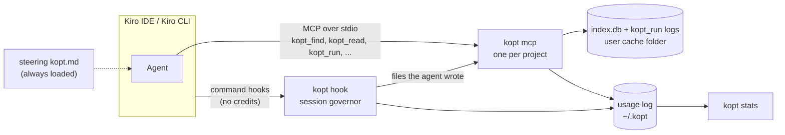

# How kopt works

1. **Setup writes user-level Kiro configuration.** `kopt setup` installs the `kopt` command globally with npm
   (unless the running copy is already the global install or you pass `--no-global`). It then writes under `~/.kiro`
   (plus one IDE user setting): the `kopt` MCP server entry, global hooks, a Kiro CLI 2.x agent, steering, a
   read-only explorer sub-agent and a global ignore file. It records its install state in `~/.kopt`. Nothing is
   written into your projects.
2. **Kiro starts `kopt mcp` for each project.** The MCP server talks to Kiro over stdio.
3. **Root detection.** The server takes the project root from the client's MCP roots, else `KOPT_ROOT`, else the
   folder Kiro starts it in. MCP roots and the start folder are widened to the nearest folder (itself included) that
   holds `.git` or `.kopt/index.db`; `KOPT_ROOT` is used as is. kopt never indexes your home folder or a filesystem
   root; tools then answer one line asking you to open a project folder.
4. **Background index on first use.** The first build runs in a worker thread. It parses with tree-sitter (WASM)
   grammars for TypeScript/TSX, JavaScript, Python, Java, C#, Go, Kotlin, Rust, PHP, Ruby and Scala, into one SQLite
   file (`node:sqlite`, FTS5) per project, in your user cache folder. It honours `.gitignore`, `.kiroignore` (nested
   ones included), Kiro's global `~/.kiro/settings/kiroignore` (which setup fills with minified files, source
   maps and bundles; lockfiles and snapshots are per-project `kopt init` suggestions) and the `exclude` setting.
   `kopt_find` and `kopt_read` answer as soon as symbols are written; `kopt_refs` once references are
   resolved too. A call that would have to wait more than 15 s answers at once with the progress and an estimate
   (`index building: 12000/33090 files parsed, ~2 min left – use built-in search/read tools until then`).
5. **Incremental refresh.** Hooks record the files the agent writes; before answering a tool call, the server
   re-indexes those files (waiting 2 s at most), after the refresh already running if there is one (a full check
   that started before the write does not see it). At most every 30 s, on a tool call (there is no timer), it compares a
   few git files (HEAD, the branch ref, `.git/index`) and runs the full freshness check (listing + size/date of every
   file), which catches pulls and checkouts, when they changed, and every 2 minutes in any case. All indexing runs in
   a worker thread, so tool calls keep answering meanwhile, and one process at a time indexes a project (a lock file
   next to the index). When the project has a complete index and the kopt MCP server is configured, a session start
   also triggers a background `kopt index --refresh --if-idle` (at most once a minute).
6. **The agent calls kopt tools.** Answers are compact text (never JSON) with a hard token cap and short `#handles`.
   Code already shown in the session is not re-sent. Test and build output is reduced to the verdict, the failures
   and the errors.
7. **Hooks govern the session.** Kiro `command` hooks cost no credits. kopt counts tool calls and blocks a few
   expensive patterns, with a one-line hint: whole-file reads of big files, verbose commands outside `kopt_run`,
   identical re-runs, runaway loops. The big-read, verbose-command and duplicate-run rules block once each. Once the
   tool-call budget is reached, every further tool call is blocked until the next user prompt. Hooks also measure
   the size of every tool response.
8. **Local stats.** kopt tool calls, governor blocks and the size of every tool response go to a local JSONL log
   under `~/.kopt`, kept 90 days. `kopt stats` reads it, together with the per-request credits found in Kiro's local
   session files.

## Supported surfaces

| Surface | What `kopt setup` configures | What you get |
|---|---|---|
| Kiro IDE 1.x | `~/.kiro/settings/mcp.json`, global hooks `~/.kiro/hooks/kopt.json`, steering, explorer agent, `~/.kiro/settings/kiroignore`, the IDE setting `kiroAgent.agentIgnoreFiles` | 4 tools, full governor, steering, `.kiroignore` |
| Kiro IDE 0.x (0.12) | the same files; 0.x ignores global hooks, so the MCP server writes one prompt hook (`.kiro/hooks/kopt-prompt.kiro.hook`) into each workspace it serves | 4 tools, steering. No tool-call governor: upgrade to 1.x for it. The prompt hook is written only when prompt pointers are on (`budgets.frontload`) |
| Kiro CLI V3 | `mcp.json` and the global hooks `~/.kiro/hooks/kopt.json` | 4 tools, full governor, steering |
| Kiro CLI 2.x | agent `~/.kiro/agents/kopt.json` (hooks embedded, `includeMcpJson`), set as `chat.defaultAgent` when no default agent is set | 4 tools, full governor, `always` steering (use `kiro-cli chat --agent kopt` if you keep another default agent) |
| Standalone CLI | the global `kopt` command | the same operations as commands (`kopt find/read/outline/refs/run/expand`), same output, for any terminal or agent |

**OS notes.** It works the same on Linux, macOS and Windows (CI runs all three on Node 22 and 24), with no native
modules and no compiler needed. Kiro starts kopt with absolute paths, so nothing has to be on the `PATH` Kiro sees
(Kiro IDE started from the Dock or the Start menu does not get your shell's `PATH`): the MCP server is
`<absolute node> <kopt>/dist/bin.js mcp`, and hooks run a small launcher, `~/.kopt/bin/kopt` (`kopt.cmd` on Windows),
that turns any failure into a silent allow. Re-run `kopt setup` after upgrading or moving Node (see
[docs/INSTALL.md](INSTALL.md)). `kopt_run` uses PowerShell 7 when it is on `PATH`, else Windows PowerShell 5.1, else
cmd.exe. On Linux and macOS it uses bash, else sh. `KOPT_SHELL` overrides the shell. On Linux and macOS the commands
get the `PATH` kopt started with, then the folder of the Node running kopt, then the `PATH` of your login shell
(read once, in the background, with `$SHELL -ilc`), then `/opt/homebrew/bin`, `/usr/local/bin`, `~/.local/bin` and
nvm's default Node when they exist: `npm test` works even when Kiro gives kopt `PATH=/usr/bin:/bin`. A command
that is still not found (exit 127, or 9009 from cmd.exe) ends with one `kopt:` line naming the program and where
the `PATH` came from.

## Measuring savings

`kopt stats` reports, from the local usage log, the tokens each kopt tool returned and the savings where the raw
alternative is computable (raw command output for `kopt_run`, the full file for `kopt_read`). These are gross
figures and upper bounds: the fixed prompt, the extra turns of governor blocks and follow-up reads are not
subtracted. It also shows the governor blocks, the tokens that built-in tools put into the context, and the
per-request credits found in Kiro's session files (Kiro CLI and IDE 1.x; IDE 0.x stores none that kopt reads).
`kopt credits` collects those credits explicitly. No savings figure is claimed without measurement.

Three benchmarks back the [Results](../README.md#results): `kopt bench`, an offline proxy that compares the tokens returned and
the recall of verified gold answers for one exploration step on 11 repositories (138 tasks; one repository per
language), native Kiro exploration, CodeGraph and KiroGraph against kopt; `bench/agentab`, real agents with and
without kopt and every tool call logged; and the compression table of `bench/compress/run.mjs`. `kopt bench ab` is the
online A/B that runs your own questions about your own repository through the real Kiro CLI, with and without kopt,
and compares the credits Kiro bills on paired tasks both arms solved (guide:
[bench/ab/README.md](../bench/ab/README.md)). Results: [docs/BENCHMARKS.md](BENCHMARKS.md); method and protocol:
[bench/README.md](../bench/README.md).
